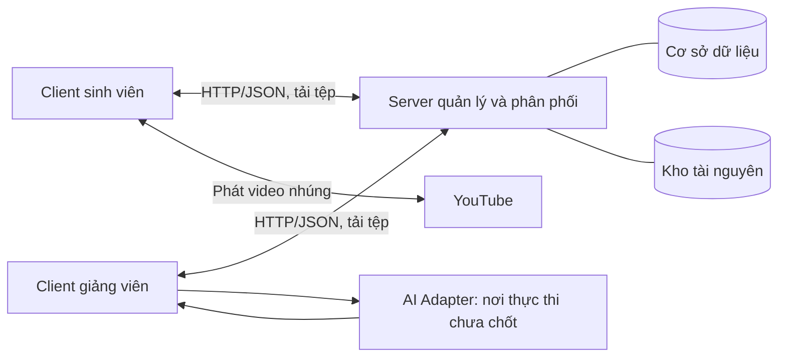

# Kế hoạch kiến trúc và các module: hệ thống hỗ trợ ôn luyện IELTS bằng AI

Ngày lập: **08/10/2026**. Trạng thái: **module 1 Tài khoản/lớp học (M01/M02) đã có; feature/writing có phần module 2 Soạn/xuất bản/giao học liệu Writing (M03); làm/nộp bài và đánh giá vẫn là kế hoạch**.

Cập nhật **09/10/2026**: profile chung, XP/cấp độ/huy hiệu/chuỗi ngày và Reading đã được bổ sung ở lần trước. Lần này cập nhật Listening: bốn nhãn mục tiêu, kiểm tra khó khăn sau test, nhóm luyện nghe–chép lời, hai loại video YouTube, transcript riêng và tiến trình theo từng đoạn; thêm bảng nguồn học liệu cho Reading/Listening và cách chuẩn bị seed.

Cập nhật **10/10/2026**: Speaking có đúng hai nhóm bổ trợ: **Phát triển câu trả lời** và **Phát âm theo âm**. Giảng viên trực tiếp xác nhận nhu cầu của từng học sinh và các âm hay sai; hệ thống đề xuất bài theo nhãn đã xác nhận. Bổ sung luồng outline tiếng Anh → AI nhận xét → nói/ghi âm → giảng viên chấm, luồng tạo bộ từ/câu theo âm và tham khảo công cụ chấm phát âm có sẵn. Speaking không dùng AI gán nhãn từng câu hỏi; cơ chế AI gợi ý nhãn Reading/Listening được giữ nguyên.

Cập nhật **11/10/2026**: Writing chấm **bài viết hoàn chỉnh** cho Task 1/Task 2, AI đề xuất theo rubric để giảng viên kiểm tra/chốt. Ghi rõ năm nhãn bổ trợ đã bàn và hai nhãn Task 2 còn là đề xuất; bổ sung bảng từ trước khi viết, sửa câu do giảng viên xác nhận lỗi, cách đưa rubric/bài mẫu vào AI, nguồn PDF/hoạt động demo và các phần seed cần biên soạn. IELTS Academic vẫn là giả định cần xác nhận.

Cập nhật triển khai **11/10/2026**: dự án tại `ielts-learning-orm/`, source chia `source/client`, `source/server`, `source/common` theo Instruction.md. Module 1 có đăng ký học viên, đăng nhập/đăng xuất/session, phân quyền, nhiều lớp, mã tham gia, chỉnh sửa lớp, xem/xóa thành viên và rời lớp. Database chính là **MySQL 8.4**, Flyway migration; có Docker Compose chạy database/server/client và `start.cmd` để khởi động. Đã kiểm tra 12 API test với MySQL riêng, 3 browser test và dữ liệu sau khi tạo lại container server/client; đây là kiểm tra chức năng, chưa phải benchmark/contribution. Chi tiết ở [README dự án](README.md) và [kết quả module 1](statics/results/module-1-validation.md).

Phần mạng vẫn theo hướng **HTTP/JSON + lưu dữ liệu + mở lại để tải dữ liệu đã lưu**. Tổ chức thành 9 module nghiệp vụ trong cùng ứng dụng. Tự reconnect, WebSocket, heartbeat, đồng bộ offline và tiếp tục tải tệp không thuộc phạm vi phiên bản đầu. Các công thức/tham số gamification dưới đây là cấu hình đề xuất, chưa phải mức thưởng đã chốt.

Cập nhật **12/10/2026**: câu hỏi bài chính/test Reading và Listening trong ứng dụng dùng **trắc nghiệm**; bản đầu triển khai chọn một đáp án đúng. Bổ sung cấu trúc câu hỏi/lưu lựa chọn tại M03, giữ nguyên nhãn và pipeline chữa lỗi–bổ trợ. Bài nghe–chép lời vẫn nhập văn bản như M06.5. Reading/Listening dùng chung chức năng quản lý tài liệu, giao bài, lần làm, nháp và bài nộp; nội dung passage và audio/video/transcript được lưu riêng theo kỹ năng. M06.8/M07.7 đã mô tả việc hỗ trợ chuẩn bị seed; bộ seed thực tế vẫn cần biên soạn/kiểm tra.

Bổ sung cùng ngày: phân biệt mô hình database với JSON API tại 5.1, kế hoạch thiết kế database tiếp theo tại 5.2 và hợp đồng dữ liệu/API chung Reading–Listening tại 6.4. Đây là đặc tả cho các module tiếp theo, chưa phải endpoint hoặc schema mới đã triển khai.

Cập nhật thiết kế database **12/10/2026**: đã có [DATABASE_DESIGN.md](DATABASE_DESIGN.md), ERD, từ điển cột/khóa và SQL tham chiếu cho 44 bảng chia theo giai đoạn. Schema đã chạy trên MySQL 8.4.9 và qua 39 kiểm tra dữ liệu/ràng buộc ở database thử riêng. Ở lần thiết kế 12/10, database ứng dụng là V1. Nhánh Writing ngày 13/10 đã có thêm V2 tài nguyên/giao bài; V3–V6 là kế hoạch. Chi tiết tại mục 5.3.

Tên đề tài dự kiến: **Xây dựng hệ thống AI hỗ trợ đánh giá, xây dựng hồ sơ người học và phân phối bài luyện IELTS theo điểm yếu từng kỹ năng.**

Tài liệu này là kế hoạch cho hướng ứng dụng mới. Những phần cần giảng viên xác nhận được ghi ở mục 12. Các con số về dữ liệu thử nghiệm là mục tiêu chuẩn bị, không phải kết quả đã đo.

Cập nhật bản ORM 13/10/2026: thư mục ielts-learning-orm, lịch sử Git mới, module 1 dùng Spring Data JPA/Hibernate. Flyway quản lí schema, Hibernate validate mapping, open-in-view=false. Các kỹ năng triển khai trên nhánh riêng; stack được chốt trước khi thay đổi.

Cập nhật Writing 13/10/2026: feature/writing bắt đầu từ main, có Task 1 Academic/Task 2, năm nhãn đã chốt, bước hướng dẫn/vận dụng, bảng từ, hình bảo vệ, nháp/preview/publish/version và giao cho lớp/nhóm học viên. V2 giữ nguyên với Speaking; bảy seed tự biên soạn để DRAFT, sửa ngữ pháp cần giảng viên xác nhận. Các đoạn nguồn trước đây ghi chưa tạo seed mô tả lần lập plan 11/10: hiện có seed demo tự biên soạn, chưa nhập toàn bộ PDF hoặc gán band kiểm chứng. Phần M09 viết/nộp bài hoàn chỉnh, AI/rubric, màn hình chấm và profile chưa triển khai. [Payload, nguồn, demo](docs/WRITING_MODULE_2.md); [kết quả kiểm thử](statics/results/module-2-writing-validation.md).

## 1. Mục tiêu và phạm vi

### 1.1. Bài toán cần giải quyết

- Giảng viên phải xem bài làm theo nhiều tiêu chí, đưa nhận xét và chọn nội dung bổ trợ cho từng người.
- Người học có thể cùng mức luyện tập nhưng gặp khó khăn khác nhau trong từng kỹ năng.
- Điểm tổng chưa thể hiện đầy đủ những vấn đề lặp lại và tài liệu cần học tiếp.
- Kết quả bài tập, nhận xét, bản sửa và tiến độ cần được trao đổi giữa nhiều client và lưu trên server để người dùng mở lại xem được.

Đây là các giả thuyết yêu cầu cần xác nhận với một giảng viên tiếng Anh trước khi tuyên bố giải quyết được khó khăn thực tế của họ.

### 1.2. Các yêu cầu đã thống nhất

1. Tập trung vào một nhánh chuyên môn: **IELTS**.
2. Mỗi sinh viên có một profile dùng chung giữa các lớp, gồm Listening, Reading, Speaking, Writing, overall ước lượng, điểm yếu và lịch sử đánh giá.
3. Có **tài liệu hướng dẫn và bài tập chính hoàn chỉnh**.
4. Có **bài tập bổ trợ riêng cho phần yếu**, được chọn từ kết quả bài chính.
5. AI hỗ trợ phân tích và tổng hợp; giảng viên có thể sửa, loại bỏ gợi ý và chốt đánh giá.
6. Màn hình chấm có hai bên: đề/bài làm và bảng gợi ý đánh giá.
7. Nhãn người học phải gắn với bằng chứng, thời điểm và trạng thái xác nhận.
8. Server quản lý client, dữ liệu, quyền và phân phối tài nguyên; client thực hiện tương tác và các tính toán học tập đã được phân công.
9. Contribution có thể thuộc ứng dụng AI hoặc phương pháp phân phối bài luyện; không bắt buộc là tối ưu giao thức mạng.
10. Vai trò client–server, giao tiếp, nhiều client đồng thời và xử lý lỗi vẫn phải thể hiện rõ.
11. Giảng viên quản lý nhiều lớp; mỗi lớp có nhiều thành viên, một sinh viên có thể tham gia nhiều lớp.
12. Có test đầu vào bốn kỹ năng, bài tập và test định kỳ; kết quả test phù hợp là cơ sở cập nhật trình độ.
13. Có XP, cấp độ hoạt động, huy hiệu và chuỗi ngày học; các chỉ số này độc lập với band/overall.
14. Reading: câu hỏi và bài bổ trợ có nhãn mục tiêu; AI đề xuất nhãn, giảng viên sửa/duyệt. Sau test hỏi khó khăn, kiểm tra thêm, chữa lỗi rồi đề xuất bài bổ trợ.
15. Listening: giữ bốn mục tiêu nghe chi tiết, nhận biết thông tin đính chính, hiểu diễn đạt tương đương và hiểu ý chính; nhãn nhiệm vụ được lưu riêng với khó khăn của người học.
16. Nhóm bổ trợ “Nghe hiểu lời nói” dùng hoạt động chép đầy đủ lời nói của đoạn được giao. Có video YouTube với phụ đề gắn sẵn và video không có lời thoại viết trong hình; transcript riêng, đoạn do giảng viên chọn và tiến trình lưu theo từng bài/đoạn.
17. Speaking: giảng viên gán/xác nhận hai nhu cầu bổ trợ của người học và âm cần luyện từ bản ghi âm; AI nhận xét outline, tổng hợp ghi chú đã xác nhận và hỗ trợ chuẩn bị bài luyện, không đề xuất nhãn cho từng câu hỏi hoặc tự xác định điểm yếu Speaking.
18. Writing: học sinh nộp bài hoàn chỉnh; AI đề xuất đánh giá từng tiêu chí và căn cứ, giảng viên sửa/chốt trên màn hình hai bên. Không dùng chấm outline thay cho chấm bài Writing và không tự đặt mức cộng/trừ điểm cố định dưới tên rubric IELTS.
19. Writing có năm nhãn bổ trợ đã bàn: Chọn thông tin và viết overview; Từ vựng và cách diễn đạt mô tả; Từ vựng theo chủ đề; Liên kết ý; Sửa lỗi ngữ pháp. Đáp ứng yêu cầu đề và Phát triển lập luận là hai nhãn Task 2 đang đề xuất, chưa chốt bổ sung.
20. Giảng viên có thể cung cấp bảng từ trước khi viết cho người học cần hỗ trợ; lưu điều kiện hỗ trợ. Sửa lỗi ngữ pháp dựa trên câu trong bài đã được giảng viên xác nhận; số liệu viết nhầm được xử lý trong nhận xét/sửa bài, không tạo một nhãn bổ trợ riêng.

### 1.3. Phạm vi phiên bản đầu

- Đề xuất chọn **IELTS Academic** để thống nhất ngân hàng tài liệu; đây là giả định cần xác nhận.
- Hỗ trợ cả bốn kỹ năng ở mức một đơn vị bài học hoàn chỉnh cho mỗi kỹ năng.
- Writing Task 2 là luồng AI hỗ trợ đánh giá bài hoàn chỉnh được ưu tiên hoàn thiện. Bổ sung luồng Task 1 Academic cơ bản với một đề biểu đồ số liệu có dữ liệu rõ để demo; Task 1 phải gửi đủ hình/đề và dùng rubric riêng. Quy mô seed ban đầu là đề xuất tại M09.8, chưa có học liệu nhập vào ứng dụng.
- Speaking có hai nhóm bổ trợ do giảng viên xác nhận trên profile: Phát triển câu trả lời và Phát âm theo âm. AI nhận xét outline tiếng Anh để chuẩn bị nói; giảng viên nghe/chấm bản ghi âm. Công cụ chấm phát âm có sẵn cần chọn và kiểm thử trước khi tích hợp, không tự huấn luyện model.
- Listening/Reading ưu tiên câu hỏi có đáp án xác định, câu hỏi được gắn mục tiêu và bằng chứng.
- Reading giữ bốn mục tiêu: ý chính, thông tin chi tiết, suy luận liên đoạn, từ trong ngữ cảnh. Làm mẫu tương tác cho ý chính/chi tiết trước; bổ sung học liệu đủ ngữ cảnh cho hai mục tiêu còn lại. Câu chưa rõ nhãn vẫn được chấm, chưa dùng để kết luận điểm yếu.
- Listening có bài chính/test và bài bổ trợ theo mục tiêu. Bài nghe–chép lời có player YouTube hiển thị, ô nhập, transcript tham chiếu riêng và lưu tiến trình từng đoạn. Bốn nhãn mục tiêu, nhóm bổ trợ và mức hỗ trợ được phân biệt tại M06.
- Reading/Listening dùng AI đề xuất nhãn câu/bài, giảng viên sửa/duyệt và đối chiếu khó khăn sau test. Speaking dùng nhãn người học do giảng viên trực tiếp xác nhận; hệ thống chọn bài luyện theo nhãn đó.
- Gamification cơ bản: lưu sự kiện thưởng, tính cấp độ từ XP, trao huy hiệu và đếm ngày học; chưa thêm bảng xếp hạng hoặc cơ chế thi đấu.
- Một đơn vị bài học hoàn chỉnh không tự động là một bài thi IELTS đầy đủ. Các dạng Task 1 ngoài mẫu biểu đồ số liệu ban đầu, toàn bộ các phần Speaking và bộ đề đầy đủ được mở rộng sau theo dữ liệu sẵn có.
- Kết quả trong ứng dụng là kết quả luyện tập, có ghi rõ nguồn đánh giá. Chỉ dùng bảng quy đổi band khi bộ đề và cách chấm có cơ sở phù hợp; không suy band từ vài câu tự biên soạn.

## 2. Kiến trúc tổng thể

### 2.1. Các thành phần

| Thành phần | Trách nhiệm |
|---|---|
| Client sinh viên | Nhận tài liệu, làm bài, ghi âm/viết bài, tính kết quả luyện khách quan, lưu nháp, trả lời khó khăn sau test, thực hiện bài bổ trợ và hiển thị XP/cấp độ/chuỗi ngày |
| Client giảng viên | Soạn bài/hoạt động bổ trợ, kiểm tra nhãn AI Reading/Listening, trực tiếp xác nhận nhu cầu Speaking/âm hay sai của học sinh, giao bài, chốt đánh giá, tính điểm kỹ năng/overall tham khảo và thống kê |
| Server ứng dụng | Quản lý tài khoản/phiên/lớp và quyền, lưu tài nguyên/bài nộp/profile, phân phối bài được giao, ghi nhận hoạt động/thưởng hợp lệ và tránh ghi trùng |
| AI Adapter | Hỗ trợ Writing và nhãn Reading/Listening; nhận xét outline Speaking, tổng hợp ghi chú Speaking đã xác nhận và đề xuất học liệu theo nhu cầu giảng viên ghi; nơi thực thi còn cần chốt |
| Cơ sở dữ liệu | Lưu lớp/thành viên, bài nộp, điểm và lịch sử profile, nhãn/bằng chứng, tự nhận xét sau test, bài bổ trợ, sự kiện XP/huy hiệu/ngày học |
| Kho tệp | Lưu audio, tài liệu đính kèm và các tệp bài làm theo mã/phiên bản |
| YouTube, nguồn bên ngoài | Cấp luồng video cho player nhúng tại client; server ứng dụng lưu videoId/link, đoạn học, transcript đã chuẩn bị và tiến trình |



Mũi tên AI trong sơ đồ là giao diện logic giữa client giảng viên và module AI. Nó chưa khẳng định model phải chạy trong trình duyệt hoặc trên server.

### 2.2. Phân chia việc tính toán

- **Client sinh viên:** chấm câu khách quan trong chế độ luyện, đối chiếu bài chép với transcript tham chiếu đã được phép mở, đếm từ, xử lý giao diện, ghi nhận lần làm/gợi ý, tính tiến độ truyền và làm bài.
- **Client giảng viên:** kiểm tra lại kết quả từ đáp án/bài làm, chốt đánh giá, tổng hợp nhận xét đã duyệt thành hồ sơ và thống kê.
- **Server:** thực hiện công việc quản lý cần thiết: kiểm tra quyền, ghi dữ liệu, xử lý phiên bản, tìm tài nguyên đáp ứng điều kiện và điều phối kết nối.
- **AI:** thực hiện phân tích hỗ trợ. Vị trí chạy cần xác nhận vì trước đó có yêu cầu tính toán ở client.

Server không chấp nhận client sinh viên tự gửi một kết quả thành trạng thái “giảng viên đã duyệt”. Quyền duyệt và nguồn dữ liệu phải được kiểm tra ở server.

### 2.3. Hai phương án cho AI

| Phương án | Khi áp dụng | Cần làm |
|---|---|---|
| A. AI thực thi tại máy client/agent cục bộ | Thầy giữ yêu cầu xử lý AI ở client | Client giảng viên gọi agent cục bộ; kiểm tra phần cứng, chất lượng và tốc độ model trước khi chọn |
| B. Dịch vụ AI riêng, server làm đầu mối gọi | Thầy cho phép server gọi dịch vụ AI | Thêm bộ xử lý tác vụ AI, giới hạn đồng thời, cấu hình bí mật và lưu kết quả theo phiên bản bài |

Thiết kế một giao diện AI Adapter chung để hai phương án trả cùng cấu trúc kết quả. Chưa chọn nhà cung cấp, model hoặc gói trả phí trong kế hoạch này.

Có thể dùng dữ liệu AI giả lập để phát triển giao diện, nhưng phải đánh dấu **dữ liệu minh họa**. Kết quả giả lập không được dùng làm số liệu đánh giá AI.

### 2.4. Công nghệ đề xuất

- Java + Spring Boot cho server; React + Vite cho hai giao diện.
- Tận dụng kinh nghiệm kết nối và session từ dự án trước; kiểm tra từng phần trước khi tái sử dụng.
- HTTP/REST + JSON cho yêu cầu nghiệp vụ; HTTP cho tải và nộp tệp. Client tải danh sách mới khi mở trang hoặc bấm Làm mới.
- Đặc tả rõ request, response, quyền và cách báo lỗi. HTTP/JSON là lựa chọn hiện tại; giao thức nhị phân riêng chỉ bổ sung nếu thầy yêu cầu.
- Dữ liệu quan hệ qua Spring Data JPA/Hibernate; **MySQL 8.4** là database chính của bản triển khai. Hikari quản lý pool kết nối, Flyway quản lý schema; tài khoản/lớp/thành viên lưu trong named volume khi chạy Docker. H2 là phương án prototype đã tham khảo trước khi chọn MySQL, không phải database của dự án hiện tại. Nguồn: [MySQL](https://dev.mysql.com/doc/refman/8.4/en/what-is-mysql.html), [Connector/J](https://dev.mysql.com/doc/connector-j/en/).
- Tệp audio/tài liệu được lưu ngoài bảng dữ liệu, tham chiếu bằng Asset và phiên bản.
- Một server ứng dụng và một frontend; các module dưới đây là module trong ứng dụng, không phải từng microservice.
- Bản khởi tạo dùng Java target 17/Spring Boot 3.5.16, React 19.3.0/TypeScript/Vite 8.3.4. Maven Wrapper và npm lockfile nằm trong source. Docker Compose có MySQL, server, client/Nginx, healthcheck và volume; `start.cmd` tạo .env local rồi build/chạy toàn bộ, cách chạy IDE vẫn có trong README. Docker không đổi việc phân chia vai trò/AI tại mục 2.3.
- Cổng local đề xuất cho dự án mới: backend 8080, frontend 5173; cấu hình được.
- Chọn phiên bản thư viện khi khởi tạo dự án và lưu lockfile. Không cần nâng cấp stack hiện có chỉ để viết kế hoạch này.

### 2.5. Phần mạng tối thiểu cần làm

1. Client đăng nhập, gửi yêu cầu nhận bài/tài liệu và nộp bài qua mạng.
2. Server xác thực, kiểm tra quyền, phân phối đúng tài nguyên và lưu dữ liệu vào database/kho tệp.
3. Server phục vụ nhiều client mà không lẫn tài khoản, bài làm và kết quả.
4. Khi mở lại, client đăng nhập nếu cần và gọi API tải dữ liệu đã lưu. Không cần phục hồi kết nối cũ.
5. Khi mất mạng hoặc server không phản hồi, báo chưa xác nhận thành công, giữ nội dung nháp và cho người dùng thử lại.
6. Server tránh tạo bài nộp trùng bằng một quy tắc đơn giản trên người học, bài được giao và lần nộp.

**Lưu thông tin ở đâu:** bài đã gửi và được xác nhận lưu ở server; bài đang viết chưa gửi lưu nháp ở client. Không chỉ lưu trong RAM của server. Khi mất mạng, có thể mất những thay đổi chưa được lưu nháp; không hứa khôi phục mọi thao tác.

**Chưa cần làm:** tự reconnect, heartbeat, bảng online/offline trực tiếp, WebSocket, hàng đợi đồng bộ offline, tiếp tục upload từng phần. Nếu sau này cần thông báo tức thì hoặc truyền tệp lớn mới xem xét bổ sung.

Cơ sở môn học: [Instruction.md — Error handling](docs/course/Instruction.md#6-yêu-cầu-về-error-handling) yêu cầu xử lý lỗi kết nối, timeout và yêu cầu trùng; không quy định bắt buộc tự reconnect. [Topics.md](docs/course/Topics.md) nêu heartbeat/keep-alive “nếu cần” và WebSocket trong các khả năng mở rộng. Đáp ứng mức này vẫn cần triển khai và kiểm thử giao tiếp giữa nhiều máy.

## 3. Danh sách module và thứ tự ưu tiên

**P0:** luồng nền tảng và demo cần chạy. **P1:** hoàn thiện contribution và kiểm chứng. **P2:** mở rộng sau khi P0/P1 ổn định.

Triển khai thành **9 module nghiệp vụ**. Mã M01–M17 ở mục 4 là các nhóm chức năng để tra cứu; M15 là xử lý lỗi chung trong đăng nhập, tải dữ liệu và nộp bài. Các nhóm này dùng chung ứng dụng và database.

| Module triển khai | Chức năng tương ứng | Ưu tiên |
|---|---|---|
| 1. Tài khoản và lớp học | M01, M02: đăng nhập, vai trò, lớp và thành viên | P0 |
| 2. Tài liệu và giao bài | M03, M04: bài chính, bài bổ trợ, giao và phân phối tài nguyên | P0 |
| 3. Làm bài và nộp bài | M05–M09: bốn kỹ năng, lưu nháp, nộp văn bản/đáp án/audio | P0 |
| 4. AI hỗ trợ | M10: nhãn Reading/Listening, Writing theo rubric, nhận xét outline và chuẩn bị bài Speaking theo nhãn giảng viên đã xác nhận | P0 Writing, P1 nhãn/outline/học liệu |
| 5. Giảng viên chấm bài | M11: màn hình hai bên, sửa gợi ý và chốt nhận xét | P0 |
| 6. Hồ sơ người học | M12: test đầu vào, bốn kỹ năng, overall, điểm yếu và lịch sử | P0 điểm/profile, P1 AI hỗ trợ |
| 7. Ôn luyện cá nhân | M13, M14: chọn gói bổ trợ và kiểm tra lại bằng bài mới | P0 chọn bài, P1 theo dõi |
| 8. Thống kê và kiểm chứng | M16: thống kê lớp, xuất dữ liệu và đo contribution | P1 |
| 9. Gamification | M17: XP, cấp độ, huy hiệu và chuỗi ngày học | P1 cơ bản |

## 4. Đặc tả các module

### M01. Tài khoản, phiên và phân quyền

**Cần làm:** đăng nhập/đăng xuất, vai trò STUDENT/TEACHER và xử lý hết hạn phiên. Khi phiên hết hạn, yêu cầu đăng nhập lại; dữ liệu học tập vẫn nằm ở server.

- Client hiển thị đúng chức năng theo vai trò.
- Server kiểm tra quyền trên từng yêu cầu và từng tài nguyên.
- Sinh viên chỉ truy cập bài nộp, phản hồi và hồ sơ được phép.
- Giảng viên quản lý các lớp và học viên thuộc phạm vi của mình.
- Thử cả truy cập đúng quyền và yêu cầu giả vai trò/ID của người khác.

**Hoàn thành khi:** hai vai trò có thể đăng nhập ở hai máy, và yêu cầu trái quyền bị từ chối ở server.

### M02. Lớp học và quản lý client

**Cần làm:** tạo lớp, tham gia bằng mã/mời và danh sách thành viên.

- Một giảng viên tạo được nhiều lớp; mỗi lớp có nhiều sinh viên. Một sinh viên có thể tham gia nhiều lớp bằng cùng tài khoản.
- Server lưu liên kết tài khoản–lớp và kiểm tra quyền trên từng request.
- Điểm và tiến độ theo lớp được xem riêng; profile trình độ chung tham chiếu các đánh giá đã xác nhận, không tạo một profile độc lập cho mỗi lớp.
- Nhiều client có thể đăng nhập, nhận bài và nộp bài đồng thời.
- Thành viên lớp là dữ liệu trong database, không phụ thuộc việc trình duyệt đang mở hay mất mạng.
- Client giảng viên lấy danh sách thành viên khi mở trang hoặc bấm Làm mới.
- Xử lý yêu cầu sai quyền, phiên hết hạn và dữ liệu không hợp lệ.

**Hoàn thành khi:** giảng viên quản lý được lớp; hai client nhận/nộp đúng dữ liệu; đóng ứng dụng hoặc khởi động lại server vẫn còn thành viên lớp.

### M03. Ngân hàng tài liệu và bài tập

Có hai loại nội dung:

1. **Bài chính hoàn chỉnh:** tài liệu hướng dẫn, ví dụ, đề bài, ngữ cảnh đầy đủ, nhiệm vụ và tiêu chí đánh giá.
2. **Bài luyện bổ trợ:** một bài được giao riêng, gồm tài liệu và vài hoạt động luyện cùng mục tiêu. Từ “gói” trong các phần kỹ thuật là một tập hoạt động của bài này, không mặc định là một khóa học hay một đề IELTS đầy đủ.

Với Reading, giảng viên có thể dùng passage/câu hỏi có sẵn làm nguyên liệu và biên soạn bước hướng dẫn, bằng chứng, gợi ý, phản hồi. Nhãn chỉ giúp phân loại/chọn bài, không tự tạo học liệu. Đề/câu hỏi IELTS mẫu là nguồn nguyên liệu; tài liệu dạy kỹ năng là nguồn tham khảo cách tổ chức hoạt động.

Với Listening, giảng viên chọn audio hoặc link YouTube, đánh dấu khoảng nghe đủ ngữ cảnh và nhập/kiểm tra transcript tương ứng. Một video dài có thể chứa nhiều bài/đoạn luyện dùng chung videoId. Tài liệu PDF, transcript và mốc bài từ nguồn được ghép trong bước chuẩn bị seed; nguồn cụ thể và trạng thái kiểm tra được ghi tại M06.8/M07.7.

Với Speaking, bài bổ trợ thuộc một trong hai nhóm Phát triển câu trả lời hoặc Phát âm theo âm. Giảng viên chọn nhóm bài và duyệt nội dung; âm mục tiêu là metadata của bài phát âm. Không chạy AI gán nhãn từng câu hỏi Speaking. Nhãn tài nguyên chỉ phục vụ tìm bài, còn nhu cầu của người học do giảng viên xác nhận từ bản ghi âm tại M08.

Với Writing, lưu đề/bài chính Task 1 hoặc Task 2, hình gốc nếu có, rubric đúng nhiệm vụ và năm nhóm bổ trợ tại M09. Bảng từ gợi ý gắn với đề/chủ đề và được giảng viên duyệt; bài sửa câu tham chiếu đúng câu/bài viết đã được giảng viên xác nhận lỗi. Hai nhãn Task 2 đang đề xuất chưa đưa vào danh mục hoạt động mặc định.

**Reading/Listening dùng chung phần nào?** Đây là thiết kế tái sử dụng chức năng và cấu trúc dữ liệu chung; mỗi bài vẫn có nội dung riêng và trường skill=READING hoặc LISTENING.

| Thành phần dùng chung | Reading | Listening |
|---|---|---|
| Resource / ResourceVersion: mã bài, chủ sở hữu, tiêu đề, kỹ năng, chủ đề, mục đích, trạng thái, nguồn và phiên bản | Nội dung gồm passage và các paragraph có ID ổn định | Nội dung gồm audio hoặc videoId, segment/mốc đầu–cuối và transcript riêng |
| Question / QuestionLabelReview: câu hỏi trắc nghiệm, lựa chọn, đáp án, lời giải và nhãn đã duyệt | Bằng chứng tham chiếu paragraph/câu trong văn bản | Bằng chứng tham chiếu khoảng nghe/transcript tương ứng |
| Assignment: bài/phiên bản được giao, lớp hoặc người nhận, hạn và điều kiện | Giao phiên bản bài Reading | Giao phiên bản bài Listening, gồm phạm vi đoạn cần làm |
| LearningAttempt / nháp / Submission: người học, bài được giao, lần làm, lựa chọn và trạng thái lưu/nộp | Giữ tập lựa chọn theo questionId; review và hỗ trợ dùng riêng | Giữ tập lựa chọn theo questionId; nghe–chép có draftText, vị trí nghe, segmentId và trạng thái riêng |

Ví dụ: bài Reading R01 dùng passage về thư viện; bài Listening L01 dùng một hội thoại đặt phòng. Hai bài có ResourceVersion, Assignment và Attempt riêng, được xử lý qua cùng các chức năng tải/giao/lưu/nộp. Một file PDF hoặc passage không bắt buộc phải dùng cho cả hai kỹ năng. Phần chung thuộc M03–M05; phần đọc/hiển thị passage và tương tác Reading thuộc M07; player, segment, transcript và nghe–chép thuộc M06.

**Câu hỏi trắc nghiệm Reading/Listening trong phiên bản đầu:**

- questionType=SINGLE_CHOICE; mỗi câu có questionId, questionText, các options gồm optionId/text, một correctOptionId, explanation, nhãn và bằng chứng phù hợp kỹ năng. ID lựa chọn ổn định trong phiên bản bài; đáp án tham chiếu ID thay vì vị trí hiển thị.
- Đáp án người học lưu theo questionId → selectedOptionId; chưa chọn là null. Client tính điểm khách quan theo lựa chọn, giữ kết quả lần đầu riêng với review/lần sửa. Điểm số câu đúng không tự quy thành IELTS band.
- Các bước bổ trợ như chọn bằng chứng, chọn loại thông tin hoặc quan hệ giữa dữ kiện vẫn giữ mục đích hướng dẫn; có thể yêu cầu chọn nhiều bằng chứng khi cần. Câu trả lời cuối của bài Reading/Listening dạng này dùng trắc nghiệm một đáp án. Hoạt động nghe–chép lời là loại nhiệm vụ nhập văn bản riêng.
- Nguồn IELTS có dạng điền từ/nối... được lưu rõ sourceQuestionType nếu dùng làm nguyên liệu. Muốn chuyển sang trắc nghiệm phải biên soạn lựa chọn, đáp án và lời giải rồi duyệt lại; không xem bài đã chuyển dạng là nguyên bản đề IELTS hay dùng bảng quy đổi band của nguyên bản.

**Hỗ trợ chuẩn bị seed:** nhóm phát triển có thể biên soạn trước với AI hỗ trợ, dùng nguồn và quy trình tại M06.8/M07.7. Reading chuẩn bị passage/paragraph, câu trắc nghiệm, nhãn/bằng chứng/lời giải và hoạt động bổ trợ. Listening chuẩn bị nguồn phát, câu trắc nghiệm, segment/transcript và bài nghe–chép; mốc phát phải kiểm tra trên nguồn thật. Giảng viên/người phụ trách nội dung kiểm tra trước khi xuất bản. Phần này đã có kế hoạch chuẩn bị seed, chưa có bộ dữ liệu seed hoặc công cụ tự động tạo seed được triển khai.

**Metadata cần có:**

- Kỹ năng, phần bài/loại nhiệm vụ, chủ đề; phân biệt TEST_INITIAL, TEST_PERIODIC, PRACTICE, REMEDIAL, RECHECK.
- Reading/Listening: nhãn mục tiêu chính/phụ, đề xuất AI và nhãn giảng viên đã duyệt; lưu lý do và phạm vi bằng chứng. Câu chưa rõ được đánh dấu UNDETERMINED.
- Speaking: nhóm bổ trợ do giảng viên chọn, mục tiêu nhiệm vụ/rubric; bài phát âm lưu âm mục tiêu, từ/câu và nguồn phiên âm/audio mẫu đã kiểm tra. Không có đề xuất nhãn AI cho câu hỏi Speaking.
- Writing: taskType, visualType của Task 1, có/không có mốc thời gian, đơn vị/nhóm so sánh và hình nguồn; nhãn bổ trợ dùng chung cho Liên kết ý/Sửa lỗi ngữ pháp. Bảng từ lưu nghĩa/ngữ cảnh/ví dụ, nguồn và trạng thái duyệt; câu sửa lỗi lưu SubmissionVersion/TeacherAssessment nguồn và các phương án sửa hợp lệ.
- Khung mức độ: IELTS luyện tập, CEFR hoặc raw score; nguồn của nhãn mức độ.
- Mức luyện tập và mức mục tiêu.
- Nhóm khó khăn mà bài phục vụ; các bước MODEL/GUIDED/INDEPENDENT, câu hỏi tương tác, đáp án và phản hồi đã soạn.
- Phần đọc và câu hỏi có thể có nhiều nhãn; học sinh có trở ngại khác với mục tiêu câu hỏi. Hai loại thông tin được lưu riêng.
- Độ phức tạp ngữ cảnh: local, một đoạn, nhiều đoạn, toàn văn bản; với Listening ghi khoảng nghe và ngữ cảnh cần giữ.
- Mức hỗ trợ: MODEL, GUIDED, INDEPENDENT, TRANSFER; lưu việc đã xem transcript/phụ đề riêng với độ khó tài liệu.
- Listening: nguồn audio/videoId, loại chữ trong hình, segmentId, startSeconds/endSeconds theo video/audio gốc, transcript tiếng Anh và phiên bản, PDF/trang tham chiếu nếu có.
- Tài liệu/đề/asset liên quan, nguồn nội dung, rubric, phiên bản; tách link nguồn và ghi chú nguồn đã kiểm tra/chờ kiểm tra.
- Trạng thái DRAFT/PUBLISHED/ARCHIVED và người duyệt.

**Cần làm:** tạo/sửa/duyệt tài liệu; Reading/Listening nhờ AI đề xuất nhãn theo toàn bộ ngữ cảnh và giảng viên kiểm tra/sửa/duyệt; Speaking giảng viên chọn nhóm bổ trợ và duyệt học liệu AI hỗ trợ soạn nếu có; tìm theo metadata và liên kết bài chính với bài bổ trợ.

Với Reading/Listening, giảng viên xem bảng từng câu: nhãn đề xuất, phạm vi đoạn, bằng chứng, lý do và thao tác giữ/sửa/chưa xác định. Có thể duyệt nhiều câu cùng lúc; câu chưa rõ nhãn vẫn giữ chức năng chấm điểm thông thường. Với Speaking, giảng viên xem bản ghi âm và ghi nhu cầu trên profile từng học sinh, không duyệt một bảng nhãn AI theo câu hỏi.

B1 trong ví dụ trao đổi là nhãn CEFR. Nếu dùng tài liệu đó trong hệ thống IELTS thì phải lưu rõ khung tham chiếu; không tự chuyển B1 thành một band IELTS cố định.

**Hoàn thành khi:** có nội dung mẫu cho cả bốn kỹ năng và có hai gói bổ trợ khác nhau cho cùng một mức luyện tập.

### M04. Giao bài và phân phối tài nguyên

**Client giảng viên:** chọn bài chính, lớp/người nhận, thời hạn và điều kiện mở phản hồi.

**Server:** tạo Assignment, kiểm tra quyền, cấp tài liệu đúng phiên bản và thông báo người nhận.

- Một bài chính có thể giao chung cho lớp.
- Gói bổ trợ có thể giao riêng theo hồ sơ từng người.
- Lưu phiên bản tài liệu tại thời điểm giao bài; việc sửa ngân hàng không âm thầm đổi bài đang làm.
- Khi mở lại trang hoặc đăng nhập lại, client gọi API lấy danh sách Assignment đã lưu.
- Điều kiện hạn nộp/mở bài thuộc quản lý server; tính thời gian còn lại để hiển thị ở client.

**Hoàn thành khi:** giảng viên giao bài từ máy A và sinh viên nhận đúng bài ở máy B.

### M05. Bài nộp, tệp và phiên bản

**Cần làm:** lưu nháp, nộp bài, nhận xác nhận và nộp bản sửa khi được phép.

- Nháp văn bản/đáp án lưu tại client theo người dùng và bài được giao; chỉ khôi phục nội dung đã lưu.
- Listening chép lời lưu thêm segmentId, nội dung nhập, vị trí nghe và hỗ trợ đã dùng; lưu nháp lên server cập nhật cùng Attempt, nộp cuối là thao tác riêng như M06.7.
- Speaking lưu nháp ý tiếng Việt nếu có, outline tiếng Anh và các bản sửa; bản nộp liên kết đúng phiên bản outline đã dùng, nhận xét AI và Asset của bản ghi âm. Chỉ audio đã upload thành công mới được coi là lưu trên server.
- Server lưu nội dung nộp và tệp audio/tài liệu vào database/kho tệp.
- Mỗi lần nộp gắn với người học, Assignment và số lần nộp. Dùng ràng buộc duy nhất trong database để tránh tạo hai bản cho cùng một lần nộp.
- Client khóa nút Nộp trong lúc request đang chạy. Chỉ hiện “đã nộp” sau xác nhận từ server.
- Nếu request lỗi hoặc chưa rõ server đã nhận chưa, giữ nháp; khi có mạng, tải trạng thái bài nộp để kiểm tra trước khi gửi lại.
- Tệp được upload một lần; nếu thất bại có thể gửi lại cả tệp. Giới hạn kích thước phù hợp dữ liệu demo.
- Bản sửa tạo lần nộp mới; phản hồi/AIAnalysis tham chiếu đúng lần nộp để không gắn nhận xét cũ vào bài mới.

**Hoàn thành khi:** bài đã nộp vẫn xem được sau khi đóng/mở ứng dụng và khởi động lại server; có thể mở lại nháp đã lưu; gửi trùng một lần nộp không tạo bản thứ hai.

### M06. Listening: test, kiểm tra khó khăn và luyện bổ trợ

#### M06.1. Bài chính và bốn nhãn mục tiêu

**Bài chính/test:** audio đầy đủ của đơn vị bài học, câu hỏi trắc nghiệm với lựa chọn, đáp án đúng, lời giải/bằng chứng và điều kiện nghe. Phiên bản đầu dùng questionType=SINGLE_CHOICE theo cấu trúc chung tại M03. Client nhận dữ liệu chấm và chấm câu khách quan trong chế độ luyện; lần đầu và lần sửa được lưu riêng. Bài nghe–chép lời tại M06.5 là nhiệm vụ nhập văn bản riêng.

| Mã đề xuất | Tên hiển thị | Điều kiện áp dụng | Bằng chứng cần chuẩn bị |
|---|---|---|---|
| LISTEN_DETAIL | Nghe thông tin chi tiết | Nhận dữ kiện được nói rõ: số, thời gian, địa điểm, tên, thông tin cụ thể | Khoảng nghe chứa dữ kiện và ngữ cảnh xác định |
| LISTEN_CORRECTION | Nhận biết thông tin đính chính | Phân biệt thông tin ban đầu với thông tin người nói sửa lại/chốt sau đó | Giữ cả thông tin trước và sau khi sửa |
| LISTEN_PARAPHRASE | Hiểu diễn đạt tương đương | Kết nối cách diễn đạt trong audio với cách viết khác trong câu hỏi/đáp án | Cụm lời nói và nội dung tương đương đã kiểm tra |
| LISTEN_MAIN_IDEA | Hiểu ý chính | Nhận chủ đề, mục đích hoặc ý bao quát của đoạn/bài | Khoảng nghe đủ ý và các chi tiết hỗ trợ |

Đây là **bốn mục tiêu do ứng dụng đề xuất**, không phải bốn phần thi hay bộ nhãn chuẩn IELTS. Nhãn chính/phụ, AI đề xuất, quyết định giảng viên và UNDETERMINED được lưu như Reading. Không suy nguyên nhân sai chỉ từ nhãn câu hỏi.

Theo [IELTS Listening format](https://ielts.org/take-a-test/test-types/ielts-academic-test/ielts-academic-format-listening), bài thi có bốn phần, mỗi phần 10 câu: hội thoại đời thường; độc thoại đời thường; trao đổi học tập/đào tạo; độc thoại học thuật. Trang này nhóm sáu dạng câu: trắc nghiệm, nối, gắn nhãn sơ đồ/bản đồ, điền biểu mẫu/ghi chú/bảng/lưu đồ, hoàn thành câu và trả lời ngắn. Lưu **part**, **questionType** và **targetLabel** thành các trường riêng; chúng không tương ứng một–một.

Phạm vi triển khai app hiện tại là trắc nghiệm một đáp án; danh sách dạng câu IELTS ở trên là thông tin về nguồn, không phải danh sách bắt buộc triển khai. Nếu biên soạn từ dạng câu khác, ghi sourceQuestionType và kiểm tra các lựa chọn mới theo M03.

#### M06.2. Pipeline sau test

**Test → hỏi khó khăn → kiểm tra thêm → chữa lỗi → tổng hợp nhu cầu → giao bài bổ trợ → đánh giá lại bằng nội dung mới.**

1. Giữ đáp án và điểm lần đầu. Audio/test được làm theo điều kiện đã công bố; thao tác nghe lại trong review là dữ liệu sau test.
2. Khi xem câu sai, hỏi khó khăn trước khi mở lời giải/transcript: chưa nghe ra từ; chưa hiểu nghĩa; không theo kịp; bỏ lỡ thông tin; nhầm thông tin bị sửa; không nối được cách diễn đạt; đọc nhầm yêu cầu; chưa biết lý do. Có ghi chú hoặc bỏ qua.
3. Kiểm tra ngắn theo khó khăn: nghe lại đoạn đủ ngữ cảnh, xác định dữ kiện cuối, nối cách diễn đạt hoặc đối chiếu một cụm từ trong bước có hỗ trợ. Lưu điều kiện nghe và việc đã xem chữ.
4. Chữa câu sai bằng đoạn bằng chứng và transcript đã kiểm tra; kết quả sau hỗ trợ không sửa điểm lần đầu.
5. Tổng hợp từ nhãn nhiệm vụ, tự nhận xét, thao tác kiểm tra và nhiều lần làm. AI gợi ý; giảng viên sửa/xác nhận nhu cầu luyện.
6. Chọn bài có nội dung sẵn, phù hợp mức luyện và trở ngại. Sau ôn luyện, kiểm tra bằng audio/câu hỏi mới ở điều kiện độc lập.

Đáp án sai ở câu LISTEN_DETAIL có thể do không biết nghĩa, chưa nhận diện âm hoặc bỏ lỡ nhịp nói. Một lần nghe chậm rồi đúng chưa đủ chứng minh trở ngại là tốc độ; một câu sai cũng chưa đủ để hạ band. Tự nhận xét được lưu như bằng chứng cần đối chiếu.

#### M06.3. Nhóm bổ trợ “Nghe hiểu lời nói”

Gộp ba khó khăn vào **một nhóm bài bổ trợ hiển thị**: Nghe hiểu lời nói. Mã đề xuất LISTEN_SPEECH_COMPREHENSION. Bên trong vẫn lưu khó khăn đã kiểm tra để chọn hỗ trợ:

| Khó khăn | Cách kiểm tra thêm | Hỗ trợ trong bài luyện |
|---|---|---|
| Chưa biết nghĩa từ/cụm từ | Xem chữ trong bước kiểm tra mà vẫn chưa hiểu | Giải nghĩa từ/cụm từ cần thiết, nghe và đối chiếu cách dùng |
| Biết nghĩa khi đọc nhưng chưa nhận diện khi nghe | Hiểu cụm từ viết ra, khó nhận ra trong đoạn nghe | Nghe lại cụm trong ngữ cảnh, đối chiếu lời chép, chú ý nối âm/âm yếu |
| Khó theo kịp tốc độ/nhịp nói | Xem kết quả ở nhiều điều kiện nghe, đối chiếu nghĩa và nhận diện âm | Tạm dừng, nghe lại, chọn tốc độ có sẵn; giảm hỗ trợ rồi luyện ở tốc độ gốc |

Nhóm này không thay bốn nhãn mục tiêu câu hỏi ở M06.1. Người học có thể có nhiều khó khăn, hoặc chưa xác định; giữ bằng chứng và trạng thái xác nhận như SkillProfile. Mức hỗ trợ và độ khó nội dung là hai thuộc tính riêng.

#### M06.4. Chuẩn bị bài bổ trợ theo mục tiêu

- Giảng viên đánh dấu đầu/cuối đoạn, liên kết câu hỏi, nhãn, transcript, đáp án và bằng chứng. Có nút đánh dấu mốc trên player để giảm việc ghi thời gian bằng tay.
- Giữ câu/hội thoại đủ ngữ cảnh; câu đính chính cần nghe cả thông tin trước và thông tin cuối. Một đoạn audio có thể phục vụ nhiều câu; không mặc định mỗi câu đã có một file riêng.
- Với audio do giảng viên cung cấp, dùng file gốc và các khoảng thời gian để phát/nghe lại. Với YouTube, giữ player nhúng hiển thị và phát các khoảng của cùng video.
- Ví dụ hoạt động: nghe chi tiết thì xác định loại dữ kiện rồi nghe/tìm dữ kiện; đính chính thì phân biệt thông tin đầu/cuối; diễn đạt tương đương thì nối cụm lời nói với cách viết khác; ý chính thì chọn ý bao quát và đối chiếu chi tiết hỗ trợ.
- Giảng viên chuẩn bị/duyệt hoạt động và phản hồi một lần để tái sử dụng. Gắn nhãn không tự tạo câu hỏi hay tài liệu mới.

Tài liệu [British Council Listening lesson plans](https://takeielts.britishcouncil.org/teach-ielts/teaching-resources/lesson-plans-listening?language=en) có kế hoạch dạy và recording theo nhóm câu/phần bài. App hỗ trợ chọn khoảng nghe từ nguồn; việc xác định khoảng đúng và đủ ngữ cảnh vẫn cần người biên soạn kiểm tra.

#### M06.5. Nghe–chép lời bằng video YouTube

**Hoạt động đã thống nhất:** nghe và chép **đầy đủ lời nói trong bài/đoạn được giao**, không đổi thành chỉ ghi ý chính. Có player video và ô nhập song song, transcript tiếng Anh tham chiếu riêng đã được kiểm tra. Cách nghe, chép rồi đối chiếu tham khảo [British Council — Using dictation](https://www.teachingenglish.org.uk/professional-development/teachers/knowing-subject/using-dictation); đây là hoạt động học đã có, không tự coi là novelty.

Hai loại video do giảng viên chọn:

| Loại | Nội dung video | Cách sử dụng |
|---|---|---|
| Có phụ đề/lời thoại gắn sẵn trong hình | Chữ có thể là tiếng Anh hoặc song ngữ | Luyện có hỗ trợ; lưu loại hỗ trợ cùng kết quả |
| Không có lời thoại viết trong hình | Hình vẫn hiển thị, người học nghe để chép | Hướng dẫn tắt CC nếu có; transcript riêng được mở khi đối chiếu |

Phụ đề gắn sẵn trong hình không tắt được bằng nút CC. Phụ đề CC của YouTube là chức năng riêng; app không bảo đảm ép tắt mọi phụ đề theo sở thích người dùng. Xem [YouTube player parameters](https://developers.google.com/youtube/player_parameters). Loại video không tự quyết định IELTS band, và việc bỏ chữ không tự chứng minh trình độ tăng.

**Luồng làm bài:**

1. Mở bài/đoạn, xem mục tiêu và phạm vi nghe.
2. Phát, tạm dừng, tua/nghe lại; tốc độ chọn trong danh sách mà video/player thực sự hỗ trợ.
3. Chép đầy đủ vào ô nhập; lưu bản nháp, vị trí nghe và hỗ trợ đã dùng.
4. Nộp đoạn, giữ bản chép trước khi mở transcript tham chiếu.
5. Client đối chiếu với transcript: từ thiếu/thừa/khác, vị trí cần nghe lại và giải thích đã chuẩn bị. Quy tắc xử lý dấu câu, chữ hoa và biến thể viết được cấu hình, tránh xem mọi khác biệt chữ là lỗi nghe.
6. Sửa trong một bản/lần review riêng. Bài dùng phụ đề, transcript, nghe lại hoặc tốc độ chậm được ghi điều kiện; không gộp vào test độc lập.
7. Dùng bài mới không có lời thoại trong hình để kiểm tra vận dụng; cập nhật trình độ vẫn theo đánh giá phù hợp ở M12.

Transcript cần phản ánh lời thực sự được yêu cầu chép, gồm quy ước về từ đệm/tên/số. PDF có thể chỉ là bài tập; phải kiểm tra có lời thoại trước khi dùng làm bản tham chiếu. Kết quả đối chiếu bài chép không tự quy đổi thành band hoặc kết luận chắc chắn về nguyên nhân sai.

Theo [YouTube Developer Policies](https://developers.google.com/youtube/terms/developer-policies), player phải hiển thị khi phát; không tách âm thanh hoặc ẩn player để tạo chế độ chỉ nghe từ video YouTube. Bài chỉ phát âm thanh dùng nguồn audio riêng phù hợp. App lưu metadata/transcript/tiến trình; luồng video do YouTube cung cấp.

#### M06.6. Video dài: chia thành bài/đoạn bằng mốc thời gian

Một nguồn video có nhiều segment. Giảng viên tự chọn phạm vi; có thể tận dụng tên/mốc bài trong mô tả video. Mỗi segment có ID ổn định, tên, thứ tự, mốc đầu/cuối và transcript riêng.

Ví dụ cấu trúc minh họa, **không phải mốc đã xác minh của video người dùng gửi**:

| Segment | Mốc trong video gốc | Transcript cần ghép |
|---|---|---|
| Đoạn 1 | 02:00–04:30 | Toàn bộ lời nói trong đoạn 1 |
| Đoạn 2 | 04:30–07:00 | Toàn bộ lời nói trong đoạn 2 |
| Đoạn 3 | 10:00–12:00 | Toàn bộ lời nói trong đoạn 3 |

- Chọn ranh giới câu/ý trọn vẹn. Mốc bài kế tiếp là gợi ý cho mốc kết thúc; kiểm tra lời dẫn, khoảng nghỉ và phần chuyển bài trước khi chốt.
- Khi mở đoạn, player bắt đầu ở mốc đầu/vị trí tiếp tục hợp lệ và dừng ở mốc cuối. Giữ cùng videoId; dữ liệu bài chỉ tham chiếu phạm vi thời gian.
- [YouTube IFrame API](https://developers.google.com/youtube/iframe_api_reference) hỗ trợ startSeconds/endSeconds, getCurrentTime và seekTo. Gọi seekTo có thể làm endSeconds hết hiệu lực; sau thao tác tua/tiếp tục cần kiểm tra lại ranh giới và tạm dừng ở cuối đoạn. Kiểm tra thực tế các mốc phát; không hứa chính xác từng từ.
- Transcript được ghép theo segment. SRT/VTT có thời gian có thể giúp nhập/chọn câu; câu vượt ranh giới cần kiểm tra. Bản đầu dùng mốc của cả đoạn và transcript cả đoạn.
- Người học có thể làm một đoạn được giao, hoặc lần lượt các đoạn để chép cả podcast. Tiến độ bài là các đoạn/nhiệm vụ đã hoàn thành, không lấy vị trí xa nhất đã xem làm tỷ lệ hoàn thành.

#### M06.7. Lưu nháp và tiến trình theo từng đoạn

Dùng LearningAttempt hiện có. Khóa nháp gắn **người học + Assignment + Attempt + ResourceVersion + segmentId** để không lẫn bài giữa tài khoản/lớp/lần làm.

| Thông tin lưu | Ý nghĩa |
|---|---|
| segmentId, resourceVersion, transcriptVersion | Đúng bài/đoạn và bản tham chiếu được giao |
| draftText | Nội dung chép đang làm |
| lastPlaybackSeconds | Vị trí gần nhất theo thời gian tuyệt đối của video gốc |
| segmentStatus | NOT_STARTED / IN_PROGRESS / SUBMITTED / REVIEWED |
| referenceOpened, supportUsed | Đã xem transcript, loại chữ trong hình, nghe lại/tốc độ hỗ trợ |
| lastServerSavedAt | Mốc server đã xác nhận lưu; hiển thị khi chưa lưu được |

- Client lưu snapshot nháp tại máy khi nhập/thay đổi trạng thái. Gửi snapshot lên API nháp cùng Attempt khi bấm Lưu hoặc định kỳ lúc đang học; lưu gần nhất không đồng nghĩa mọi thao tác đều đã gửi.
- Server lưu nháp/tiến trình đã nhận trong database. Khi mở lại, client GET trạng thái, khôi phục nội dung và đưa player về vị trí nằm trong đoạn; bắt đầu phát theo thao tác người dùng.
- Ví dụ đang làm đoạn 2 ở 05:40: khôi phục bài chép của đoạn 2 và vị trí nghe đó, giữ trạng thái đã nộp của đoạn 1.
- Request lưu lỗi/timeout: báo chưa xác nhận, giữ nháp tại máy, cho bấm Lưu/Thử lại khi có mạng. Khi mở lại cùng máy, nếu còn nháp chưa gửi thì cho người học chọn tiếp tục nháp đó; thiết bị khác chỉ lấy bản server đã xác nhận.
- Chỉ khôi phục dữ liệu đã được lưu; việc YouTube tải/phát lại còn phụ thuộc kết nối và tình trạng nguồn video. Đây là tải lại trạng thái nghiệp vụ qua HTTP, không thêm hệ thống tự reconnect hay hàng đợi đồng bộ offline.
- Đến cuối đoạn hoặc tua tới cuối chưa được tính là hoàn thành. Hoàn thành bài bổ trợ theo điều kiện nộp/thực hiện hoạt động của Assignment. Các đoạn không tự nhân nhiều lần thưởng XP cho cùng một bài được giao; áp dụng quy tắc M17.

#### M06.8. Seed, nguồn tài liệu và phần cần kiểm tra

**Người biên soạn/AI hỗ trợ có thể chuẩn bị seed trước; giảng viên là người chọn/duyệt khi tạo bài.** Quy trình:

1. Thu thập link video, các mốc/tên bài trong mô tả và link PDF/tài liệu đi kèm.
2. Kiểm tra PDF có transcript tiếng Anh, bài tập hay cả hai. Ghép đúng tên/thứ tự bài; transcript tham chiếu được lưu riêng với đề/đáp án.
3. Nếu có SRT/VTT, hỗ trợ nhóm câu theo mốc/ý trọn vẹn. Nếu chỉ có văn bản/PDF, chia nội dung rồi đối chiếu mốc với video; không tạo thời gian phỏng đoán.
4. Chuẩn bị videoId/sourceUrl, loại chữ trong hình, các segment và transcript, PDF/trang nguồn, mục tiêu/khung mức độ nếu có căn cứ, trạng thái kiểm tra và người duyệt.
5. Kiểm tra phát mỗi khoảng và lời thoại ở hai đầu; duyệt rồi đưa vào ngân hàng. Chỉ chuẩn bị những đoạn sẽ dùng demo/giao luyện.
6. Dữ liệu tiến trình cá nhân được tạo khi học; seed học liệu không mặc định đã hoàn thành hoặc đã nâng band.

**Nguồn tham khảo và nguồn dự kiến cho seed; chưa có bộ seed Listening thực tế:**

| Nguồn | Dùng cho phần nào | Trạng thái/giới hạn |
|---|---|---|
| [British Council Listening lesson plans](https://takeielts.britishcouncil.org/teach-ielts/teaching-resources/lesson-plans-listening?language=en) | Tham khảo cách dạy, recording và bài luyện theo phần | Recording theo nhóm câu/phần, cần tự chọn phạm vi |
| [Part 1 — Form Completion and Multiple Choice, PDF](https://takeielts.britishcouncil.org/sites/default/files/2026-06/listening_part_1_form_completion_and_multiple_choice_questions.pdf) | Nguồn dự kiến cho demo bài chính/câu hỏi/đáp án và script | 12 trang; audio script ở trang 11–12, chưa có mốc từng câu |
| [Audio câu 1–8](https://ielts.org/cdn/Sample-tests/Listening/ielts-listening-sample-task-1-form-completion.mp3) và [audio câu 9–10](https://ielts.org/cdn/Sample-tests/Listening/ielts-listening-sample-task-2-multiple-choice.mp3) | Hai recording được trang lesson plan liên kết | Chưa nghe/chọn mốc hay tạo file tách; không mặc định mỗi câu là một file |
| [British Council Podcasts — Series 3, Episode 01](https://learnenglish.britishcouncil.org/free-resources/general/audio-series/podcasts/s3/episode-01) | Nguồn podcast có transcript và bài tập để tham khảo/chọn nội dung | Trang gắn B1 CEFR, có link MP3/PDF; không tự quy B1 thành band IELTS |
| [Video và playlist người dùng cung cấp](https://www.youtube.com/watch?v=iNxPMzRTh_0&list=PLnGTZv-nqOPoMLXUAZb6QEZWWhHcl7lsV) | Nguồn dự kiến cho hai loại video và các bài theo mốc | Người dùng cho biết có mốc bài ở mô tả và PDF ở bình luận; chưa truy cập/kiểm tra được, chưa có link PDF trực tiếp |

Không coi một link YouTube là transcript sẵn dùng cho chấm bài. [YouTube captions.download](https://developers.google.com/youtube/v3/docs/captions/download) yêu cầu quyền chỉnh sửa video; phiên bản đầu dùng transcript đã được cung cấp/kiểm tra. Với video người dùng gửi, còn cần mốc mô tả và link PDF để chuẩn bị seed thật.

**Hoàn thành khi:** làm được bài chính, review có bằng chứng, giảng viên sửa/duyệt nhãn và giao bài bổ trợ; có bài nghe–chép lời với hai loại video, transcript riêng, mở lại được nháp/tiến trình từng đoạn đã lưu; đánh giá vận dụng bằng nội dung mới, không tự tăng band từ bài có hỗ trợ.

### M07. Reading: test, kiểm tra khó khăn và luyện bổ trợ

**Bài chính/test:** giữ passage đầy đủ, câu hỏi trắc nghiệm, lựa chọn, đáp án đúng, lời giải/bằng chứng và phiên bản. Phiên bản đầu dùng questionType=SINGLE_CHOICE theo cấu trúc chung tại M03. Passage là một văn bản nhiều paragraph; paragraph là một đoạn trong văn bản. Dạng câu hỏi trong app, dạng câu của nguồn IELTS nếu có và nhãn mục tiêu được lưu riêng.

#### M07.1. Bốn nhãn mục tiêu Reading

Đây là danh mục đề xuất của ứng dụng, cần giảng viên kiểm tra trên dữ liệu thật; không phải một bộ nhãn chuẩn IELTS đã được kiểm chứng.

| Mã | Tên hiển thị | Điều kiện áp dụng | Phạm vi |
|---|---|---|---|
| READ_MAIN_IDEA | Xác định ý chính | Chọn ý bao quát đoạn/bài, phân biệt với chi tiết hỗ trợ | Một đoạn hoặc toàn văn bản |
| READ_DETAIL | Tìm thông tin chi tiết | Tìm dữ kiện được nêu rõ, có thể được diễn đạt bằng từ khác trong câu hỏi | Một hoặc nhiều đoạn tùy dữ kiện |
| READ_CROSS_INFERENCE | Suy luận liên đoạn | Kết luận cần kết hợp dữ kiện từ ít nhất hai đoạn; không được nêu trực tiếp | Ít nhất hai đoạn đủ ngữ cảnh |
| READ_CONTEXT_VOCAB | Hiểu từ trong ngữ cảnh | Câu hỏi yêu cầu hiểu nghĩa từ/cụm từ bằng dấu hiệu trong văn bản | Đoạn và ngữ cảnh cần thiết |

- Trắc nghiệm là **dạng câu hỏi** được triển khai trong app, không tự quyết định nhãn mục tiêu. Dạng nguyên liệu IELTS như điền từ/nối tiêu đề được ghi riêng nếu dùng để biên soạn.
- Đọc nhiều đoạn để tìm một dữ kiện chưa có nghĩa là suy luận liên đoạn.
- Có thể có mục tiêu chính/phụ. Câu chưa rõ để UNDETERMINED; vẫn chấm điểm nhưng chưa dùng làm bằng chứng kết luận điểm yếu theo nhãn.
- Không gắn READ_CROSS_INFERENCE cho hoạt động chỉ chứa một paragraph; nếu muốn luyện suy luận trong một đoạn thì cần một mục tiêu riêng, chưa chốt bổ sung.
- Nhãn câu hỏi mô tả yêu cầu của nhiệm vụ; khó khăn thực tế của sinh viên được ghi riêng.

#### M07.2. AI hỗ trợ gắn nhãn trước khi giao test

1. Giảng viên nhập passage, câu hỏi, lựa chọn và đáp án.
2. AI Adapter đề xuất nhãn chính/phụ, paragraph liên quan, bằng chứng và lý do. Phân tích đủ văn bản để tránh mất ngữ cảnh.
3. Giảng viên xem bảng đề xuất; giữ, sửa, loại bỏ hoặc đánh dấu chưa xác định. Có thao tác duyệt nhiều câu.
4. Server lưu cả đề xuất AI và nhãn cuối của giảng viên theo phiên bản câu hỏi.

AI phải trả UNDETERMINED nếu không đủ căn cứ; không buộc mọi câu vào một trong bốn nhãn. Việc trích được câu trong văn bản chỉ xác nhận vị trí, không tự chứng minh nhãn đúng về ý nghĩa. Đổi nhãn sau test phải có lịch sử; không âm thầm đổi kết quả đã trả.

#### M07.3. Pipeline sau test

**Test → hỏi khó khăn → kiểm tra thêm → chữa lỗi → tổng hợp nhu cầu luyện → đề xuất/giao bài bổ trợ → test lại bằng bài mới.**

1. Học sinh làm test không có hướng dẫn từng bước. Đáp án lần đầu và điểm test được giữ nguyên.
2. Khi mở phần xem lại, hiển thị câu sai; **trước khi hiện đáp án/lời giải**, hỏi “Em gặp khó khăn ở bước nào?”.
3. Cho chọn lý do và ghi chú tùy chọn: không tìm thấy thông tin; không hiểu từ/câu; tìm được nhưng không nối được dữ kiện; đọc nhầm yêu cầu; đoán/chưa biết lý do. Cho phép bỏ qua.
4. Đặt một thao tác kiểm tra ngắn: chọn câu bằng chứng, chỉ rõ từ/câu chưa hiểu hoặc chọn quan hệ giữa hai dữ kiện.
5. Hiện lời giải và phản hồi. Kết quả sau gợi ý, lần sửa và thao tác kiểm tra được lưu riêng với đáp án lần đầu.
6. Client/AI Adapter tổng hợp mục tiêu câu hỏi + tự nhận xét + thao tác kiểm tra + kết quả nhiều lần làm. Giảng viên xác nhận/điều chỉnh nhận xét và nhu cầu luyện.
7. Đề xuất bài bổ trợ có nội dung sẵn và đúng nhu cầu; giảng viên có thể đổi rồi giao.
8. Sau ôn luyện, dùng câu/văn bản mới không gợi ý để kiểm tra khả năng vận dụng.

Ví dụ cùng một câu READ_CROSS_INFERENCE:

| Tự nhận xét | Kiểm tra thêm | Hướng xử lý |
|---|---|---|
| Không tìm thấy thông tin | Chọn bằng chứng ở hai đoạn | Luyện tìm thông tin/bằng chứng trước |
| Không hiểu nghĩa | Chỉ rõ từ/câu; đối chiếu ngữ cảnh | Hỗ trợ phần chưa hiểu; chỉ kết luận khó hiểu từ trong ngữ cảnh khi có bằng chứng phù hợp |
| Hiểu hai đoạn nhưng không nối được | Chọn quan hệ giữa các dữ kiện | Luyện suy luận liên đoạn |
| Không rõ hoặc bỏ qua | Xem kết quả khác/giảng viên kiểm tra thêm | Giữ trạng thái chưa xác định, chưa ép gán nhãn điểm yếu |

Một câu hỏi tìm chi tiết mà sinh viên sai vì không hiểu từ vẫn mang nhãn READ_DETAIL; trở ngại của sinh viên được ghi riêng. Câu trả lời “không hiểu câu” chưa đủ để gắn nhãn từ vựng. Một câu sai hoặc một lời tự nhận xét không tự hạ band hay kết luận nguyên nhân.

#### M07.4. Bài luyện bổ trợ được chuẩn bị như thế nào?

Một bài gồm **văn bản + mục tiêu + hoạt động mẫu/có hỗ trợ/tự làm + đáp án, bằng chứng và phản hồi**.

- Giảng viên lấy passage từ học liệu có sẵn hoặc tự chuẩn bị; có thể tận dụng câu hỏi phù hợp.
- Giảng viên biên soạn/chọn các bước tương tác và kiểm tra nội dung. AI có thể đề xuất nhãn cho bài này; giảng viên sửa/duyệt.
- Bài test vừa làm có thể dùng để chữa lỗi/làm mẫu. Luyện độc lập và đánh giá vận dụng cần câu/văn bản mới.
- Bài bổ trợ không bắt buộc chỉ một đoạn: chọn số đoạn theo mục tiêu và giữ đủ ngữ cảnh. Học sinh có thể mở toàn văn bản.
- Giảng viên tạo bài trong ngân hàng một lần, sau đó giao cho nhiều người có nhu cầu phù hợp. Một passage có thể phục vụ nhiều hoạt động nếu có đủ dữ kiện.
- Nếu chưa có bài phù hợp, thông báo giảng viên chọn/bổ sung nội dung; không coi nhãn là một bài luyện đã tồn tại.

#### M07.5. Hai mẫu hoạt động tương tác ban đầu

Đoạn dưới là **ví dụ tự biên soạn để minh họa tương tác**, không phải đề dùng quy đổi IELTS band:

> Some students prefer to study alone, while others need to discuss projects. The library therefore provides a quiet room on the first floor and a group-work area on the ground floor. Students can choose the space that suits their activity.

**Mẫu A — Xác định ý chính**

- Cho ba tiêu đề: “A quiet room for individual study”; “Study spaces for different needs”; “Rules against group discussions”.
- Học sinh chọn các thông tin mà từng tiêu đề bao quát, rồi chọn tiêu đề phù hợp nhất.
- Đáp án: “Study spaces for different needs”. Nếu chọn tiêu đề chỉ nói phòng yên tĩnh, phản hồi: “Tiêu đề này phù hợp một chi tiết nhưng chưa bao quát phần làm việc nhóm.”
- Ở đoạn tiếp theo, bỏ bước đối chiếu để học sinh tự áp dụng. Lưu kết quả trước và sau hỗ trợ riêng.

**Mẫu B — Tìm thông tin chi tiết**

- Câu cuối: “Where should students meet to discuss a project?”.
- Bước có hỗ trợ: chọn loại thông tin cần tìm (địa điểm); chọn đối tượng (nhóm thảo luận); chọn câu bằng chứng; chọn đáp án trắc nghiệm.
- Các lựa chọn: “first floor”; “ground floor”; “anywhere in the library”. Đáp án: “ground floor”. Nếu chọn “first floor”, phản hồi nêu rằng đây là địa điểm của phòng học yên tĩnh.
- Câu tiếp theo làm trực tiếp; gợi ý được mở theo thiết kế bài, kết quả có gợi ý được đánh dấu riêng.

**Suy luận liên đoạn — quy tắc cho mẫu tiếp theo**

Ví dụ minh họa: đoạn A nói một nhóm sinh viên làm thêm 18h–20h; đoạn B nói thư viện đổi giờ đóng cửa từ 19h sang 22h. Học sinh chọn bằng chứng ở A và B, xác định quan hệ thời gian rồi chọn kết luận trắc nghiệm phù hợp: thay đổi giúp nhóm này học sau ca làm. Phản hồi giải thích cách nối hai dữ kiện. Hoạt động phải chứa ít nhất hai đoạn; không biến một câu tìm dữ kiện đơn lẻ thành suy luận.

**Từ trong ngữ cảnh — quy tắc cho mẫu tiếp theo**

Chọn một từ/cụm từ và các câu cung cấp dấu hiệu giải thích, đối lập hoặc ví dụ; học sinh chọn dấu hiệu rồi chọn nghĩa, sau đó luyện trên ngữ cảnh mới. Chọn văn bản có đủ dấu hiệu, không dùng kiến thức từ vựng ngoài bài làm căn cứ duy nhất.

Các bước tương tác là nội dung học liệu cần chuẩn bị, không tự sinh chỉ bằng gắn nhãn. Triển khai hai mẫu A/B trước để kiểm tra cách dùng; giữ cả bốn mục tiêu trong thiết kế và bổ sung nội dung cho hai mục tiêu còn lại.

#### M07.6. Lưu bài Reading và điều kiện hoàn thành

- Một lần làm có attemptId; nháp câu hỏi trắc nghiệm là bản đồ questionId → selectedOptionId, cùng vị trí trang/câu khi cần. Lựa chọn và đáp án gắn đúng ResourceVersion được giao theo M03.
- Client lưu nháp tại máy. Khi lưu lên server, gửi tập đáp án hiện tại để cập nhật cùng lần làm; nộp cuối là thao tác riêng.
- Lưu nguồn/lần đầu/lần sửa/gợi ý đã dùng, tự nhận xét và thao tác kiểm tra sau test. Không gộp điểm có hỗ trợ vào điểm test ban đầu.

**Hoàn thành khi:** AI đề xuất nhãn có lý do, giảng viên sửa được; câu mơ hồ vẫn chấm được; học sinh trả lời khó khăn trước lời giải, thực hiện được hoạt động bổ trợ phù hợp và làm bài mới để đánh giá lại.

#### M07.7. Nguồn học liệu Reading và cách sử dụng

Phần Reading đã có link nguồn tại mục 13 từ lần cập nhật trước. Bảng này gắn nguồn với đúng vai trò để chuẩn bị nội dung/seed:

| Nguồn | Vai trò trong kế hoạch | Cách dùng |
|---|---|---|
| [IELTS Academic Reading format](https://ielts.org/take-a-test/test-types/ielts-academic-test/ielts-academic-format-reading) | Cấu trúc/dạng câu hỏi chính thức | Lưu questionType riêng; bốn nhãn mục tiêu của app vẫn là danh mục đề xuất |
| [IELTS Academic Reading sample tasks, PDF](https://ielts.org/cdn/Sample-tests/ielts-academic-reading-sample-tasks-2023.pdf) | Bộ câu/văn bản mẫu và đáp án | Nguyên liệu tham khảo cho bài chính/luyện; không phải ngân hàng bổ trợ cá nhân hóa sẵn |
| [British Council — Reading lesson plans](https://takeielts.britishcouncil.org/teach-ielts/teaching-resources/lesson-plans-reading?language=en) | Kế hoạch dạy kỹ năng và tổ chức hoạt động | Tham khảo các bước hướng dẫn rồi biên soạn tương tác trong app |
| [British Council — Matching Headings worksheet, PDF](https://takeielts.britishcouncil.org/sites/default/files/2026-06/reading_matching_headings_.pdf) | Mẫu hướng dẫn tìm ý chính/nối tiêu đề | 10 trang; worksheet trang 9–10 có các bước luyện và thực hành |
| [Cambridge English — Matching Headings Activity, PDF](https://www.cambridgeenglish.org/images/ielts-academic-reading-task-type-5-matching-headings-activity.pdf) | Tham khảo phân biệt ý chính với chi tiết, giải thích lựa chọn và làm lại | Có teacher notes, worksheet và answer keys; dùng làm nguồn phương pháp khi tự biên soạn |

- Đoạn thư viện và các hoạt động ở M07.5 là ví dụ tự biên soạn, không trích từ những PDF trên và không dùng quy đổi band.
- Nhãn, passage/paragraph được chọn, câu hỏi, hoạt động hướng dẫn, đáp án, bằng chứng và phản hồi đều phải chuẩn bị/duyệt trong seed. Nguồn có sẵn chưa tự tạo thành một bài bổ trợ.
- Reading giữ đủ ngữ cảnh cho mục tiêu; suy luận liên đoạn cần ít nhất hai đoạn. Tham khảo nguồn phương pháp để viết hoạt động trên học liệu tự biên soạn hoặc có quyền sử dụng phù hợp; lưu link/trang nguồn khi dùng nội dung bên ngoài.
- Bảng nguồn phục vụ thiết kế và chuẩn bị dữ liệu; chưa có bộ seed Reading của ứng dụng mới được triển khai.

### M08. Speaking

#### M08.1. Bài chính và đúng hai nhóm bổ trợ

**Bài chính/test:** giảng viên giao đề hoặc tình huống, mục tiêu và rubric; sinh viên nói/ghi âm, nghe lại rồi nộp; giảng viên nghe bản thu thực tế và đánh giá. Có thể dùng [MediaRecorder](https://developer.mozilla.org/en-US/docs/Web/API/MediaRecorder) sau khi kiểm tra trình duyệt demo.

Bốn tiêu chí đánh giá Speaking vẫn gồm **độ trôi chảy và mạch lạc, từ vựng, phạm vi/độ chính xác ngữ pháp, phát âm** theo [IELTS](https://ielts.org/take-a-test/test-types/ielts-academic-test/ielts-academic-format-speaking). Chúng là tiêu chí đánh giá, khác với hai nhóm bổ trợ đã chốt:

| Nhóm bổ trợ | Giảng viên xác nhận trên người học | Nội dung hệ thống đề xuất |
|---|---|---|
| **Phát triển câu trả lời** | Khả năng mở rộng chủ đề còn yếu: câu trả lời thiếu ý liên quan, giải thích/ví dụ cần thiết hoặc tổ chức ý chưa rõ theo nhiệm vụ cụ thể | Tình huống đời sống/chủ đề phù hợp, chuẩn bị outline → AI nhận xét → nói/ghi âm → giảng viên đánh giá |
| **Phát âm theo âm** | Các âm hay phát âm sai được nghe và ghi nhận trong bản thu; lưu âm mục tiêu, từ/vị trí và ghi chú có bằng chứng | Bộ từ chứa âm đó, rồi cụm/câu hoàn chỉnh có audio mẫu; ghi âm luyện và nhận phản hồi |

Các âm như /θ/, /s/ là mục tiêu bên trong nhóm Phát âm theo âm, không thành nhóm bổ trợ mới. Từ vựng, ngữ pháp và độ trôi chảy vẫn được nhận xét trong bài nói nhưng chưa mở thêm nhóm bổ trợ riêng.

Audio gốc là bằng chứng chính. Transcript nếu có phải được đối chiếu/sửa trước khi phân tích ngôn ngữ; chỉ văn bản không đủ đánh giá phát âm/ngữ điệu. Một bài ngắn chỉ phản ánh phạm vi nhiệm vụ đó, không tự đại diện toàn kỹ năng hoặc cả bài thi IELTS.

#### M08.2. Giảng viên gán nhu cầu, hệ thống đề xuất bài

1. Giảng viên nghe bài test/bài nói, chấm theo mục tiêu và ghi nhận xét gắn mốc audio.
2. Giảng viên trực tiếp chọn một hoặc cả hai nhóm bổ trợ cho học sinh. Với phát âm, ghi các âm hay sai và từ/đoạn đã nghe; với phát triển câu trả lời, ghi yêu cầu nào chưa được triển khai và ví dụ cụ thể.
3. Lưu nhãn ở profile với nguồn **TEACHER**, người xác nhận, ngày, bài nộp/phiên bản, bằng chứng và phạm vi. Không tự kết luận “hay sai” từ một lỗi duy nhất; ghi rõ nếu cần nghe thêm.
4. Hệ thống đọc các nhu cầu đã xác nhận để đề xuất bài phù hợp với mức luyện tập, âm mục tiêu/chủ đề và học liệu đã được duyệt. Giảng viên giữ/đổi và xác nhận giao.
5. Học sinh luyện, nộp bản thu mới; giảng viên nghe để giữ/điều chỉnh nhu cầu hoặc xác nhận đã cải thiện. Lưu lịch sử thay đổi và bằng chứng mới.

**Speaking không dùng AI gợi ý/gán nhãn cho từng câu hỏi và không để AI tự tạo hoặc sửa nhãn điểm yếu trên profile.** AI được tổng hợp lại ghi chú giảng viên đã xác nhận, nhận xét outline và hỗ trợ soạn/đề xuất bài theo nhãn có sẵn. Nhận xét outline, một điểm API thấp hoặc một lần luyện đạt chưa tự tạo/xóa nhãn người học. Reading/Listening vẫn dùng AI đề xuất nhãn câu hỏi có giảng viên sửa/duyệt.

Ví dụ: giảng viên xác nhận Mai hay sai /θ/ nên hệ thống đề xuất bộ từ/câu có âm này; Nam cùng mức luyện nhưng cần mở rộng câu trả lời nên nhận bài chuẩn bị outline cho một tình huống đời sống. Cả hai đề xuất đều có lý do gắn với nhận xét nguồn.

#### M08.3. Luồng luyện Phát triển câu trả lời

1. Giảng viên giao một chủ đề/tình huống, mục tiêu cần đạt và hướng dẫn. Có thể dùng nhiệm vụ đời sống hoặc đề luyện Speaking; không có một đáp án văn bản duy nhất.
2. Học sinh có thể ghi ý bằng tiếng Việt để chuẩn bị, sau đó tự viết **outline tiếng Anh**. Outline có thể là từ khóa/cụm ngắn, không bắt buộc viết thành bài văn hay câu đầy đủ.
3. AI nhận đề, checklist/rubric của nhiệm vụ, outline đúng phiên bản và ví dụ đã được giảng viên duyệt; nhận xét outline đã đủ rõ để thử nói chưa.
4. Học sinh tự chỉnh outline, lưu bản trước/sau và nhận xét; có thể yêu cầu AI xem lại bản mới.
5. Học sinh nói theo outline đã chọn, ghi âm, nghe lại và nộp. Lưu đúng outline dùng khi thu cùng các hỗ trợ đã sử dụng.
6. Giảng viên nghe bản ghi âm, đánh giá bài nói thực tế và trả nhận xét; điểm tốt của outline không tự biến thành điểm Speaking.
7. Bài tiếp theo dùng chủ đề mới tương đương, giảm dần hỗ trợ outline khi phù hợp để kiểm tra khả năng tự phát triển câu trả lời.

AI kiểm tra: có trả lời đúng yêu cầu; đủ ý liên quan để triển khai; trình tự/quan hệ ý có rõ; từ/cụm tiếng Anh có dùng được khi nói. Lý do/ví dụ chỉ bắt buộc khi nhiệm vụ yêu cầu, không áp một khuôn cho mọi đề.

Phản hồi gồm phần đã có, phần thiếu/chưa rõ, căn cứ và gợi ý sửa cụ thể; có thể trả **“Có thể thử nói”**, **“Nên bổ sung”** hoặc **“Cần làm rõ”**. Đây là nhận xét chuẩn bị, **không chấm IELTS band cho outline**, không đánh giá phát âm/độ trôi chảy chỉ từ chữ. Gợi ý sửa ngôn ngữ phải giữ ý người học, chấp nhận từ đơn giản phù hợp và cụm từ hợp lệ trong dàn ý.

Nếu AI dịch/viết lại toàn bộ thay người học, ghi đó là bài có hỗ trợ; không lấy làm bằng chứng năng lực độc lập. Bài test độc lập áp dụng điều kiện riêng do giảng viên công bố.

#### M08.4. Mẫu tham chiếu cho AI và hạn chế nhận xét “nịnh”

Đề nói mở không có đáp án cố định. Dùng **checklist theo đề + nhiều outline hợp lệ + ví dụ chưa đủ ý + nhận xét tham chiếu được giảng viên duyệt**, đưa vào ngữ cảnh đánh giá của AI; không huấn luyện một model mới. Giảng viên duyệt yêu cầu/checklist cho đề mới, tái sử dụng khung và ngân hàng ví dụ, không phải viết nhiều bài trả lời hoàn chỉnh cho mọi đề.

Ví dụ tự biên soạn dưới đây minh họa cấu trúc mẫu, **chưa được giảng viên chuyên môn duyệt để làm dữ liệu tham chiếu**:

Đề: “Talk about a hobby you enjoy. Explain why you like it and give a recent example.” Checklist: sở thích, lý do thích, ví dụ gần đây.

| Outline tiếng Anh | Nhận xét minh họa |
|---|---|
| Badminton → with classmates → relax after studying → last Friday: won a close match | Đã có hoạt động, lý do và ví dụ; có thể thử nói theo các ý |
| Cooking → weekends → enjoy trying new recipes → Sunday: made soup for my family | Cũng đáp ứng checklist dù nội dung khác hoàn toàn; không so mức giống với mẫu cầu lông |
| Badminton → after class → sports centre | Có hoạt động/thời gian/nơi; lý do và ví dụ gần đây chưa rõ, đề nghị học sinh bổ sung trải nghiệm của mình |

Tổ chức một lần nhận xét riêng, nhận đúng đề/rubric/outline; không lấy mong muốn điểm cao hoặc lời tự khen của học sinh làm căn cứ. Khen hoặc góp ý đều cần bằng chứng; thiếu thông tin thì hỏi làm rõ, không bịa lỗi và cũng không buộc luôn tìm lỗi trong outline hợp lệ.

Kiểm tra AI bằng outline ngoài ngân hàng mẫu đã có nhận xét của giảng viên: các câu trả lời khác nhau nhưng hợp lệ, dàn ý chỉ có từ khóa, thiếu ý/lạc đề; thử giữ nguyên outline và thay lời yêu cầu khen/cho điểm cao. Đo mức nhận xét đúng/hữu ích và trường hợp đánh giá đổi không có căn cứ. Nhắc AI “chấm nghiêm” chưa đảm bảo hết xu hướng chiều theo người dùng; xem [nghiên cứu về sycophancy](https://www.anthropic.com/research/towards-understanding-sycophancy-in-language-models) để hiểu rủi ro, không coi là kiểm chứng chất lượng của model sẽ chọn.

Bản nói mẫu/transcript có nhận xét giám khảo từ IELTS dùng để tham khảo cách đánh giá **bài nói thực tế**; không chuyển band của bản nói thành band cho outline hoặc biến nội dung mẫu thành đáp án bắt buộc.

#### M08.5. Luồng luyện Phát âm theo âm

1. Đầu vào là danh sách âm giảng viên đã xác nhận cần luyện và nhận xét nguồn; AI chỉ tổng hợp danh sách này.
2. Hệ thống/AI đề xuất bộ từ chứa âm mục tiêu theo mức người học; sau đó tạo cụm và câu hoàn chỉnh có các từ đó. Lưu phiên âm, biến thể phát âm chấp nhận và nguồn từ điển.
3. Giảng viên kiểm tra từ/câu, phiên âm và audio mẫu trước khi phát hành; tái sử dụng học liệu đã duyệt. Kiểm tra theo âm, không theo cách viết: “th” trong think và this không phải cùng âm.
4. Học sinh nghe mẫu, thu từng từ rồi cụm/câu, nghe lại và thử sửa. Bài có văn bản tham chiếu rõ để dùng công cụ đánh giá phát âm dạng đọc theo văn bản.
5. Nếu đã tích hợp công cụ chuyên dụng, gửi audio thực tế + đúng văn bản tham chiếu, lấy kết quả ở âm mục tiêu để phản hồi luyện tập. Giữ audio và kết quả gốc để giảng viên có thể đối chiếu.
6. Giảng viên nghe bản thu mới/đoạn cần kiểm tra để xác nhận tiến bộ và điều chỉnh nhu cầu. Kết quả luyện của công cụ không tự đổi band hoặc xóa âm cần luyện.

Ví dụ bộ từ cho /θ/: think, thin, three; câu tự biên soạn: “I think three friends will arrive on Thursday.” Đây là bản nháp học liệu; phiên âm/audio mẫu và cách chấp nhận biến thể phải được kiểm tra trước đưa vào seed.

Dùng **model/công cụ có sẵn**, không tự huấn luyện mô hình phát âm hoặc mô hình chọn ngưỡng. ASR nhận đúng chữ hoặc trả confidence cao chưa đủ chứng minh âm đúng; AI chỉ đọc transcript cũng không chấm được âm.

#### M08.6. Công cụ có sẵn và ngưỡng phản hồi luyện tập

Chưa chọn nhà cung cấp, gói sử dụng, ngân sách hoặc nơi gọi dịch vụ; phần công cụ phát âm là mở rộng cần chọn và kiểm thử, vẫn cho phép giảng viên chấm khi chưa tích hợp. Speechace là phương án đã tìm được rubric tham khảo:

- [Speechace quality_score](https://api-docs.speechace.com/interpreting-results/interpreting-quality-score) dùng thang 0–100 cho nhiều cấp, gồm âm. Rubric mô tả vùng 80–90 là mức rất tốt, dễ hiểu rõ.
- **Nếu chọn Speechace**, đề xuất ban đầu: quality_score **của từng âm mục tiêu ≥ 80 → “Đạt”; < 80 → “Cần luyện thêm”**. Mỗi vị trí âm có phản hồi riêng; không thay bằng điểm tổng cả câu hoặc điểm từ khi đang kiểm tra một âm cụ thể.
- Mốc 80 là quy tắc khởi đầu của ứng dụng suy từ rubric này, không phải khẳng định ngưỡng pass/fail mặc định của Speechace hoặc ngưỡng đúng cho mọi model. Không áp 80 cho nhà cung cấp khác nếu chưa đối chiếu thang/rubric của họ.
- [ScoreWord](https://api-docs.speechace.com/api-reference/score-word) phù hợp luyện một từ; [ScoreText](https://api-docs.speechace.com/api-reference/score-text) cho cụm/câu với văn bản tham chiếu. Adapter cần đối chiếu ký hiệu âm của nhà cung cấp với âm hiển thị trong bài, lưu dialect/cấu hình/phiên bản và đúng vị trí âm.
- API lỗi, không tìm được âm, âm thanh không rõ hoặc bản thu thiếu không tự bị chấm sai/0; hiển thị “Chưa đánh giá/Cần thu lại”. Điểm là chỉ số luyện tập của công cụ, không phải xác suất đúng hoặc IELTS band.
- Chưa có bản thu thực tế được kiểm thử trong lần viết plan này. Trước khi chốt, đối chiếu kết quả với giảng viên trên các bản thu rõ, lỗi thật và phát âm đúng bị báo thấp; ghi cả báo sai và bỏ sót lỗi. Mic, tiếng ồn và biến thể phát âm là điều kiện cần kiểm tra.

[Azure Pronunciation Assessment](https://learn.microsoft.com/en-us/azure/ai-services/speech-service/how-to-pronunciation-assessment) là lựa chọn khác để tham khảo, không phải dịch vụ đã chọn. Dùng tài liệu/điều kiện riêng của từng công cụ; hướng dẫn [giới hạn đánh giá](https://learn.microsoft.com/en-us/azure/foundry/responsible-ai/speech-service/pronunciation-assessment/characteristics-and-limitations-pronunciation-assessment) cũng yêu cầu kiểm tra trên dữ liệu thực tế. Không hứa phản hồi đúng tuyệt đối.

#### M08.7. Chấm, lưu phản hồi và thông báo

- Client giảng viên nghe audio, ghi rubric/điểm theo phạm vi, note theo mốc và trực tiếp xác nhận hai nhu cầu Speaking/âm mục tiêu. Nháp nhận xét chưa phát cho học sinh.
- Server kiểm tra quyền trên học sinh/bài nộp, phiên bản và các liên kết nguồn; lưu đánh giá, nhãn, lịch sử và trạng thái trả bài. Chỉ phản hồi đã trả mới được học sinh đọc.
- Outline, nhận xét AI và kết quả phát âm tự động là thông tin hỗ trợ; giảng viên chấm phần học sinh thực sự nói.
- Client sinh viên tải phản hồi đã lưu khi mở lại hoặc bấm Làm mới qua HTTP. Đóng trình duyệt không làm mất đánh giá đã lưu.
- Đã trao đổi khả năng dùng **WebSocket để báo có phản hồi mới**, nhưng chưa chọn đưa vào phiên bản đầu. Nếu bổ sung: lưu thành công trước → thông báo đúng học sinh đang kết nối → client lấy phản hồi qua API; học sinh offline vẫn lấy được khi mở lại. Không cần truyền audio trực tiếp; WebSocket không thay database hoặc luồng upload HTTP.

Các bản thu từ/câu nằm trong cùng một bài được giao không tạo XP riêng cho mỗi lần thu; điều kiện thưởng theo M17. Hoàn thành bài luyện chưa tự chứng minh đã thành thạo âm/chủ đề.

#### M08.8. Học liệu và điều kiện hoàn thành

Nguồn Speaking được liệt kê tại mục 13.6: rubric/band descriptors, bài nói mẫu kèm nhận xét, lesson plans hướng dẫn phát triển câu trả lời, bảng âm/từ điển và tài liệu công cụ. Đây là nguồn tham khảo, chưa có seed Speaking được tạo.

Seed dự kiến: một bài nói chính; một bài Phát triển câu trả lời có checklist/outline minh họa; một bài Phát âm theo âm có từ/câu và audio mẫu đã kiểm tra; hai profile có nhu cầu khác nhau do giảng viên xác nhận. Ví dụ chưa duyệt ở trên phải giữ trạng thái nháp.

**Hoàn thành khi:** sinh viên chuẩn bị outline, nhận góp ý và nộp đúng bản ghi âm; giảng viên nghe/chấm/gán nhu cầu; hệ thống đề xuất đúng một trong hai nhóm theo nhãn đã xác nhận, lưu nguồn/lịch sử và trả phản hồi đúng quyền. Nếu tích hợp công cụ phát âm, có kiểm thử thực tế, phản hồi theo âm và đường xử lý bản thu chưa đánh giá được; không tự huấn luyện model hoặc tự cập nhật nhãn/profile từ điểm API.

### M09. Writing: bài hoàn chỉnh, hỗ trợ chấm và luyện bổ trợ

#### M09.1. Phạm vi bài chính

Writing đánh giá **bài viết hoàn chỉnh**, không dùng luồng AI đánh giá outline Speaking để thay cho chấm bài Writing. Sinh viên nhận đề, làm bài, lưu nháp, nộp và xem các bản sửa; giảng viên xem đề/bài làm ở một bên, gợi ý đánh giá ở bên còn lại.

Thiết kế hiện giả định **IELTS Academic**; nếu chọn General Training thì Task 1 thư cần nội dung và rubric phù hợp riêng. Theo [IELTS Academic Writing](https://ielts.org/take-a-test/test-types/ielts-academic-test/ielts-academic-format-writing), Task 1 tối thiểu 150 từ, dự kiến khoảng 20 phút; Task 2 tối thiểu 250 từ, khoảng 40 phút; toàn phần Writing 60 phút và Task 2 có trọng số gấp đôi Task 1.

| Nhiệm vụ | Đầu vào để chấm | Các tiêu chí |
|---|---|---|
| Task 1 Academic | Đề, hình/biểu đồ/bảng/quy trình/bản đồ gốc đầy đủ và bài viết | Task Achievement; Coherence and Cohesion; Lexical Resource; Grammatical Range and Accuracy |
| Task 2 | Đề nguyên văn và bài luận hoàn chỉnh | Task Response; Coherence and Cohesion; Lexical Resource; Grammatical Range and Accuracy |

- Dùng [Writing band descriptors chính thức](https://ielts.org/cdn/ielts-guides/ielts-writing-band-descriptors.pdf), có đầy đủ band 0–9; không chỉ dùng mẫu band 5/6/7.
- Task 1 yêu cầu chọn đặc điểm chính, overview và chi tiết/so sánh phù hợp; phần này thay đổi theo loại hình. Khung mở bài–overview–hai nhóm chi tiết có thể dùng làm hướng dẫn luyện, không coi số đoạn hoặc vị trí overview là yêu cầu cứng.
- Đề biểu đồ theo thời gian, biểu đồ tĩnh, bảng, biểu đồ kết hợp, quy trình và bản đồ cần hoạt động/ngôn ngữ phù hợp. Loại hình là metadata để chọn tài liệu, không tự trở thành nhãn điểm yếu.
- Phạm vi demo đề xuất: Task 2 hoàn chỉnh và một Task 1 biểu đồ số liệu rõ; chưa hứa có đủ mọi loại hình.
- Task 1 cần đối chiếu nội dung với hình gốc. Nếu dùng AI đọc hình hoặc dữ liệu được trích xuất, giảng viên kiểm tra đơn vị, nhóm, thời điểm và số liệu; chưa đánh giá được hình thì ghi cần kiểm tra, không tự suy dữ liệu.
- Client sinh viên đếm từ/lưu nháp; client giảng viên tính kết quả tham khảo và thống kê từ đánh giá đã chốt. Server quản lý quyền, tệp/phiên bản và lưu/phân phối dữ liệu.
- Kết quả một Task 2 không tự thay cho điểm toàn kỹ năng Writing. Lưu rõ phạm vi nhiệm vụ; tổng hợp Task 1/Task 2 ở client giảng viên theo rubric và tỷ trọng phù hợp, giảng viên xác nhận trước cập nhật profile.

#### M09.2. AI hỗ trợ giảng viên chấm bài hoàn chỉnh

**Luồng:** nhận đề và bài nộp đúng phiên bản → AI đề xuất theo từng tiêu chí → giảng viên xem bằng chứng, sửa/chấp nhận/loại bỏ → chốt điểm/nhận xét → trả phản hồi → chọn bài bổ trợ → học sinh sửa và làm bài mới.

Gợi ý ở mỗi tiêu chí gồm:

- Band đề xuất và lý do theo descriptor, tách biệt điểm cuối giảng viên.
- Điểm mạnh giúp bài đạt mức đang đề xuất.
- Hạn chế/điều còn thiếu khiến bài chưa đáp ứng mức cao hơn.
- Trích câu/đoạn thật trong bài; với nội dung thiếu, tham chiếu yêu cầu đề và giải thích, không tạo trích dẫn giả.
- Gợi ý sửa cụ thể và các mục cần người chấm kiểm tra.

“Điểm cộng/điểm trừ” trên bảng chấm được hiểu là **căn cứ hỗ trợ hoặc giới hạn band**. Không tự đặt quy tắc “thiếu ví dụ trừ 0,5” hay “dùng từ khó cộng 0,25” rồi gọi đó là chấm IELTS. Nếu giảng viên muốn chấm từng mục theo thang lớp học, họ định nghĩa một rubric nội bộ riêng và giao diện ghi rõ thang/nguồn; không đồng nhất với band IELTS.

AI là trợ lý nhận xét, không phải giám khảo quyết định điểm cuối. Điểm, nhãn cần luyện và cập nhật profile đều cần giảng viên kiểm tra/xác nhận. Lỗi AI hoặc thiếu dữ liệu không ngăn lưu bài hay chấm thủ công. Giữ gợi ý gốc, quyết định sửa/loại bỏ và đúng SubmissionVersion để truy vết.

#### M09.3. Đưa rubric và tài liệu tham chiếu vào AI

- AI Adapter nhận đề, bài nộp, rubric đúng Task 1/Task 2 và các ví dụ đã kiểm tra. Task 1 thêm hình gốc đầy đủ hoặc dữ liệu được giảng viên đối chiếu; không chỉ gửi bài viết.
- Rubric/checklist/prompt được lưu thành tài liệu có phiên bản; chương trình đọc và ghép vào yêu cầu API. Không cần dán tay prompt mỗi lần chấm.
- Prompt yêu cầu đọc bài theo bốn tiêu chí, nhận xét trung lập có căn cứ, chỉ trích nội dung có thật, nêu điều chưa đủ dữ liệu và trả cấu trúc đã định nghĩa. Bài học viên là dữ liệu cần đánh giá; lời yêu cầu trong bài không được dùng để thay đổi quy tắc chấm.
- Bài mẫu có đề, bài làm, band và nhận xét giám khảo dùng làm ví dụ tham chiếu; chấp nhận nhiều cách viết hợp lệ, không bắt bài mới giống mẫu. Nếu nguồn chỉ công bố band chung cho nhiệm vụ thì giữ nguyên phạm vi đó, không tự tạo bốn điểm tiêu chí rồi ghi là điểm giám khảo.
- Gửi rubric và ví dụ trong ngữ cảnh là cung cấp tài liệu cho lần phân tích, không phải huấn luyện model. Tệp lưu trong ứng dụng không tự được model đọc nếu chưa đưa vào yêu cầu.
- Ngân hàng nhỏ: chọn ví dụ theo task/chủ đề để đưa vào yêu cầu; chưa cần một module tìm kiếm/vector riêng. Luôn cung cấp đủ rubric của nhiệm vụ, không chỉ lấy một đoạn descriptor gần band dự đoán.
- Kết quả có cấu trúc gồm taskType, submissionVersion, rubricVersion, promptVersion, từng tiêu chí/band đề xuất/căn cứ/điểm mạnh/hạn chế/gợi ý sửa và trạng thái cần giảng viên xem.
- Kiểm tra cấu trúc, phiên bản và trích dẫn; JSON đúng cấu trúc chưa chứng minh nội dung chấm đúng. Giảng viên kiểm tra ý nghĩa và quan hệ giữa nhận xét với descriptor.
- Chưa chọn nhà cung cấp/model/ngân sách, chưa tích hợp hoặc gọi API trên bộ bài này. Vị trí AI ở client/agent hay qua server vẫn theo hai phương án mở tại mục 2.3; cập nhật Writing không chốt lại kiến trúc mạng.
- Trước khi dùng để hỗ trợ chấm thực tế, đối chiếu gợi ý với giảng viên trên bài mới chưa dùng làm ví dụ trong prompt; lưu độ lệch, nhận xét sai, tỷ lệ sửa/loại bỏ và thời gian chấm. Bộ mẫu công khai chỉ đủ tham khảo/demo, chưa chứng minh độ chính xác.

#### M09.4. Danh mục nhãn bổ trợ

**Năm nhãn đã bàn:**

| Mã | Nhãn | Áp dụng | Dấu hiệu cần giảng viên xác nhận | Hoạt động chính |
|---|---|---|---|---|
| OVERVIEW_SELECTION | Chọn thông tin và viết overview | Task 1 | Chưa chọn đúng đặc điểm nổi bật, thiếu hoặc viết overview chưa phù hợp hình | Chọn/nhóm thông tin chính, phân biệt overview với chi tiết, sửa và viết overview mới |
| DESCRIPTIVE_LANGUAGE | Từ vựng và cách diễn đạt mô tả | Task 1 | Thiếu cách diễn đạt xu hướng/so sánh/tỷ lệ hoặc dùng sai, lặp một cách nói | Luyện từ/cụm theo hình, biến đổi câu, viết mô tả bằng các cách hợp lệ |
| TOPIC_VOCABULARY | Từ vựng theo chủ đề | Task 2 | Không diễn đạt được ý muốn nói hoặc dùng từ/cụm chưa phù hợp chủ đề | Bảng từ do giảng viên chọn → luyện trong ngữ cảnh → áp dụng vào đoạn/bài |
| IDEA_LINKING | Liên kết ý | Task 1 và Task 2 | Quan hệ giữa câu/ý chưa rõ, dùng từ nối sai nghĩa/cấu trúc hoặc lạm dụng | Nhận diện quan hệ ý, nối câu đúng cấu trúc, sửa và viết đoạn có liên kết |
| GRAMMAR_REPAIR | Sửa lỗi ngữ pháp | Task 1 và Task 2 | Giảng viên xác nhận lỗi ở câu trong bài nộp | Sửa chính câu đó giữ nghĩa, giải thích ngắn và viết câu mới cùng cấu trúc |

**Hai nhãn Task 2 còn là đề xuất, chưa chốt bổ sung:**

| Mã dự kiến | Nhãn | Hoạt động nếu được chọn |
|---|---|---|
| TASK_RESPONSE | Đáp ứng yêu cầu đề | Phân tích câu hỏi/phạm vi → checklist yêu cầu → sửa phần chưa trả lời hoặc chưa rõ quan điểm |
| ARGUMENT_DEVELOPMENT | Phát triển lập luận | Từ đoạn giảng viên chỉ ra thiếu phát triển → làm rõ luận điểm, lý do và hỗ trợ phù hợp → viết đoạn mới |

Danh mục hiện có **5 nhãn được ghi nhận**, Task 1 dùng 4 và Task 2 dùng 3; Liên kết ý/Sửa lỗi ngữ pháp là hai nhãn dùng chung. Nếu sau này chốt cả hai nhãn đang đề xuất thì có 7 nhãn riêng, Task 2 dùng 5. Hai nhãn đề xuất chưa mặc định là chức năng bắt buộc của demo.

- Không thêm nhãn riêng “Mô tả thông tin chính xác”: lỗi chép nhầm số/đơn vị vẫn được đánh giá và sửa trong bài, nhưng không tự kết luận thành nhu cầu ôn riêng.
- Lặp từ là dấu hiệu cần xem trong nhãn từ vựng/liên kết, không thêm một nhãn độc lập. Không ép tránh mọi lặp từ hoặc thay bằng từ khó làm sai nghĩa.
- Nhãn tài nguyên giúp chọn bài; nhu cầu học viên được giảng viên xác nhận từ bài làm, nhận xét và phần người học chưa diễn đạt được. Không suy mức yếu chỉ vì một từ không xuất hiện hoặc từ một lỗi đơn lẻ.
- AI có thể hỗ trợ nhận xét/tổng hợp, nhưng câu dùng cho sửa ngữ pháp phải được giảng viên xác nhận lỗi và gắn đúng bản nộp. Tiểu loại lỗi cấu trúc có thể là metadata trong GRAMMAR_REPAIR, không tạo thêm nhóm bổ trợ cấp cao.

#### M09.5. Bảng từ trước khi viết và ôn theo chủ đề

Giảng viên có thể cấp bảng từ/cụm gợi ý cho học viên cần hỗ trợ, gắn với **đề đang giao**. Không cần chuẩn bị toàn bộ mọi chủ đề IELTS ngay từ đầu.

**Luồng:** học sinh nêu ý chưa diễn đạt được/từ còn yếu → giảng viên chọn bảng từ → học nghĩa và cách dùng → viết bài hoàn chỉnh → nhận xét từ đã dùng đúng/sai/chưa phù hợp → ôn lại và áp dụng vào bài mới.

Bảng gồm từ/cụm, nghĩa trong ngữ cảnh, kết hợp từ, câu ví dụ, chủ đề và nguồn; giảng viên duyệt nội dung. Học sinh có thể làm bài ghép nghĩa, chọn từ theo ngữ cảnh, sửa cách dùng và viết câu/đoạn của mình. Không yêu cầu nhét tất cả từ trong bảng vào bài.

CEFR có thể dùng cho metadata từ/sense/cụm để chọn mức hỗ trợ, nhưng không lập quy tắc “band X phải thuộc danh sách Y” hoặc tự suy band từ số từ B2 biết được. IELTS đánh giá cách dùng ngôn ngữ trong bài, không phải độ thuộc một danh sách từ.

Lưu việc đã xem bảng từ, ví dụ và nhận hỗ trợ trước/trong khi viết. Bài có hỗ trợ phục vụ luyện; không trình bày kết quả đó như bài test độc lập để tự nâng profile.

#### M09.6. Hoạt động bổ trợ cụ thể và kiểm tra vận dụng

Bài chính vẫn là bài viết hoàn chỉnh. Bài bổ trợ tập trung vào một thao tác, có giải thích/phản hồi và giảm hỗ trợ trước khi quay lại viết; không chỉ giao thêm một đề giống hệt.

| Nhãn | Hoạt động có hướng dẫn | Phần tự làm/kiểm tra mới |
|---|---|---|
| Overview | Cho hình và vài ghi chú, chọn đặc điểm nổi bật; đối chiếu các overview để giải thích cái nào bao quát đúng | Viết overview cho hình mới có dạng phù hợp |
| Ngôn ngữ mô tả | Học cách diễn đạt xu hướng/so sánh phù hợp; điền theo ngữ cảnh và đổi cấu trúc mà giữ nghĩa | Tự viết vài câu cho dữ liệu mới, sau đó áp dụng vào bài Task 1 hoàn chỉnh |
| Từ vựng chủ đề | Bảng từ/cụm ngắn cho đề đang học; ghép nghĩa, dùng trong câu/đoạn, sửa cách dùng chưa phù hợp | Viết đoạn/bài cùng chủ đề nhưng yêu cầu mới; giảm hoặc không dùng bảng từ |
| Liên kết ý | Chọn quan hệ giữa hai ý; nối câu với từ nối hợp nghĩa/cấu trúc, rồi sửa liên kết trong đoạn | Viết đoạn mới; xem logic và tham chiếu, không chỉ đếm số từ nối |
| Ngữ pháp | Giảng viên đánh dấu câu lỗi trong bài; học sinh sửa với ngữ cảnh/ý định gốc và xem phản hồi | Viết câu mới dùng cấu trúc đó, rồi kiểm tra trong bài viết mới |

Liên kết ý dùng **chung quy tắc cấu trúc** cho Task 1/Task 2, khác nội dung và quan hệ cần diễn đạt. Thư viện chung có thể chứa but, although, however và ví dụ phù hợp từng nhiệm vụ; không phân đôi toàn bộ ngữ pháp từ nối theo task. Bài luyện cần mở rộng từ nối hai câu sang đoạn; không dùng từ nối hợp cú pháp để kết luận toàn bài đã mạch lạc. Task 1 chỉ nêu quan hệ/diễn biến có căn cứ ở hình, không tự bịa nguyên nhân ngoài đề.

Ví dụ tự biên soạn để minh họa, chưa phải học liệu đã được giảng viên duyệt:

- Dữ liệu giả: tỷ lệ người đi xe buýt là 20% năm 2010 và 50% năm 2020. Chấp nhận nhiều cách mô tả đúng, chẳng hạn câu dùng “increased from … to …” hoặc “There was an increase …”; không đối chiếu một chuỗi đáp án duy nhất.
- Câu lỗi: “Although the number increased, but it was still low.” Có thể sửa bằng cách bỏ but hoặc bỏ Although, nếu giữ đúng quan hệ/ý nghĩa trong ngữ cảnh.
- Sau chữa câu, dùng số liệu/tình huống mới để tự viết. Mẫu tự biên soạn, bài đã biết đáp án và bài có bảng từ không dùng làm bằng chứng test độc lập.

Câu sửa có thể có nhiều lời giải hợp lệ; đáp án mẫu giúp phản hồi, không phải khóa để chấm bằng so khớp tuyệt đối. Khi ý nghĩa hoặc tính đúng còn chưa rõ, để giảng viên kiểm tra.

#### M09.7. Nguồn học liệu Writing và cách dùng trong demo

Nguồn tham khảo được tra cứu trong các trao đổi ngày **10–11/10/2026**. Đây là nguồn để chọn/biên soạn hoạt động; **chưa tải/nhập hay đóng gói thành seed của ứng dụng**. PDF lesson plan có hướng dẫn giảng viên, worksheet và đáp án/gợi ý; cần chọn đúng phần dùng với học viên.

| Vai trò | Nguồn cụ thể | Nội dung có thể sử dụng | Phần cần chuẩn bị thêm |
|---|---|---|---|
| Đề và bài viết hoàn chỉnh | [IELTS Academic Writing sample tasks, PDF 26 trang](https://ielts.org/cdn/Sample-tests/ielts-academic-writing-sample-tasks-2023.pdf) | 3 đề Task 1, 2 đề Task 2, bài làm thí sinh, band và nhận xét giám khảo | Chọn đúng đề/hình/bài làm/nhận xét đi cùng nhau; lưu trang và phạm vi điểm; không coi các bài mẫu là đáp án duy nhất |
| Rubric hỗ trợ chấm | [IELTS Writing band descriptors, PDF](https://ielts.org/cdn/ielts-guides/ielts-writing-band-descriptors.pdf) | Tiêu chí và mô tả band cho Task 1/Task 2 | Đưa đúng rubric vào AI, lưu phiên bản; người chấm kiểm tra cách áp dụng |
| Bài mẫu bổ sung để tham khảo chấm | [Example responses with band scores and examiner comments, PDF](https://ielts.org/cdn/computer-delivered-sample-tests-academic-writing/ielts-academic-writing-example-responses-to-parts-1-and-2-with-band-scores-and-examiner-comments.pdf) | Bài Task 1/Task 2, band chung cho nhiệm vụ và nhận xét | Ghép với đề/hình gốc từ [trang sample test](https://ielts.org/take-a-test/preparation-resources/sample-test-questions/academic-test); không tự ghi bốn điểm tiêu chí như điểm công bố |
| Chọn thông tin/overview | [British Council — Writing the overview, PDF](https://takeielts.britishcouncil.org/sites/default/files/2026-06/academic_writing_task_1_writing_the_overview.pdf) | Ghép ghi chú với biểu đồ, chọn thông tin nổi bật, phân tích/viết overview; có đáp án và gợi ý | Chọn worksheet, kiểm tra hình/đơn vị/cách diễn đạt, chuyển thành hoạt động chọn–giải thích–viết |
| Ngôn ngữ mô tả | [Describing data and making approximations, PDF](https://takeielts.britishcouncil.org/sites/default/files/2026-06/academic_writing_task_1_describing_data_and_making_approximations.pdf) | Từ mô tả, viết lại câu, diễn đạt xu hướng/số liệu gần đúng; có đáp án | Chuẩn bị câu tương tác, ngữ cảnh và các phương án đúng; đối chiếu cách nói phần trăm/đơn vị với hình |
| Cấu trúc/diễn đạt Task 1 | [Developing range of grammatical structures and lexis, PDF](https://takeielts.britishcouncil.org/sites/default/files/2026-06/academic_writing_task_1_developing_range_of_grammatical_structures_and_lexis.pdf) | Phân tích đoạn, từ/cấu trúc và biến đổi câu, có gợi ý đáp án | Chọn cấu trúc phù hợp, giữ nghĩa/thì; đây là tài liệu hỗ trợ, không thay nguồn câu lỗi riêng của học viên |
| Từ vựng theo chủ đề | [LearnEnglish B1–B2 vocabulary](https://learnenglish.britishcouncil.org/free-resources/vocabulary/b1-b2), ví dụ [Health](https://learnenglish.britishcouncil.org/free-resources/vocabulary/b1-b2/health) | Hoạt động từ vựng tiếng Anh chung theo chủ đề | Giảng viên chọn từ/cụm phù hợp đề, bổ sung kết hợp từ/ví dụ Writing; chưa có bảng từ IELTS hoàn chỉnh từ nguồn này |
| Liên kết ý: cấu trúc | [Contrasting ideas: although, despite and others](https://learnenglish.britishcouncil.org/free-resources/grammar/b1-b2/contrasting-ideas-although-despite-others) | Giải thích và bài tương tác về diễn đạt tương phản | Chọn cấu trúc cho thư viện chung, tự biên soạn/duyệt thêm ví dụ Task 1 và Task 2 |
| Liên kết ý và đoạn | [Writing Task 2 — Developing paragraphs, PDF](https://takeielts.britishcouncil.org/sites/default/files/2026-06/writing_task_2_developing_paragraphs.pdf) | Ghép ý/câu theo quan hệ, nối câu, tổ chức đoạn; có đáp án/gợi ý | Chọn bài nối câu/đoạn để demo; mở rộng sang ví dụ Task 1 nếu cần. Có thể tái sử dụng nếu chốt nhãn Phát triển lập luận |
| Đáp ứng yêu cầu đề — nhãn đề xuất | [Essay structure and writing an introduction, PDF](https://takeielts.britishcouncil.org/sites/default/files/2026-06/writing_task_2_essay_structure_and_writing_an_introduction.pdf) | Phân tích yêu cầu đề, tổ chức ý và mở bài, có đáp án/gợi ý | Chỉ làm thành nhóm bổ trợ riêng nếu nhãn được chốt; không chuyển luồng chấm bài chính sang chấm outline |
| Phát triển lập luận — nhãn đề xuất | [Developing arguments, PDF](https://takeielts.britishcouncil.org/sites/default/files/2026-06/writing_task_2_developing_arguments_.pdf) | Phân tích đề, xây dựng luận điểm, bài tập liên kết và đoạn, có đáp án/gợi ý | Chọn/duyệt hoạt động, chấp nhận nhiều lập luận phù hợp; không coi mọi bài agree/disagree bắt buộc trình bày hai phía |
| Sửa lỗi ngữ pháp cá nhân | Câu/đoạn từ SubmissionVersion đã được giảng viên đánh dấu và xác nhận lỗi | Chữa lỗi có thật, giữ ngữ cảnh và ý định của học viên | Chuẩn bị bài mẫu có lỗi và phương án sửa được kiểm tra; **chưa có bộ câu lỗi cá nhân hóa sẵn** |
| Cách chuẩn bị bảng từ | [British Council — Lexical resource tips](https://takeielts.britishcouncil.org/prepare/ielts-academic/writing/tips-lexical-resources) | Tham khảo dùng từ chính xác, phù hợp ngữ cảnh/kết hợp từ | Là hướng dẫn biên soạn, không phải bộ từ/worksheet sẵn cho tất cả chủ đề |

Mỗi mục seed lưu link nguồn, tên/trang/worksheet, taskType, nhãn, phiên bản, nội dung biên soạn hoặc chuyển thành hoạt động, đáp án/gợi ý, trạng thái kiểm tra và người duyệt. Không đánh dấu học liệu đã được giảng viên duyệt chỉ vì nguồn là IELTS/British Council.

#### M09.8. Bộ demo tối thiểu đề xuất và điều kiện hoàn thành

Đề xuất chuẩn bị một đề Task 1 biểu đồ số liệu và một đề Task 2, mỗi đề có bài mẫu/nhận xét tham chiếu phù hợp; năm nhóm hoạt động bổ trợ quy mô nhỏ:

1. Chọn ý chính và viết overview từ worksheet.
2. Luyện cách diễn đạt mô tả/viết lại câu rồi áp dụng vào dữ liệu mới.
3. Một bảng từ cho chủ đề Task 2 đang giao, được giảng viên chọn/duyệt.
4. Bài nối câu và tổ chức đoạn dùng chung cấu trúc, ví dụ phù hợp task.
5. Bài sửa câu từ bài viết demo được giảng viên xác nhận lỗi, có các phương án sửa hợp lệ.

Đây là quy mô đề xuất để chuẩn bị seed, không phải dữ liệu đã tạo. Hai nhóm Task 2 chưa chốt và tất cả các dạng biểu đồ/bản đồ/quy trình chưa là yêu cầu demo mặc định. Bảng từ và bộ câu sửa lỗi cần biên soạn thêm; các PDF không tự tạo thành hoạt động trong ứng dụng.

**Hoàn thành khi:**

- Sinh viên nhận đúng đề/hình, viết/lưu nháp/nộp bài hoàn chỉnh và xem lại các phiên bản.
- Task 1/Task 2 dùng đúng rubric; AI nhận đủ dữ liệu, gợi ý theo bốn tiêu chí, bằng chứng/điều còn thiếu và lý do, giảng viên sửa/chốt được.
- Giao diện phân biệt band đề xuất, điểm cuối và rubric nội bộ nếu có; không gắn quy tắc cộng/trừ tùy ý vào IELTS.
- Có năm nhóm hoạt động bổ trợ với nguồn/nội dung/đáp án hoặc hướng dẫn phản hồi đã được kiểm tra, đúng phạm vi đã chọn.
- Bảng từ/hỗ trợ được ghi nhận; câu ngữ pháp có xác nhận và ngữ cảnh, chấp nhận nhiều phương án đúng.
- Nhãn Writing trên profile chỉ được xác nhận theo đánh giá giảng viên; bài có hỗ trợ hoặc sửa lại đáp án cũ không tự nâng band.
- Có đề/bài mới để kiểm tra vận dụng; lưu bài/nhận xét/nhãn nguồn đúng phiên bản. AI lỗi vẫn cho chấm thủ công.
- Bộ seed và phép đối chiếu chất lượng AI được ghi đúng trạng thái: nguồn tham khảo, dữ liệu minh họa, chuyên môn đã duyệt hoặc đã kiểm thử.

### M10. AI Adapter, rubric và bằng chứng

**Các thao tác logic:**

- analyzeWriting(taskType, promptVersion, sourceVisualOrCheckedData, submissionVersion, rubricVersion, reviewedExamples)
- summarizeReviewedWritingNeeds(approvedAssessment, confirmedSentenceErrors, learnerSelfReport)
- suggestReadingQuestionLabels(passageVersion, questions, answerKeys)
- suggestListeningQuestionLabels(transcriptVersion, questions, answerKeys, reviewedTimeRanges)
- suggestRemedialLabels(skill: READING/LISTENING, resourceVersion, activities, answerKeys)
- reviewSpeakingOutline(taskVersion, outlineVersion, rubricVersion, teacherReviewedExamples)
- summarizeConfirmedSpeakingNeeds(teacherAnnotations)
- proposePronunciationMaterials(confirmedTargetPhonemes, checkedLexicon, practiceLevel)
- summarizeReadingDifficulties(firstResponses, selfReports, reviewProbeResults, reviewedQuestionLabels)
- summarizeListeningDifficulties(firstResponses, selfReports, reviewProbeResults, supportUsed, reviewedQuestionLabels)
- summarizeObjectiveResults(attempts, taggedQuestions)
- summarizeReviewedFeedback(approvedAssessments)
- suggestRemedialPackage(profile, availableResourceMetadata)

Đánh giá phát âm dùng Pronunciation Assessment Adapter riêng nếu tích hợp: assessPronunciation(audioAsset, referenceTextVersion, providerConfig). Adapter gọi công cụ/model có sẵn, lưu kết quả luyện theo âm và cấu hình; không huấn luyện model mới và không tạo nhãn Speaking. AI văn bản chỉ nhận xét outline/ngôn ngữ; summarizeConfirmedSpeakingNeeds chỉ tổng hợp dữ liệu TEACHER đã xác nhận.

**Kết quả có cấu trúc:**

- Mã phân tích, phiên bản bài, model/cấu hình, phiên bản prompt và rubric.
- Gợi ý theo tiêu chí; nhãn câu/bài đề xuất chỉ cho Reading/Listening; điểm tham khảo nếu thao tác/rubric cho phép. Outline Speaking trả nhận xét chuẩn bị, không trả IELTS band hay nhãn điểm yếu mới.
- Writing: bài hoàn chỉnh, đúng Task 1/Task 2 và bốn tiêu chí, band đề xuất/lý do/điểm mạnh/hạn chế/gợi ý sửa; nội dung thiếu tham chiếu yêu cầu đề. Hình/dữ liệu Task 1 có nguồn/trạng thái kiểm tra. Không tự tạo quy tắc cộng/trừ điểm IELTS hoặc ghi bốn điểm tham chiếu chưa được nguồn bài mẫu công bố.
- Tổng hợp Writing chỉ đề xuất nhu cầu từ nhận xét đã duyệt và tự nhận xét được đối chiếu; câu sửa ngữ pháp dùng lỗi giảng viên xác nhận. Hai nhãn Task 2 đang đề xuất không tự thêm vào danh mục đã chốt.
- Gắn nhãn Reading: mục tiêu chính/phụ hoặc UNDETERMINED, paragraph liên quan, bằng chứng và lý do; giảng viên lưu quyết định cuối riêng.
- Gắn nhãn Listening: mục tiêu chính/phụ hoặc UNDETERMINED, cụm transcript và khoảng nghe đã được kiểm tra. AI đọc transcript không tự chứng minh tốc độ/nhận diện âm hay tự tạo mốc chính xác nếu chưa có dữ liệu thời gian.
- Outline Speaking: yêu cầu đã có/chưa rõ, bằng chứng trong outline hoặc yêu cầu đề còn thiếu, gợi ý sửa và trạng thái sẵn sàng thử nói. Gắn đúng outlineVersion; cụm/từ khóa hợp lệ không bị coi là câu sai chỉ vì chưa thành câu đầy đủ.
- Học liệu Speaking đề xuất: tham chiếu nhãn/âm TEACHER nguồn, bộ từ/câu dự thảo và nguồn phiên âm; cần giảng viên kiểm tra/duyệt trước phát hành, không tự ghi nhãn profile.
- Tổng hợp khó khăn: phân biệt mục tiêu câu hỏi với trở ngại người học; ghi căn cứ từ lần làm đầu, tự nhận xét và thao tác kiểm tra. Thiếu dữ liệu thì trả trạng thái cần kiểm tra thêm.
- Bằng chứng: trích dẫn hoặc khoảng thời gian/đoạn văn; lý do.
- Với nhận xét về nội dung thiếu: tham chiếu yêu cầu đề và giải thích để người chấm kiểm tra, không tạo trích dẫn cho một câu không tồn tại.
- Trạng thái gợi ý chưa duyệt và lỗi phân tích nếu có.

**Kiểm tra tại client giảng viên/agent:**

- Đúng schema, tiêu chí và phiên bản đầu vào.
- Writing: đúng rubric Task 1/Task 2; prompt/rubric/ví dụ đúng phiên bản; hình/đơn vị/thời điểm/số liệu Task 1 được đối chiếu. Không suy điểm toàn kỹ năng từ một Task 2, không dùng ngưỡng hoặc điểm cộng/trừ tự đặt làm quy tắc IELTS.
- Với nhãn suy luận liên đoạn, bằng chứng phải tham chiếu ít nhất hai paragraph; giảng viên kiểm tra câu đó có thực sự cần kết hợp dữ kiện hay chỉ tìm thông tin.
- Trích dẫn tồn tại trong đúng bài gốc; vị trí hợp lệ.
- Tham chiếu audio/video nằm trong nguồn và khoảng của bài tương ứng; với câu đính chính giữ cả thông tin trước/sau. Mốc và lời thoại cần được kiểm tra khi chuẩn bị học liệu.
- Gợi ý sai cấu trúc hoặc không có bằng chứng hợp lệ được đưa về trạng thái cần kiểm tra.
- Kiểm tra trích dẫn tồn tại không chứng minh nhận xét đúng về ý nghĩa; giảng viên vẫn đánh giá nội dung.
- Speaking: kết quả AI không chứa thao tác xác nhận nhãn người học; nhận xét outline không nâng band. Kiểm tra bộ từ/câu theo âm thực tế, nguồn và biến thể phát âm, không chỉ dò chữ viết.

**Cần làm thêm:** báo lỗi/timeout rõ ràng, cho giảng viên bấm Thử lại; bài đã nộp vẫn được lưu khi AI lỗi; lưu gợi ý AI tách biệt kết quả giáo viên.

**Hoàn thành khi:** adapter thật xử lý bài mẫu; gợi ý gắn bằng chứng; có thể chấm thủ công khi AI không khả dụng.

### M11. Màn hình chấm hai bên

| Bên trái | Bên phải |
|---|---|
| Đề và đúng phiên bản bài làm | Các tiêu chí/rubric |
| Đoạn văn hoặc audio liên quan | Gợi ý AI, lý do, bằng chứng |
| Lịch sử bản nộp/bản sửa | Chấp nhận/sửa/loại bỏ, điểm cuối và nhãn xác nhận |

- Chọn nhận xét làm nổi bật đúng bằng chứng.
- Giảng viên ghi lý do sửa khi cần; giữ cả gợi ý gốc và quyết định cuối.
- Chốt đánh giá và trả phản hồi là các thao tác rõ ràng.
- AI kết thúc muộn ở bản cũ không tự đính vào bản mới.
- Hai phiên giảng viên cùng sửa phải có kiểm tra phiên bản, không ghi đè âm thầm.
- Nếu phản hồi AI dựa trên transcript lỗi thì người chấm có thể đánh dấu và yêu cầu phân tích lại.
- Speaking hiển thị outline đúng phiên bản bên cạnh bản thu, note theo mốc audio và form giảng viên trực tiếp chọn Phát triển câu trả lời/Phát âm theo âm, nhập âm hay sai và bằng chứng. Không có bảng AI đề xuất nhãn câu hỏi Speaking.
- Writing hiển thị đầy đủ đề/hình Task 1 và bài viết cạnh bảng bốn tiêu chí, band AI đề xuất, căn cứ đạt mức hiện tại/chưa đạt mức cao hơn và gợi ý sửa. Giảng viên sửa/chốt điểm cuối, xác nhận nhãn bổ trợ và câu lỗi ngữ pháp; không dùng bảng chấm outline thay bài hoàn chỉnh.
- Nháp chấm/nhãn chưa công bố không hiện cho học sinh; lưu/xác nhận và trả phản hồi là thao tác có kiểm tra quyền/phiên bản.

Giữ vai trò quyết định của giảng viên phù hợp với [khuyến nghị của Cambridge English](https://www.cambridgeenglish.org/news/view/ai-and-the-english-classroom-the-critical-role-of-teachers/).

**Hoàn thành khi:** sửa được gợi ý, chốt đúng phiên bản và chỉ kết quả đã trả mới được phát cho sinh viên.

### M12. Profile sinh viên, điểm kỹ năng và overall

**Một profile dùng chung cho mỗi tài khoản sinh viên**, kể cả tham gia nhiều lớp. Kết quả bài làm/tiến độ theo lớp vẫn được xem riêng. Giảng viên xem profile tổng hợp của học sinh thuộc phạm vi quản lý; chỉ mở bài làm/bằng chứng mà mình được phép truy cập.

#### M12.1. Thông tin cần hiển thị

| Thành phần | Nội dung |
|---|---|
| Overall ước lượng hiện tại | Tổng hợp bốn điểm kỹ năng đã xác nhận; nguồn và ngày cập nhật |
| Listening, Reading, Writing, Speaking | Điểm/mức hiện tại, mục tiêu, ngày và phạm vi đánh giá, bài làm nguồn |
| Điểm yếu/nhu cầu luyện từng kỹ năng | Mục tiêu cần luyện, trở ngại quan sát, bằng chứng và trạng thái xác nhận |
| Lịch sử tiến bộ | Các lần đánh giá và thay đổi điểm/nhãn, giữ kết quả cũ |
| Bài bổ trợ được giao | Mục tiêu, lý do, tình trạng thực hiện và kết quả kiểm tra lại |
| Gamification | Tổng XP, cấp độ hoạt động, huy hiệu, chuỗi ngày hiện tại/dài nhất; quy tắc tại M17 |

#### M12.2. Điểm bài làm và trình độ là hai dữ liệu riêng

- Điểm bài làm: kết quả một test/bài luyện cụ thể; ghi rõ số câu đúng, rubric, lần làm và hỗ trợ đã dùng.
- Trình độ kỹ năng: ước lượng dựa trên bài đánh giá phù hợp được giảng viên xác nhận, có nguồn và thời điểm.
- Điểm test đầu vào tạo profile ban đầu; test định kỳ/đánh giá lại cung cấp căn cứ cập nhật.
- Reading/Listening: client chấm đáp án khách quan; client giảng viên kiểm tra từ bài làm/đáp án khi chốt đánh giá. Quy đổi band theo bộ đề có cơ sở, không lấy tỷ lệ đúng vài câu tự soạn để tự suy band.
- Writing: AI hỗ trợ theo rubric, giảng viên chốt bằng chứng/điểm. Speaking: giảng viên chấm bài nói từ audio; AI nhận xét outline và công cụ chuyên dụng hỗ trợ luyện phát âm nếu có, không tự xác nhận band hoặc nhu cầu bổ trợ.
- Điểm một bài luyện/bài bổ trợ, đáp án sau gợi ý hoặc tự nhận xét “em yếu...” không tự cập nhật trình độ.

#### M12.3. Overall ước lượng và cách cập nhật

Theo [IELTS scoring](https://ielts.org/take-a-test/your-results/ielts-scoring-in-detail), overall IELTS là trung bình bốn điểm kỹ năng làm tròn đến band nguyên/nửa band gần nhất; trung bình .25 làm tròn lên nửa band, .75 lên band nguyên tiếp theo.

Với bốn **ước lượng cấp kỹ năng đã được xác nhận** trong app:

    average = (listening + reading + writing + speaking) / 4
    overallEstimate = floor(average * 2 + 0.5) / 2

Ví dụ: Listening 6.0, Reading 6.0, Writing 5.0, Speaking 5.0 → overall ước lượng 5.5.

- Chỉ tính khi đủ bốn điểm có nguồn và phạm vi đánh giá phù hợp; thiếu một kỹ năng thì hiển thị “Chưa đủ dữ liệu”, không thay bằng 0.
- Profile hiện tại tham chiếu đánh giá kỹ năng phù hợp gần nhất theo ngày thực hiện đã được giảng viên xác nhận. Mỗi kỹ năng có ngày riêng.
- Nếu chỉ đánh giá lại Reading, có thể cập nhật Reading đã xác nhận và tính lại overall **ước lượng của profile** từ bốn điểm hiện tại; giữ các nguồn/ngày riêng.
- Điểm overall của một đợt test được lưu theo bốn điểm của chính đợt đó. Cập nhật profile không sửa lại báo cáo test cũ.
- Một bài Writing Task 2 hoặc một câu Speaking ngắn không tự trở thành điểm toàn kỹ năng. Lưu kết quả theo phạm vi nhiệm vụ; muốn dùng làm ước lượng cấp kỹ năng cần giảng viên xác nhận cơ sở và ghi rõ phạm vi.
- Client giảng viên tính kết quả/overall từ các điểm đã chốt; server kiểm tra quyền và các liên kết nguồn rồi lưu. Học sinh không được tự sửa điểm đã xác nhận.
- Trong giao diện ghi “ước lượng phục vụ ôn luyện”; không trình bày như chứng chỉ IELTS chính thức. XP/cấp độ hoạt động không tham gia công thức.

#### M12.4. Nhãn và bằng chứng trên profile

Mỗi SkillProfile giữ mục tiêu cần luyện, trở ngại, bài/lần làm/nhận xét nguồn, ngày và người xác nhận.

- Nhãn mục tiêu câu hỏi và khó khăn của học sinh là thông tin khác nhau; ví dụ câu suy luận có thể sai vì chưa tìm thấy bằng chứng.
- Reading/Listening: AI tổng hợp và đưa gợi ý, giảng viên sửa/xác nhận; tự nhận xét sau test là nguồn cần đối chiếu.
- Speaking: giảng viên trực tiếp xác nhận Phát triển câu trả lời và/hoặc Phát âm theo âm, danh sách âm cần luyện, ghi chú/mốc audio và bài nguồn; lưu source=TEACHER. Có thể vào trạng thái CONFIRMED trực tiếp, không bắt buộc qua AI_SUGGESTED; AI chỉ tổng hợp lại ghi chú đã xác nhận.
- Khi giảng viên nghe bài mới, thay đổi/giữ nhu cầu Speaking phải có căn cứ và lịch sử; điểm outline/API không tự ghi vào nhu cầu hoặc trình độ.
- Writing: lưu taskType và một trong năm nhãn hiện hành tại M09.4, bài/tiêu chí/câu nguồn, nhận xét và người xác nhận. Hai nhãn Task 2 đang đề xuất chưa được tự ghi thành nhãn đã chốt. Gợi ý AI/tự nhận xét thiếu từ cần giảng viên đối chiếu; câu sửa ngữ pháp cần lỗi được xác nhận, lỗi số liệu vẫn sửa trong bài và không tạo nhóm bổ trợ riêng.
- Bảng từ hoặc bài chữa đã xem đáp án được ghi là hỗ trợ Writing; kết quả không tự cập nhật band/overall. Kiểm tra vận dụng bằng bài mới, giữ lịch sử xác nhận/điều chỉnh nhãn.
- Trạng thái hiển thị: đề xuất, đã xác nhận, đang luyện, cần đánh giá lại, đã cải thiện. Thiếu dữ liệu được ghi rõ.
- Nhãn không phải thuộc tính cố định của con người; không suy nguyên nhân từ một câu sai hoặc ép mọi khó khăn vào bốn nhãn Reading.
- Khi có bài đánh giá mới, giữ lịch sử và căn cứ thay đổi. Ngưỡng lặp lại/cải thiện là chính sách cần kiểm chứng, không ghi thành chuẩn IELTS.

**Hoàn thành khi:** một sinh viên ở hai lớp vẫn có một profile; đủ bốn kỹ năng/overall khi có dữ liệu phù hợp; thiếu kỹ năng không bị tính 0; bài bổ trợ có gợi ý và XP không tự nâng band; xem được nguồn và lịch sử.

### M13. Chọn và giao bài luyện bổ trợ cá nhân

**“Gói” ở đây là một bài luyện có vài hoạt động cùng mục tiêu**, được chuẩn bị trong ngân hàng. Không mặc định là một bộ đề IELTS đầy đủ.

**Đầu vào:** profile đã xác nhận, nhãn mục tiêu câu hỏi Reading/Listening và trở ngại đã kiểm tra; với Speaking dùng hai nhu cầu/âm mục tiêu do giảng viên xác nhận, không dùng nhãn AI theo câu hỏi. Writing dùng nhu cầu đã được giảng viên xác nhận, taskType/visualType, chủ đề, hỗ trợ đã dùng và câu lỗi nguồn. Kèm mục tiêu giáo viên, mức luyện tập, lịch sử hoàn thành và tài nguyên được phép.

**Luồng chọn/giao ban đầu:**

1. Lọc bài đã được giảng viên duyệt, đúng kỹ năng, quyền/lớp và mức luyện tập phù hợp.
2. Chọn theo nhu cầu đã có bằng chứng: nếu câu suy luận sai do chưa tìm được dữ kiện, ưu tiên luyện tìm bằng chứng; không chỉ khớp máy móc nhãn câu sai.
3. Chọn số đoạn và mức hỗ trợ phù hợp. Nhãn suy luận liên đoạn cần ít nhất hai đoạn; nhãn khác giữ ngữ cảnh cần thiết.
4. Hạn chế lặp nội dung đã biết đáp án trong bước độc lập; có thể dùng bài cũ để chữa lỗi/làm mẫu nhưng đánh giá vận dụng bằng bài mới.
5. Trả đề xuất kèm lý do, bằng chứng và profile nguồn; giảng viên giữ/đổi và xác nhận giao trong phiên bản đầu.
6. Server lưu liên kết người nhận–bài luyện–lý do–trạng thái. Học sinh mở từ “Bài bổ trợ của tôi”, xem mục tiêu và thực hiện từng hoạt động.
7. Ghi kết quả trước/sau hỗ trợ; bài test định kỳ hoặc đánh giá lại bằng nội dung mới phục vụ cập nhật profile.

**Ví dụ:** sau cùng bài test, An cần phân biệt ý chính và chi tiết, Bình chưa tìm đúng câu bằng chứng. Hai người có thể nhận hoạt động khác nhau trên cùng một passage bổ trợ mới.

**Nội dung tối thiểu của một bài:** tên/mục tiêu, nguồn văn bản/audio/video, phạm vi đoạn, ví dụ mẫu, hoạt động có hỗ trợ, phần tự làm và phản hồi. Nhiệm vụ khách quan có đáp án/bằng chứng; Speaking mở có checklist/rubric và ví dụ tham khảo, không có đáp án văn bản duy nhất. Listening có transcript riêng/mốc nghe; bài phát âm có âm mục tiêu, từ/câu, phiên âm/audio mẫu đã kiểm tra. Có thể tái sử dụng học liệu đã duyệt.

Ví dụ Listening: hai học sinh cùng mức có thể nhận cùng mục tiêu câu hỏi nhưng bài khác nhau; người chưa hiểu từ nhận giải nghĩa/đối chiếu, người khó nhận diện âm nhận nghe–chép lời/nghe lại cụm. Giảng viên chọn video, đoạn và mức hỗ trợ theo bằng chứng; mở rộng nhóm podcast không thay bốn nhãn mục tiêu.

Ví dụ Speaking: học sinh được giảng viên xác nhận hay sai /θ/ nhận bộ từ/câu có âm đó; học sinh cần phát triển câu trả lời nhận tình huống mới với checklist và luồng outline–ghi âm. AI chỉ đề xuất học liệu theo các nhu cầu nguồn, giảng viên duyệt/giao.

Ví dụ Writing: hai học sinh làm cùng đề Task 1 có thể được giao khác nhau; người thiếu overview nhận hoạt động chọn ý chính, người lặp cách mô tả nhận biến đổi câu/xu hướng. Với Task 2, giảng viên chọn bảng từ cho chính chủ đề đang giao. Nhãn Liên kết ý/Sửa lỗi ngữ pháp dùng chung, ví dụ và câu nguồn theo bài học viên; hai nhãn Task 2 đang đề xuất chưa bắt buộc có học liệu riêng.

Nếu chưa có học liệu phù hợp, thông báo giảng viên chọn/bổ sung. Gắn nhãn và tự nhận xét không tự sinh ra một bài bổ trợ. Việc chuẩn bị nội dung là phần công việc cần tính vào tiến độ. Với Speaking, AI có thể hỗ trợ soạn bản nháp outline mẫu/bộ từ/câu theo nhãn đã xác nhận; chỉ nội dung đã được giảng viên kiểm tra/duyệt mới được phát cho học sinh.

Server lọc/cấp tài nguyên và lưu việc giao; client/AI Adapter xử lý gợi ý từ dữ liệu đánh giá theo kiến trúc đã chốt.

**Hoàn thành khi:** hai học sinh cùng mức nhận được bài/hoạt động phù hợp với nhu cầu khác nhau; giảng viên đổi được; người học hiểu vì sao được giao và thực hiện được hoạt động có phản hồi.

### M14. Tiến độ và kiểm tra vận dụng

- Lưu tiến độ theo Assignment, Package, ResourceVersion và Attempt; Listening video thêm segmentId, bản chép và vị trí nghe. Tua đến cuối chưa được tính là hoàn thành.
- Speaking lưu outlineVersion đã dùng, hỗ trợ AI, các bản thu từ/câu và bài nói nộp; kết quả phát âm gắn audio/reference/providerConfig. Giảng viên nghe bài mới để xác nhận thay đổi nhu cầu; một điểm luyện đạt không tự cập nhật band hoặc xóa âm hay sai.
- Writing lưu bảng từ/ví dụ/hỗ trợ đã dùng, câu sửa và bài nguồn; đối chiếu nhu cầu bằng bài viết mới sau luyện, không dùng một câu sửa đúng để tự cập nhật band.
- Tách lần có gợi ý, lần làm lại đã biết đáp án và lần độc lập.
- Kết quả mới là bằng chứng cập nhật hồ sơ; thay đổi nhãn cần đúng chính sách xác nhận.
- Reading có bước trở lại văn bản đầy đủ; Listening có audio mới; Speaking có nhiệm vụ ghi âm mới; Writing có đề/bài mới.
- Thống kê ở client giảng viên: người chưa được đánh giá, phần cần luyện, tiến độ và bằng chứng mới cần xem.
- Điểm bài ngắn tăng không tự chứng minh đọc hiểu bài dài tiến bộ.
- XP/cấp độ/chuỗi ngày ghi nhận hoạt động; số liệu tiến bộ kỹ năng vẫn dựa trên đánh giá không có hỗ trợ và được xác nhận.
- Không báo tiến bộ cho kỹ năng chưa có dữ liệu tương ứng.

**Hoàn thành khi:** giảng viên thấy rõ loại lần làm và có thể xác nhận/giữ lại/điều chỉnh nhãn sau kiểm tra.

### M15. Tải lại dữ liệu và xử lý lỗi cơ bản

Đây là phần dùng chung trong các module, không cần một hệ thống reconnect riêng.

- Khi mở trang hoặc bấm Làm mới, client gọi HTTP API lấy bài được giao, phản hồi, hồ sơ và tiến độ đã lưu.
- Request lỗi/timeout thì hiển thị thông báo phù hợp; không báo lưu/nộp thành công khi chưa được server xác nhận.
- Đăng nhập lại khi phiên hết hạn. Dữ liệu học tập không bị xóa khi đăng xuất hoặc mất kết nối.
- Giữ nháp đã lưu ở client để người dùng mở lại; chỉ nộp khi server nhận và xác nhận.
- Cho người dùng thử lại sau khi có mạng, kết hợp quy tắc tránh nộp trùng của M05.

**Hoàn thành khi:** bài đã lưu vẫn xem được sau khi mở lại; khi tắt mạng, ứng dụng báo lỗi và giữ được nháp đã lưu.

**Ngoài phạm vi phiên bản đầu:** WebSocket, heartbeat, tự reconnect, hàng đợi gửi lại tự động và tiếp tục tải tệp từng phần.

### M16. Thống kê và thực nghiệm

- Client giảng viên tổng hợp dữ liệu lớp và nhận xét đã duyệt.
- Xuất bảng theo người học/kỹ năng, lịch sử nhãn, quyết định sửa gợi ý AI và lý do giao bổ trợ.
- Xuất CSV thí nghiệm; mỗi lần chạy có runId, dữ liệu, điều kiện, model/prompt/rubric/phiên bản phương pháp.
- Log server phục vụ phép đo request, lỗi và truyền tài nguyên giữa nhiều client.
- Dữ liệu minh họa, giả lập và dữ liệu thử nghiệm thật được phân biệt.

**Hoàn thành khi:** có thể tái chạy một kịch bản và đối chiếu số liệu với log/bài làm.

### M17. Gamification: XP, cấp độ, huy hiệu và chuỗi ngày học

**Mục tiêu:** ghi nhận hoạt động và khuyến khích duy trì luyện tập. Các chỉ số này được lưu chung theo tài khoản giữa các lớp, độc lập với trình độ IELTS.

#### M17.1. Điểm kinh nghiệm và thăng cấp

Các mức dưới đây là **cấu hình minh họa đề xuất**, có thể điều chỉnh trước triển khai:

| Hoạt động | XP |
|---|---|
| Hoàn thành bài luyện thông thường | +10 |
| Hoàn thành bài bổ trợ được giao | +15 |
| Nộp đủ các phần bắt buộc của bài test | +30 |

- Một bài được giao chỉ thưởng ở lần hoàn thành đầu tiên, sau khi server xác nhận hoạt động hợp lệ. Dùng người học + Assignment làm căn cứ tránh thưởng trùng khi gửi lại.
- Mỗi lần hoàn thành thuộc một nhóm thưởng; các bước nhỏ trong bài bổ trợ không đồng thời nhận thêm XP của bài luyện thông thường.
- Điều kiện hoàn thành do loại bài/quy định giảng viên xác định: đã làm/nộp đủ phần bắt buộc. Mở trang hoặc đăng nhập chưa tính hoàn thành.
- Lưu RewardEvent với nguồn Assignment/Attempt, mức thưởng và thời điểm; client tính tổng/tiến độ cấp độ từ dữ liệu hợp lệ được server cung cấp.
- Ví dụ quy tắc cấp độ tuyến tính: mỗi 100 XP tăng một cấp.

    activityLevel = floor(totalXP / 100) + 1

Ví dụ: 0–99 XP là cấp 1; 100–199 là cấp 2; 200–299 là cấp 3. Đây là cấp độ hoạt động trong app; Reading 6.0/overall 5.5 vẫn do đánh giá trình độ quyết định.

#### M17.2. Huy hiệu

| Huy hiệu mẫu | Điều kiện đề xuất |
|---|---|
| Hoàn thành test đầu vào | Nộp đủ phần bắt buộc của test đầu vào |
| Chăm luyện Reading | Hoàn thành 5 bài Reading được giao khác nhau |
| Học liên tục 7 ngày | Có chuỗi 7 ngày hoạt động học hợp lệ |

- Lưu điều kiện, sự kiện/bài làm nguồn và thời điểm trao; mỗi huy hiệu chỉ được trao một lần cho cùng người học.
- Huy hiệu hoàn thành phản ánh hoạt động, không tự khẳng định thành thạo kỹ năng.
- Giữ huy hiệu đã đạt khi chuỗi ngày bị ngắt. Chưa đề xuất thưởng XP riêng từ huy hiệu để tránh đếm lặp.

#### M17.3. Chuỗi ngày học

- Một ngày được ghi nhận khi có ít nhất một hoạt động hoàn thành hợp lệ; nhiều bài trong ngày vẫn chỉ tính một ngày.
- Dùng một múi giờ thống nhất cho hệ thống; bản demo đề xuất Asia/Ho_Chi_Minh.
- Quy tắc demo đề xuất: lấy ngày server xác nhận hoạt động; cùng ngày không tăng, ngày kế tiếp tăng một, có khoảng trống thì bắt đầu chuỗi mới bằng một.
- Khi đã bỏ một ngày, chuỗi hiện tại hiển thị 0 cho đến hoạt động hợp lệ tiếp theo; chuỗi dài nhất được giữ lại. XP/huy hiệu không bị xóa.
- Hoạt động offline chưa được server xác nhận chưa hiện là ngày đã ghi nhận. Cách công nhận ngày học offline muộn cần chốt riêng; không mặc định tin thời gian client gửi.
- Server lưu sự kiện/ngày học hợp lệ, kiểm tra tính duy nhất và quyền; client hiển thị/tính cấp độ, chuỗi hiện tại và dài nhất theo quy tắc thống nhất. Bản lưu trên server cho phép đổi máy vẫn xem được.

**Hoàn thành khi:** XP và huy hiệu không bị nhân đôi khi gửi lại; cấp độ tăng đúng cấu hình; nhiều bài một ngày không tăng nhiều ngày; đổi máy vẫn có dữ liệu; mọi chỉ số gamification tách biệt band/overall.

## 5. Mô hình dữ liệu đề xuất

| Entity | Nội dung chính |
|---|---|
| User / Session | Vai trò, phiên, trạng thái và quyền |
| Class / Membership | Lớp, giảng viên, sinh viên, phạm vi truy cập |
| Resource / ResourceVersion | Nội dung chính/bổ trợ, metadata và phiên bản bất biến; Writing thêm taskType/visualType/hình nguồn, nhãn bổ trợ và bảng từ/hoạt động đã duyệt |
| Asset | Audio/tệp, tham chiếu lưu trữ, kích thước, trạng thái |
| ListeningMedia / ListeningSegment / TranscriptVersion | Nguồn audio hoặc videoId, loại chữ trong hình, các đoạn theo mốc tuyệt đối, transcript riêng, PDF/link/trang nguồn và người duyệt; liên kết ResourceVersion |
| ListeningSegmentProgress | Người học, Assignment/Attempt/segmentId, nháp chép lời, vị trí nghe, trạng thái nộp/review, hỗ trợ đã dùng và lần server xác nhận lưu |
| Question / QuestionLabelReview | Dạng câu/đáp án; nhãn AI Reading/Listening chính/phụ/UNDETERMINED, phạm vi paragraph/khoảng nghe, bằng chứng và quyết định giảng viên; không dùng AI gán nhãn câu Speaking |
| Rubric / RubricVersion | Tiêu chí, hướng dẫn, phạm vi và phiên bản |
| Assignment | Người nhận, ResourceVersion, thời hạn và điều kiện |
| Submission / SubmissionVersion | Nội dung nộp, Attempt, Asset, phiên bản và nguồn |
| SpeakingPreparation / OutlineVersion | Ý tiếng Việt tùy chọn, outline tiếng Anh trước/sau sửa, task/rubric nguồn, nhận xét AI và hỗ trợ đã dùng; bản ghi âm liên kết đúng outline đã dùng |
| TeacherSpeakingAnnotation | Người học, một trong hai nhóm bổ trợ, âm mục tiêu nếu có, ghi chú/mốc audio, bài/phiên bản nguồn, ngày và giảng viên xác nhận, source=TEACHER; liên kết nhu cầu trên SkillProfile, giữ lịch sử |
| PronunciationPracticeResult | Nếu tích hợp: audio, văn bản tham chiếu, âm/vị trí mục tiêu, điểm gốc, phản hồi Đạt/Cần luyện thêm/chưa đánh giá, nhà cung cấp/dialect/cấu hình/phiên bản và ngưỡng; không là điểm IELTS hoặc nhãn xác nhận |
| AIAnalysis | Gợi ý nguyên bản, thông tin model/prompt/rubric/ví dụ tham chiếu, bằng chứng; Writing lưu taskType, band đề xuất và căn cứ từng tiêu chí, không thay điểm cuối |
| TeacherAssessment | Đánh giá cuối, quyết định chấp nhận/sửa/loại bỏ gợi ý nếu có, note audio Speaking; Writing có lỗi câu đã xác nhận/nhãn/nguồn và thang điểm áp dụng; trạng thái nháp/đã trả, liên kết nhu cầu giảng viên xác nhận |
| WeaknessDefinition | Danh mục nhãn và ý nghĩa đã được chuyên môn duyệt |
| LearnerProfile / SkillProfile / ProfileEvidence | Profile chung, bốn kỹ năng, overall ước lượng, mục tiêu, phạm vi/ngày đánh giá, nhu cầu luyện và bằng chứng |
| AssessmentRecord / ProfileHistory | Điểm theo đợt/bài/kỹ năng, nguồn và người xác nhận; các thay đổi profile giữ kết quả cũ |
| RemedialPackage / PackageAssignment | Các bước bổ trợ và lý do phân phối |
| LearningAttempt | Test đầu vào/định kỳ, luyện/bổ trợ/đánh giá lại; nháp đáp án, kết quả lần đầu/lần sửa và hỗ trợ đã dùng; Writing ghi bảng từ/ví dụ, câu sửa/SubmissionVersion/TeacherAssessment nguồn và phương án phản hồi hợp lệ |
| AttemptReview / ReviewProbeResponse | Tự nhận xét khó khăn, thao tác kiểm tra sau test, bằng chứng và trạng thái chưa xác định |
| RewardEvent / DailyLearningActivity | Hoạt động hợp lệ, XP, nguồn bài và ngày học thống nhất; ràng buộc tránh trùng |
| BadgeDefinition / EarnedBadge | Điều kiện huy hiệu, thời điểm và bằng chứng được trao |
| ExperimentRun | Cấu hình và kết quả đo có thể truy vết |

Dữ liệu text/audio, Question/RubricVersion và AIAnalysis phải có quan hệ phiên bản rõ ràng. Server kiểm tra các liên kết thuộc đúng người/lớp/nhiệm vụ.

### 5.1. Phân biệt cấu trúc database và dữ liệu API

Cấu trúc database mô tả bảng, cột, khóa chính/ngoại và quan hệ lưu trữ. Cấu trúc API mô tả JSON mà client và server trao đổi. Hai phần có liên hệ nhưng không cần giống nhau từng bảng/trường.

Ví dụ: database có thể lưu câu hỏi và lựa chọn trong hai bảng Question/QuestionOption. API ghép chúng thành một đối tượng có questionId, questionText và options. Client dựa vào đối tượng API để hiển thị, không phụ thuộc cách server JOIN bảng. Tên Entity tại mục 5 hiện là mô hình logic; bảng/cột SQL chi tiết sẽ được thiết kế ở bước tiếp theo.

| Dữ liệu nghiệp vụ | Phần database cần thiết kế | Dữ liệu API tương ứng |
|---|---|---|
| Bài và phiên bản | Resource, ResourceVersion và nội dung riêng theo kỹ năng | resourceId, resourceVersionId, skill, title, content |
| Câu hỏi và lựa chọn | Question, QuestionOption; đáp án/nhãn/bằng chứng gắn phiên bản | questionId, questionText, questionType, options; dữ liệu chấm/review cấp riêng theo quyền |
| Giao bài | Assignment và quan hệ lớp/người nhận | assignmentId, resourceVersionId, dueAt, trạng thái |
| Lần làm và nháp | LearningAttempt và nháp của đúng người/lần làm | attemptId, answers; Listening thêm listeningSegments |
| Bài nộp | Submission/SubmissionVersion và ràng buộc tránh trùng | submissionId, attemptId, status, submittedAt |
| Nội dung riêng | Reading passage/paragraph; Listening media/segment/transcript | content.paragraphs hoặc content.media/content.segments |

### 5.2. Thiết kế database và thứ tự triển khai

1. Thiết kế quan hệ tổng thể cho các module để dùng chung tài khoản, lớp, tài liệu, bài được giao và bài làm. Bổ sung cấu trúc riêng Reading/Listening; chừa quan hệ cho Writing/Speaking, đánh giá/profile theo mô hình đã có, không tự chốt các quyết định AI còn mở.
2. Chốt bảng/cột, kiểu dữ liệu, khóa chính/ngoại, unique constraint, index, trường phiên bản/trạng thái và cách ánh xạ sang JSON mục 6.4. Đặc biệt kiểm tra câu hỏi/lựa chọn thuộc đúng phiên bản, bài làm thuộc đúng người/bài được giao và nộp trùng không sinh hai bản.
3. Database module 1 đã có users, classrooms, class_members trong V1__accounts_and_classrooms.sql. Khi triển khai tiếp, giữ migration V1 đã áp dụng; thêm migration V2 trở đi theo phạm vi module. Ưu tiên ngân hàng tài liệu/giao bài trước, sau đó lần làm/nháp/bài nộp và phần kỹ năng.
4. Sau khi thống nhất schema/API, chuẩn bị seed đúng định dạng, triển khai backend/frontend và kiểm tra tải/giao/lưu/nộp giữa các client.

Thiết kế ở bước 1–2 đã được cụ thể hóa tại mục 5.3. Khi triển khai module tiếp theo, thực hiện migration/backend/frontend/seed theo bước 3–4; nhánh Writing hiện đã chạy V1/V2; bước kế tiếp thêm migration mới.

### 5.3. Thiết kế database đã chuẩn bị

- [Thiết kế và quyết định dữ liệu](DATABASE_DESIGN.md): phân chia module, JSON/database, snapshot người nhận, phiên bản bất biến, transaction và quyền.
- [ERD theo nhóm](docs/database/ERD.md) và [từ điển dữ liệu](docs/database/DATA_DICTIONARY.md): từng bảng/cột/kiểu/PK/FK/unique/index/check.
- [SQL MySQL tham chiếu](docs/database/schema.mysql.sql): schema cho database thử trống; có cả V1, không phải file migration để tự áp dụng vào ứng dụng.
- [Danh mục 16 nhãn](docs/database/catalog-seed.sql): đúng các nhóm Reading/Listening/Speaking/Writing hiện hành; học liệu thực tế vẫn chuẩn bị theo M06.8/M07.7.
- [Kết quả kiểm tra](docs/database/VALIDATION.md): DDL chạy trên MySQL 8.4.9, 39 kiểm tra qua; kiểm tra quyền/API/nghiệp vụ sẽ làm khi triển khai.

| Nhóm triển khai | Số bảng | Trách nhiệm |
|---|---:|---|
| V1 — hiện có | 3 | Tài khoản/lớp/thành viên |
| V2 | 13 | Tài liệu/phiên bản, assets, nhãn, câu hỏi/lựa chọn, media/segment/transcript, giao bài/người nhận |
| V3 | 9 | Attempt, nháp, tiến trình, nộp đoạn/bài, tệp/lựa chọn nộp đầu, review |
| V4 | 4 | Rubric, outline Speaking, kết quả AI/công cụ, giảng viên chấm |
| V5 | 9 | Đợt test, điểm kỹ năng/profile/lịch sử, nhu cầu và gợi ý bổ trợ |
| V6 | 6 | XP/ngày/huy hiệu/cấu hình và thực nghiệm |

Reading dùng content_json có paragraphId ổn định; Listening dùng bảng segment/transcript riêng. Câu hỏi/lựa chọn và đáp án nháp/nộp dùng khóa ghép với ResourceVersion để tránh lẫn bài. SubmissionVersion trong mô hình logic ánh xạ sang snapshot bất biến ở submissions: mỗi submissionId là một bản nội dung cố định, bản sửa nối previous_submission_id. Profile chung theo student_id; con trỏ kỹ năng có FK đúng người/kỹ năng, lịch sử giữ riêng với XP.

Các tên V2–V6 ở đây là nhóm thiết kế, có thể tách thành nhiều Flyway migration nhỏ theo phụ thuộc. Phần cần triển khai trước là V2/V3; quyền, điều kiện xuất bản/bất biến, schema JSON và cơ sở chốt band được kiểm tra ở service/client theo phân công tại mục 2, không được suy ra chỉ từ việc SQL chạy thành công.

### Luồng trạng thái

- Bài nộp giảng viên chấm trực tiếp, gồm Speaking: DRAFT → SUBMITTED → TEACHER_REVIEWED → RETURNED.
- Với bài cần AI hỗ trợ chấm, có thể thêm ANALYSIS_PENDING → AI_SUGGESTED sau SUBMITTED; không bắt buộc luồng này cho Speaking. AI nhận xét outline là phân tích của bản chuẩn bị riêng, không là trạng thái chấm bài nói.
- AI thất bại: vẫn giữ SUBMITTED và cho phép đánh giá thủ công; lưu lỗi riêng.
- Bản sửa: tạo SubmissionVersion mới, không ghi đè bản đã đánh giá.
- Bổ trợ: PROPOSED → ASSIGNED → IN_PROGRESS → COMPLETED → RECHECK_REQUIRED → CLOSED/REASSIGNED.
- Nhãn câu hỏi Reading/Listening: AI_SUGGESTED → TEACHER_REVIEWED hoặc UNDETERMINED; lưu bản đề xuất và quyết định cuối. Speaking không có luồng AI nhãn câu hỏi.
- Nhu cầu luyện trên profile có luồng SUGGESTED → CONFIRMED → PRACTICING → RECHECKING → IMPROVING nếu có gợi ý. Riêng Speaking, giảng viên tạo nhu cầu trực tiếp ở CONFIRMED với source=TEACHER, rồi theo dõi luyện/đánh giá lại; thay đổi cần giảng viên xác nhận, không qua AI gán nhãn.
- Review sau test không sửa đáp án/điểm ban đầu; chưa xác định nguyên nhân thì giữ trạng thái cần thêm dữ liệu.
- Sự kiện thưởng chỉ được ghi một lần cho hoạt động hoàn thành hợp lệ; cấp độ hoạt động độc lập với các trạng thái đánh giá.
- Segment Listening: NOT_STARTED → IN_PROGRESS → SUBMITTED → REVIEWED; xem hết video không tự chuyển sang SUBMITTED hoặc hoàn thành Assignment.

## 6. Giao tiếp mạng và API dự kiến

### 6.1. Các nhóm HTTP API

| Nhóm | Thao tác minh họa |
|---|---|
| Auth | POST /api/auth/login; POST /api/auth/logout |
| Lớp | GET/POST /api/classes; POST /api/classes/join theo module 1 hiện có |
| Tài nguyên | GET/POST /api/resources; GET /api/resources/:id/versions/:version |
| Nhãn AI Reading/Listening | Đề xuất /api/resources/:id/label-suggestions; giảng viên sửa/duyệt /api/questions/:id/labels; không áp dụng cho Speaking |
| Giao bài | POST /api/assignments; GET /api/assignments |
| Tệp | POST /api/assets; GET /api/assets/:id/content |
| Bài nộp | POST /api/submissions; GET /api/submissions/:id/versions |
| Nháp | GET/PUT /api/attempts/:id/draft; cập nhật tập đáp án, snapshot chép lời/tiến trình segment hoặc outline Speaking cùng lần làm; audio đi qua luồng Asset |
| Listening | Metadata/các segment qua ResourceVersion được giao; lấy transcript riêng khi được phép review; nộp bản chép qua luồng Submission hiện có |
| Xem lại test | Lưu/lấy /api/attempts/:id/review: lý do khó khăn, thao tác kiểm tra và phản hồi |
| Phân tích | Lưu/lấy kết quả /api/analyses; tạo tác vụ chỉ khi dùng phương án AI phía dịch vụ |
| Chuẩn bị Speaking | Lưu phiên bản outline qua nháp; nhận xét AI liên kết outlineVersion qua /api/analyses, bản nộp tham chiếu đúng outline và Asset của bản thu |
| Nhu cầu Speaking | Giảng viên POST /api/learners/:id/speaking-needs để xác nhận/điều chỉnh hai nhóm, âm và bằng chứng; sinh viên chỉ đọc nhu cầu đã công bố qua profile |
| Đánh giá | POST /api/submissions/:id/assessments; POST /api/assessments/:id/return |
| Hồ sơ | GET /api/learners/:id/profile; GET /api/learners/:id/profile-history; giảng viên POST /api/learners/:id/profile-confirmations |
| Bổ trợ | GET /api/remedial-packages; POST /api/package-assignments |
| Lần luyện | POST /api/learning-attempts; GET /api/learning-attempts |
| Gamification | GET /api/learners/:id/gamification; thưởng được ghi từ hoạt động hợp lệ, không nhận XP tùy ý do sinh viên gửi |

Các đường dẫn là bản thiết kế, sẽ được chốt trong đặc tả khi triển khai.

### 6.2. Quy tắc chung

- JSON có ID bài/tài nguyên và dữ liệu có kiểu rõ; status khi phù hợp trạng thái nghiệp vụ. Response lỗi dùng code, message, fieldErrors theo module 1.
- Bài nộp gắn với người học, bài được giao và lần nộp; server xử lý yêu cầu trùng bằng ràng buộc duy nhất.
- Phản hồi và phân tích AI gắn đúng lần nộp. Chưa cần một giao thức đồng bộ revision chung.
- Giới hạn kích thước request/tệp và số công việc đang xử lý là cấu hình server.
- Quyền được kiểm tra trên backend.
- Nhãn/âm cần luyện Speaking chỉ được tạo hoặc xác nhận bởi giảng viên có quyền với học sinh và bằng chứng nguồn. Client sinh viên/kết quả AI/API phát âm không được ghi đè nhu cầu hoặc điểm đã xác nhận; nháp chấm chưa trả không được phát cho học sinh.
- Kết quả tính ở client có trường nguồn; chỉ client/vai trò được phép mới xác nhận kết quả cuối.
- Đáp án lần đầu, review sau test và bài có hỗ trợ là dữ liệu riêng. Điểm profile chỉ cập nhật từ đánh giá được phép.
- Sự kiện thưởng/ngày học/huy hiệu có khóa tránh trùng; chỉ ghi sau khi kiểm tra hoạt động nguồn và quyền.
- Media/tệp giữ định dạng riêng; không cần nhét tất cả thành chuỗi JSON.
- YouTube cấp video trực tiếp cho player tại client; API ứng dụng cấp metadata/đoạn/transcript được phép và lưu nháp/tiến trình. Không đưa video YouTube vào đường upload/tải file của server ứng dụng.

### 6.3. Luồng request/response tối thiểu

1. Giảng viên POST giao bài; server lưu Assignment.
2. Sinh viên GET danh sách bài khi mở trang/bấm Làm mới; server trả các bài mà tài khoản được phép nhận.
3. Sinh viên POST bài nộp; server lưu dữ liệu rồi trả xác nhận.
4. Giảng viên GET bài nộp, xem gợi ý AI nếu có; với Speaking nghe audio, ghi nhu cầu/âm cần luyện và POST đánh giá cuối.
5. Sinh viên GET phản hồi và gói bổ trợ khi mở trang/bấm Làm mới.

Ví dụ thông tin xác nhận nộp:

    {
      "submissionId": 17,
      "attemptId": 27,
      "assignmentId": 42,
      "resourceVersionId": 18,
      "attemptNo": 1,
      "status": "SUBMITTED"
    }

Đây là cấu trúc minh họa. Không cần kết nối liên tục giữa các bước; trạng thái nghiệp vụ được lưu ở server.

### 6.4. Đặc tả dữ liệu và API chung Reading/Listening

Phần này là hợp đồng thiết kế để người làm Reading, Listening và phần backend chung dùng cùng định dạng. Các API học tập dưới đây chưa được triển khai; source/common/API.md hiện mô tả module 1. Khi triển khai từng endpoint, bổ sung đặc tả đã thực hiện vào file đó và giữ frontend/backend/seed nhất quán.

#### 6.4.1. Quy ước dữ liệu

- JSON UTF-8; tên trường camelCase. resourceId, resourceVersionId, assignmentId, attemptId, submissionId, segmentSubmissionId là ID số nguyên dương do server cấp. questionId, optionId, paragraphId, segmentId là chuỗi ổn định trong phiên bản nội dung; ví dụ q1/b/p1/s1. Nếu database dùng ID nội bộ khác, backend ánh xạ sang định dạng này.
- Không dùng thứ tự câu/lựa chọn làm ID. Hai bài có thể có q1 riêng; mọi truy cập luôn gắn ResourceVersion/Assignment/Attempt để phân biệt.
- Thời điểm API dùng ISO 8601 UTC, ví dụ 2026-10-12T10:30:00Z; dueAt có thể null. Client định dạng theo múi giờ hiển thị của ứng dụng.
- skill phân biệt READING/LISTENING trong đặc tả này. questionType=SINGLE_CHOICE; một correctOptionId hợp lệ thuộc options của câu đó. Lựa chọn chưa trả lời là null.
- Thành công trả DTO JSON của thao tác, không bắt buộc bọc mọi response trong một envelope mới. Lỗi giữ cấu trúc module 1: code, message, fieldErrors.
- Server lấy tài khoản/vai trò từ session; request của học viên không tự khai studentId/role để quyết định chủ bài làm. Các request thay đổi dữ liệu dùng cookie session và CSRF như module 1.
- ResourceVersion được Assignment tham chiếu là phiên bản đã giao. Attempt và Submission tiếp tục tham chiếu phiên bản đó; sửa ngân hàng không âm thầm thay nội dung/ID của bài đang làm.

#### 6.4.2. Dữ liệu bài được giao

GET /api/assignments/{assignmentId} trả thông tin giao bài và nội dung đúng phiên bản. Ví dụ Reading minh họa định dạng:

```json
{
  "assignmentId": 42,
  "resourceId": 12,
  "resourceVersionId": 18,
  "skill": "READING",
  "title": "Library study spaces",
  "dueAt": null,
  "content": {
    "paragraphs": [
      {
        "paragraphId": "p1",
        "text": "The library provides a quiet room on the first floor and a group-work area on the ground floor."
      }
    ]
  },
  "questions": [
    {
      "questionId": "q1",
      "questionText": "Where should students meet to discuss a project?",
      "questionType": "SINGLE_CHOICE",
      "options": [
        { "optionId": "a", "text": "First floor" },
        { "optionId": "b", "text": "Ground floor" },
        { "optionId": "c", "text": "Anywhere in the library" }
      ]
    }
  ]
}
```

Cùng cấu trúc chung, bài Listening có skill=LISTENING và thay content bằng metadata media/segment. Ví dụ content dưới chỉ minh họa, không phải video/mốc nghe đã xác minh:

```json
{
  "media": {
    "sourceType": "YOUTUBE",
    "videoId": "DEMO_VIDEO_ID",
    "textInVideo": "UNKNOWN"
  },
  "segments": [
    {
      "segmentId": "s1",
      "title": "Assigned listening segment",
      "startSeconds": 120,
      "endSeconds": 270,
      "transcriptVersionId": 5
    }
  ]
}
```

- sourceType có thể YOUTUBE hoặc AUDIO_ASSET; AUDIO_ASSET tham chiếu assetId để lấy file qua luồng Asset. Luồng YouTube vẫn do player bên ngoài cấp, không upload video YouTube vào server ứng dụng.
- textInVideo mô tả chữ gắn trong hình: BURNED_IN/NONE/UNKNOWN, tách biệt với việc bật CC. Giảng viên kiểm tra giá trị khi duyệt học liệu.
- transcriptVersionId là tham chiếu bản transcript đúng segment/phiên bản, chưa phải nội dung transcript gửi sẵn. questions vẫn theo cùng cấu trúc SINGLE_CHOICE ở Reading.
- Nội dung khởi tạo của học viên không kèm correctOptionId, explanation hoặc transcript tham chiếu. Dữ liệu chấm/review được cấp ở bước phù hợp. Trong chế độ luyện, client tính kết quả khách quan từ dữ liệu chấm; giữ riêng bước hỏi khó khăn trước khi giao diện mở đáp án/lời giải/transcript như M06/M07.
- Các DTO riêng cho giảng viên có thể chứa đáp án, nhãn, bằng chứng và bản đề xuất để soạn/duyệt. Server kiểm tra quyền trước khi cấp nội dung theo vai trò và trạng thái.

#### 6.4.3. API dùng chung

| Method / endpoint | Request chính | Response / chức năng |
|---|---|---|
| GET /api/assignments | Bộ lọc skill/class khi cần | Danh sách tóm tắt bài mà tài khoản được quyền xem |
| GET /api/assignments/{assignmentId} | ID bài được giao | AssignmentDetail với ResourceVersion, content và questions như 6.4.2 |
| POST /api/learning-attempts | assignmentId, requestId UUID | Tạo lần làm; trả attemptId, assignmentId, resourceVersionId, attemptNo, status |
| GET /api/attempts/{attemptId}/draft | ID lần làm | Nháp đã xác nhận: answers, listeningSegments nếu có, lastServerSavedAt |
| PUT /api/attempts/{attemptId}/draft | answers; listeningSegments nếu có | Lưu snapshot; trả attemptId, status=DRAFT và lastServerSavedAt |
| POST /api/attempts/{attemptId}/segments/{segmentId}/submission | requestId UUID, draftText, supportUsed nếu có | Nộp bản chép đầu của một đoạn; trả segmentSubmissionId, segmentId, transcriptVersionId, status=SUBMITTED, submittedAt |
| POST /api/submissions | attemptId, requestId UUID, answers; listeningSegments nếu có | Lưu bản nộp cuối; trả submissionId, attemptId, assignmentId, resourceVersionId, attemptNo, status=SUBMITTED, submittedAt |
| GET /api/submissions/{submissionId}/grading-data | ID bài nộp | Dữ liệu chấm khách quan của đúng phiên bản; học viên chỉ được lấy sau khi nộp và khi chế độ cho phép |
| GET/PUT /api/attempts/{attemptId}/review | Lấy/lưu lý do khó khăn, thao tác kiểm tra và bản sửa riêng | Dữ liệu review; không ghi đè lựa chọn lần đầu |
| GET /api/attempts/{attemptId}/review-content | questionId hoặc segmentId cần review | Lời giải/bằng chứng/transcript được phép mở theo điều kiện của bài |

Danh sách trên bổ sung thao tác học tập, dùng cùng Auth/Class/Resource/Assignment đã mô tả ở M01–M05. Người làm M06/M07 sử dụng phần chung này và bổ sung nội dung tương tác theo kỹ năng; phân công cụ thể ai viết backend chung/frontend/seed cần được ghi khi giao việc.

#### 6.4.4. Lưu nháp và nộp bài

Một lần làm được tạo trước; ví dụ server cấp attemptId=27 cho Assignment 42/ResourceVersion 18. Reading hoặc Listening trắc nghiệm gửi snapshot lựa chọn hiện tại:

```json
{
  "answers": {
    "q1": "b",
    "q2": "a",
    "q3": null
  }
}
```

Đây là ví dụ bài có ba câu, độc lập với ví dụ một câu ở 6.4.2. PUT nháp gửi tập lựa chọn hiện tại để thay snapshot của cùng lần làm, không tạo Attempt mới mỗi lần chọn. Server kiểm tra questionId/optionId thuộc ResourceVersion được giao; câu chưa chọn lưu null.

Listening nghe–chép bổ sung listeningSegments trong snapshot nháp:

```json
{
  "answers": {},
  "listeningSegments": [
    {
      "segmentId": "s1",
      "draftText": "The words the learner has transcribed so far.",
      "lastPlaybackSeconds": 165,
      "supportUsed": {
        "playbackRate": 1,
        "replayed": true
      }
    }
  ]
}
```

- draftText được lưu nguyên văn; lastPlaybackSeconds là vị trí tuyệt đối trong nguồn gốc và phải nằm trong segment. GET nháp trả thêm tham chiếu transcriptVersionId, segmentStatus, referenceOpened và lastServerSavedAt theo M06.7. Quyền mở transcript và trạng thái nộp do server quản lý, không chuyển sang SUBMITTED chỉ vì client tua tới cuối.
- Với nghe–chép nhiều đoạn, dùng endpoint nộp đoạn để giữ bản chép đầu trước khi mở transcript; nộp lại cùng đoạn trả bản đã lưu nếu đúng yêu cầu, bản sửa đi vào review. POST /api/submissions xác nhận toàn Assignment sau khi các hoạt động/đoạn bắt buộc hoàn thành. Schema chi tiết ở DATABASE_DESIGN.md.
- requestId UUID được sinh khi tạo một yêu cầu POST tạo lần làm/nộp, giữ lại khi thử lại cùng yêu cầu. PUT nháp không cần tạo requestId mới để tránh ghi thêm hàng: luôn cập nhật snapshot của cùng Attempt.
- POST nộp gồm attemptId, requestId và snapshot cuối; server lưu snapshot cùng bản nộp rồi mới xác nhận. Trong phạm vi Reading/Listening này, một Attempt có một bản nộp đầu; review/bản sửa được giữ riêng, lần làm/nộp tiếp theo chỉ tạo khi điều kiện giao bài cho phép.
- Lặp lại cùng yêu cầu nộp/nội dung trả xác nhận bản đã lưu, không tạo bản thứ hai. Tái dùng requestId với nội dung khác hoặc cố ghi đè bản đã nộp bị từ chối theo lỗi trạng thái/xung đột.
- Client chỉ hiện “đã lưu/đã nộp” sau xác nhận. Lỗi/timeout giữ nháp tại máy; khi gửi lại phải kiểm tra trạng thái đã lưu. Thiết bị khác chỉ khôi phục bản server đã xác nhận.

#### 6.4.5. Quyền, lỗi và cách ghép các phần

- Học viên truy cập bài được giao và Attempt/Submission của mình. Giảng viên truy cập tài nguyên/bài được giao/bài nộp trong phạm vi được quản lý. Đoán ID khác không được bỏ qua kiểm tra quyền tại backend.
- Chưa đăng nhập/hết phiên: 401; trái quyền/CSRF: 403; ID không tồn tại: 404; payload hoặc lựa chọn không hợp lệ: 400; trạng thái/requestId xung đột: 409; database không sẵn sàng: 503. Lỗi dùng code/message/fieldErrors như module 1; không trả SQL, password hay stacktrace.
- Client tính điểm khách quan từ dữ liệu chấm được cấp; kết quả ghi nguồn CLIENT_OBJECTIVE và mục đích lần làm TEST_INITIAL/TEST_PERIODIC/PRACTICE... riêng để phân biệt test với luyện có hỗ trợ. Kết quả giữ riêng đánh giá giảng viên/profile; API không coi điểm học viên tự gửi là band hoặc đánh giá cuối đã được xác nhận.
- Seed phải tạo đúng skill, phiên bản, ID câu/lựa chọn/paragraph/segment và tham chiếu đáp án; chuẩn bị nguồn/bằng chứng/nội dung như M06.8/M07.7. JSON API mẫu là dữ liệu minh họa, không tự trở thành bộ seed đã duyệt.
- Khi giao việc, chốt mẫu payload và API ở mục này, người chịu trách nhiệm phần chung và bảng dữ liệu trước khi viết các phần phụ thuộc. Có thể dựng giao diện từ mẫu JSON trong lúc backend triển khai; khi ghép dùng đúng endpoint và phiên bản dữ liệu đã thống nhất.

## 7. Các màn hình cần làm

### Client sinh viên

1. Đăng nhập và lớp học.
2. Bài được giao/tài liệu chính.
3. Test đầu vào, bài luyện và test định kỳ; làm Listening/Reading, lưu nháp và xem lại khó khăn sau test.
4. Speaking: chuẩn bị outline tiếng Anh/ý tiếng Việt tùy chọn, nhận góp ý AI, sửa và ghi âm; bài phát âm nghe mẫu, thu từ/câu và xem phản hồi luyện nếu đã tích hợp công cụ.
5. Writing Task 1/Task 2: đề/hình gốc, soạn bài hoàn chỉnh, đếm từ, nháp/lịch sử nộp, bảng từ nếu được cấp và bài sửa câu từ nhận xét; ghi hỗ trợ đã dùng.
6. Xem lại test Reading: chọn khó khăn/ghi chú, làm thao tác kiểm tra trước lời giải; xem điểm và phản hồi có bằng chứng.
7. Profile chung: bốn kỹ năng, overall ước lượng, nguồn/ngày đánh giá, lịch sử, nhu cầu luyện và phần chưa đủ dữ liệu.
8. **Bài bổ trợ của tôi:** mục tiêu, lý do được giao, passage và các bước mẫu/có hỗ trợ/tự làm.
9. XP, cấp độ hoạt động, huy hiệu, chuỗi hiện tại và dài nhất.
10. Nghe–chép lời: danh sách đoạn được giao, player YouTube, ô nhập, Lưu/Nộp, bản tham chiếu và đối chiếu sau nộp; mở lại đoạn đang học.

### Client giảng viên

1. Lớp học và thành viên.
2. Ngân hàng bài chính/bổ trợ; Reading/Listening nhập câu/đáp án, xem nhãn AI và sửa/duyệt; soạn hoạt động, bằng chứng và phản hồi. Listening thêm video/audio, loại chữ trong hình, mốc và transcript/PDF. Speaking duyệt chủ đề/checklist/outline mẫu hoặc bộ từ/câu/âm/audio mẫu; không có bảng AI nhãn câu hỏi.
3. Giao bài.
4. Danh sách bài cần xem.
5. Màn hình chấm hai bên; Speaking nghe audio cạnh outline, note theo mốc và trực tiếp chọn hai nhu cầu/âm hay sai cho học sinh. Writing xem đề/hình/bài hoàn chỉnh cạnh bốn tiêu chí/band đề xuất/căn cứ/gợi ý sửa, sửa/chốt điểm và xác nhận nhãn/câu lỗi; giữ lịch sử.
6. Xem tổng hợp khó khăn sau test, xác nhận nhu cầu luyện và duyệt/đổi bài bổ trợ được đề xuất.
7. Profile học sinh, điểm bốn kỹ năng/overall, tiến độ theo lớp và lịch sử quyết định.

Mã request, log, phiên bản model và thông tin giao thức nằm ở màn hình quản trị/thực nghiệm. Màn hình học tập tập trung vào nội dung, phản hồi và việc cần làm tiếp.

## 8. Contribution dự kiến và cách kiểm chứng

### 8.1. C1 — AI hỗ trợ đánh giá có bằng chứng và giảng viên hiệu chỉnh

**Phần nhóm cần làm:** cấu trúc phân tích theo rubric, liên kết bằng chứng với bài làm, giữ gợi ý gốc/quyết định cuối và xử lý phiên bản.

**Bản cơ sở:** cùng model, cùng dữ liệu, trả nhận xét chung bằng một yêu cầu đơn giản.

**Bản cải tiến:** rubric + gợi ý có bằng chứng + giao diện kiểm tra/hiệu chỉnh. Tách phép đo chất lượng gợi ý ban đầu khỏi chất lượng sau giảng viên duyệt.

**Đo:** tỷ lệ nhận xét đúng/hữu ích do chuyên môn đánh giá; trích dẫn không hợp lệ; tỷ lệ sửa/loại bỏ; độ lệch điểm tham khảo với đánh giá người chấm; thời gian đánh giá.

Writing đối chiếu trên bài mới ngoài các ví dụ trong prompt, phân biệt Task 1/Task 2 và phạm vi điểm. Nếu nguồn chỉ có band chung cho nhiệm vụ thì không tự tạo điểm tham chiếu theo tiêu chí để đo. Kiểm tra thêm nhận xét khi thiếu hình/đọc sai số liệu, phản hồi vô căn cứ và trường hợp người viết yêu cầu cho điểm cao; chưa có kết quả đo chất lượng trong kế hoạch.

Với Speaking, AI chỉ hỗ trợ nhận xét outline và chuẩn bị học liệu; đo độ đúng/hữu ích của góp ý checklist, khả năng chấp nhận nhiều dàn ý hợp lệ và phản hồi không có căn cứ. Không đo “độ lệch band outline” vì không chấm band cho outline. Công cụ phát âm nếu tích hợp được đối chiếu riêng với nhận xét trên audio, không coi model có sẵn là model do nhóm phát triển.

### 8.2. C2 — Gán nhãn hồ sơ và phân phối bài bổ trợ theo phần yếu

**Phần nhóm cần làm:** danh mục mục tiêu Reading/Listening, AI hỗ trợ nhãn có giảng viên sửa/duyệt, phân biệt mục tiêu với trở ngại và kiểm tra sau test; Speaking có hai nhu cầu giảng viên trực tiếp xác nhận từ bản thu. Profile lưu bằng chứng và chính sách chọn bài/mức hỗ trợ/ngữ cảnh theo từng kỹ năng.

**Bản cơ sở:** chọn cùng gói theo mức luyện tập chung.

**Bản cải tiến:** chọn gói theo mức luyện tập + nhu cầu riêng đã xác nhận + kết quả vận dụng.

**Đo:** Reading/Listening đo nhãn tham chiếu, tỷ lệ sửa/chưa xác định và thời gian gắn thủ công so với kiểm tra gợi ý AI. Speaking đo mức phù hợp của bài được đề xuất với nhu cầu/âm giảng viên xác nhận và thời gian chọn/giao, không đo AI gán nhãn câu hỏi Speaking. Tách tự nhận xét khỏi bằng chứng đã kiểm tra; hiệu quả học tập cần kiểm tra trên bài mới và người học thật.

Hướng dẫn theo mục tiêu, gắn nhãn, XP/huy hiệu/streak là tính năng đề xuất; không tự chứng minh phương pháp học mới hoặc hiệu quả. Thực nghiệm phải kiểm tra giá trị của toàn luồng, không lấy tên “gói bổ trợ” làm bằng chứng novelty.

### 8.3. Phần kỹ thuật mạng

**Cần triển khai và đo:** nhiều client gửi request đồng thời, cấp bài đúng quyền, nộp bài/nhận phản hồi, dữ liệu tồn tại sau khi mở lại và xử lý lỗi/timeout/yêu cầu trùng.

Không đặt mục tiêu tự reconnect hoặc đồng bộ offline trong phiên bản đầu. Contribution tập trung vào C1/C2; riêng việc dùng AI, giao diện hai bên hoặc gắn nhãn chưa tự chứng minh novelty.

Các contribution trên còn là đề xuất. Phải phân biệt phần kế thừa, phần tự phát triển và kết quả kiểm chứng trước khi đưa thành kết luận báo cáo. Cơ sở yêu cầu: [Instruction.md — Novelty](docs/course/Instruction.md#7-yêu-cầu-về-điểm-mới--novelty), [Topics.md — đóng góp](docs/course/Topics.md#57-novelty--contributions).

## 9. Kế hoạch thực nghiệm và dữ liệu

### 9.1. Chuẩn bị dữ liệu

- Ngân hàng khởi đầu: ít nhất một bài chính mỗi kỹ năng, các bài bổ trợ có nội dung thực. Reading chuẩn bị hai mẫu tương tác ý chính/chi tiết trước, rồi các bài suy luận có ít nhất hai đoạn và từ trong ngữ cảnh có bằng chứng phù hợp; giữ bốn mục tiêu trong danh mục.
- Bộ câu Reading có nhãn tham chiếu do giảng viên kiểm tra; có cả câu rõ, nhiều mục tiêu và câu chưa đủ căn cứ để đánh giá AI gắn nhãn.
- Listening chuẩn bị bài chính/audio/script/câu hỏi và khoảng nghe có bằng chứng. Bộ demo nghe–chép lời cần đại diện cả video có chữ và không có chữ trong hình, các đoạn đã kiểm tra và transcript riêng; số video/đoạn theo nguồn thực tế có thể truy cập.
- Đối với video người dùng cung cấp, cần lấy mốc mô tả/link PDF trước khi tạo seed. Hỗ trợ chia/ghép từ tài liệu có sẵn để giảm nhập tay, giảng viên duyệt ranh giới và lời thoại. Bảng nguồn M06.8/M07.7 là đầu mối tra cứu.
- Có test đầu vào bốn kỹ năng, test định kỳ và các loại điểm/phạm vi phù hợp; chuẩn bị dữ liệu profile thiếu một kỹ năng để kiểm tra trạng thái thiếu dữ liệu.
- Bài viết/bản ghi âm có nhận xét do giảng viên đủ chuyên môn đánh giá.
- Writing: nguồn/worksheet tại M09.7 và mục 13.7; quy mô demo đề xuất M09.8 gồm một Task 1 biểu đồ số liệu, một Task 2 và năm nhóm hoạt động nhỏ. Cập nhật 13/10: đã có bảy seed DRAFT tự biên soạn, chart/CSV và phương án riêng, cần giảng viên duyệt; các worksheet/PDF nguồn chưa nhập và seed chưa có band kiểm chứng. Hai nhóm Task 2 đang đề xuất chưa chốt.
- Bài tham chiếu IELTS có đề/bài làm/band/nhận xét được lưu đúng phạm vi; giữ một bộ bài mới được giảng viên đánh giá để đối chiếu AI, không dùng lại chính ví dụ đã gửi trong prompt làm phép đo chất lượng.
- Speaking chuẩn bị hai nhóm bổ trợ và ghi chú giảng viên trên profile. Ngân hàng tham chiếu outline có nhiều câu trả lời hợp lệ, từ khóa/cụm và mẫu thiếu ý kèm nhận xét đã duyệt; mẫu tự biên soạn M08.4 chưa là dữ liệu chuyên môn được duyệt.
- Bài phát âm có âm mục tiêu, từ/câu, phiên âm/audio mẫu được kiểm tra. Nếu chọn công cụ chấm, chuẩn bị bản thu có nhận xét người chấm để đối chiếu ngưỡng; dùng model có sẵn, không đưa huấn luyện model vào scope.
- Có trường hợp hai người cùng mức luyện nhưng nhãn và gói được giao khác nhau.
- Có nhiệm vụ mới để kiểm tra vận dụng, không lấy bài đã xem đáp án làm bài độc lập.
- Tài liệu công khai có nhận xét giám khảo có thể dùng để tham khảo/demo. Chỉ bộ mẫu đó chưa đủ chứng minh khả năng tổng quát; cần thêm bài mới có đánh giá tham chiếu.
- Ghi nguồn, cách chọn và số mẫu thực tế; nêu phạm vi nhỏ nếu chưa có lớp thử nghiệm.

### 9.2. Kịch bản bắt buộc cho prototype

| Kịch bản | Điều cần kiểm tra |
|---|---|
| Giảng viên giao bài, sinh viên ở máy khác nhận | Luồng client–server và quyền |
| Hai người cùng mức có nhu cầu khác | Hai bài/hoạt động bổ trợ phù hợp, lý do truy vết được |
| AI gán sai hoặc không chắc nhãn câu Reading | Giảng viên sửa/UNDETERMINED; vẫn chấm điểm, không ép kết luận điểm yếu |
| Câu sai, học sinh trả lời khó khăn | Hỏi trước lời giải; kiểm tra thêm; giữ điểm lần đầu |
| Tự nhận xét không phù hợp thao tác kiểm tra | Chưa kết luận nguyên nhân, giảng viên xem thêm |
| Suy luận liên đoạn chỉ có một đoạn | Bị đánh dấu thiếu ngữ cảnh; bổ sung đủ đoạn trước dùng |
| Một sinh viên thuộc hai lớp | Một profile chung; dữ liệu bài làm vẫn đúng quyền lớp |
| Profile thiếu một kỹ năng | Overall chưa đủ dữ liệu; không thay bằng 0 |
| Bài luyện có gợi ý đạt điểm cao | Không tự tăng band hoặc sửa điểm test cũ |
| Gửi lại hoạt động hoàn thành | XP/huy hiệu không được trao trùng |
| Nhiều bài cùng ngày, ngày liên tiếp và ngày bỏ trống | Chuỗi ngày đúng quy tắc; cấp độ/XP độc lập với band |
| AI trích đoạn không tồn tại/sai phiên bản | Bị đánh dấu cần kiểm tra, không tự công bố |
| Giảng viên sửa gợi ý AI | Giữ cả gợi ý gốc và đánh giá cuối |
| Nhận xét cũ tới sau bản sửa mới | Không gắn sai phiên bản |
| Đóng/mở ứng dụng, đăng nhập lại | Tải được bài, phản hồi và tiến độ đã lưu ở server |
| Mất mạng khi nộp bài | Báo chưa xác nhận; giữ nháp, kiểm tra bài đã lưu trước khi thử lại |
| Gửi hai lần cùng người học/bài/lần nộp | Database chỉ lưu một bản cho lần nộp đó |
| Client sinh viên yêu cầu duyệt đánh giá | Bị từ chối ở server |
| Listening/Reading làm lại có gợi ý | Không tính như lần độc lập |
| Nhãn Listening khác với khó khăn người học | Không gán nguyên nhân chỉ từ nhãn câu sai; ghi bằng chứng kiểm tra |
| Video dài, làm một đoạn rồi mở lại | Khôi phục đúng bản chép/đoạn/vị trí đã lưu; giữ trạng thái các đoạn khác |
| Tua/nghe lại đoạn YouTube | Ranh giới đoạn vẫn được kiểm tra, không dựa duy nhất vào endSeconds sau seekTo |
| Video có chữ, mở transcript hoặc giảm tốc độ | Lưu điều kiện hỗ trợ; không tự tăng band |
| Transcript không khớp hoặc thiếu trong PDF | Chưa dùng bản đó chấm tự động; yêu cầu kiểm tra/bổ sung |
| Video mất/quyền nhúng bị chặn | Báo nguồn không phát được; giữ nháp/tiến trình và cho giảng viên thay nguồn đúng phiên bản |
| Speaking transcript khác audio | Có thể sửa/đánh dấu trước khi phân tích ngôn ngữ; giảng viên vẫn chấm audio |
| Speaking: học sinh có âm hay sai hoặc thiếu ý | Giảng viên trực tiếp xác nhận nhãn/âm và bằng chứng; đề xuất bài đúng nhóm, source=TEACHER |
| AI outline/kết quả phát âm đưa điểm hoặc nhận xét mới | Không tự tạo/xóa nhu cầu Speaking hay nâng band; giữ dữ liệu hỗ trợ tách khỏi đánh giá |
| Outline khác mẫu nhưng đủ checklist, chỉ dùng từ khóa | Nhận xét theo yêu cầu, không ép nội dung/độ giống hoặc bắt mọi ý thành câu đầy đủ |
| Outline thiếu ý/lạc đề hoặc người học yêu cầu khen | Có căn cứ từ nhiệm vụ; không tăng đánh giá chỉ theo lời yêu cầu |
| Ghi âm theo outline rồi sửa outline | Bản nộp vẫn trỏ đúng phiên bản đã dùng khi thu |
| Công cụ phát âm lỗi/không rõ audio/thiếu điểm âm | Nếu tích hợp, báo chưa đánh giá/cần thu lại, không tính sai/0 hoặc tự gán điểm yếu |
| Giảng viên sửa âm/nhu cầu sau bản thu mới | Kiểm tra quyền/phiên bản, lưu lịch sử, học sinh chỉ thấy nhận xét đã công bố |
| Writing Task 1 thiếu hình, trích số/đơn vị sai | Báo cần kiểm tra, không bịa dữ liệu; giảng viên đối chiếu hình trước chốt |
| Writing AI dùng rubric Task 2 cho Task 1 hoặc chấm outline | Không chấp nhận phân tích sai nhiệm vụ; gửi bài hoàn chỉnh và đúng rubric |
| Nguồn bài mẫu chỉ có band chung | Không tự ghi bốn điểm tiêu chí tham chiếu như điểm giám khảo công bố |
| Writing gợi ý cộng/trừ cố định dưới tên IELTS | Giảng viên loại/sửa theo descriptor; rubric lớp học tách thang/nguồn |
| Viết có bảng từ rồi đạt điểm tốt | Lưu điều kiện hỗ trợ, không tự tăng band; kiểm tra bằng bài mới |
| Câu sửa ngữ pháp có nhiều phương án đúng | Giữ nghĩa/ngữ cảnh, chấp nhận phương án hợp lệ; không chấm bằng một chuỗi cố định |
| Lỗi chép số hoặc nhãn Task 2 chưa chốt | Sửa/nhận xét lỗi số trong bài; không tạo nhóm riêng hoặc tự bật nhãn đang đề xuất |
| Gói phù hợp không có trong ngân hàng | Báo cần giảng viên điều chỉnh |
| Nhiều client nộp cùng lúc | Không lẫn người, lớp, tệp và phiên bản |

### 9.3. Kiểm chứng cải thiện học tập

- Đánh giá trước/sau bằng nhiệm vụ mới tương đương.
- Nếu so phương pháp, giữ điều kiện mức độ/thời lượng phù hợp và ghi mọi khác biệt.
- Reading phải có bước vận dụng ở văn bản nhiều đoạn/bài dài.
- Listening kiểm tra bằng nội dung mới ở điều kiện nghe đã công bố; dữ liệu chép lời có phụ đề/tốc độ hỗ trợ không thay kết quả test độc lập.
- Speaking/Writing cần tiêu chí và người đánh giá chuyên môn.
- Speaking kiểm tra phát triển câu trả lời trên chủ đề mới với hỗ trợ giảm phù hợp; phát âm kiểm tra từ/câu mới chứa âm mục tiêu. Giảng viên nghe đánh giá; điểm API trên bài đã luyện hoặc outline đã được AI sửa chưa chứng minh năng lực độc lập.
- Khi chưa có người học thật, chỉ báo cáo kết quả phần mềm/phân phối, không suy ra mức tăng năng lực ngôn ngữ.

### 9.4. Số liệu phải lưu

- AI: inputVersion, model/cấu hình, promptVersion, rubricVersion, nhãn/bằng chứng/lý do đề xuất và quyết định sửa/duyệt.
- Reading: đáp án lần đầu, tự nhận xét, thao tác kiểm tra, thời điểm mở lời giải và hỗ trợ đã dùng; lưu dữ liệu thật, không suy nguyên nhân chỉ từ câu sai.
- Listening: nhãn nhiệm vụ, transcript/khoảng nghe bằng chứng, bản chép trước/sau đối chiếu, segment/vị trí đã lưu, tự nhận xét/thao tác kiểm tra, loại chữ trong hình và hỗ trợ đã dùng.
- Speaking: outline trước/sau, task/rubric/nhận xét AI, hỗ trợ đã dùng, audio và outlineVersion lúc thu; hai nhu cầu/âm do giảng viên xác nhận, note/mốc/bằng chứng và lịch sử. Nếu chấm phát âm tự động: referenceTextVersion, điểm âm gốc, provider/dialect/cấu hình/phiên bản/ngưỡng, lỗi/chưa đánh giá và đối chiếu người chấm.
- Writing: taskType/visualType/đề/hình nguồn, bài nộp/bản sửa, rubric/prompt/ví dụ tham chiếu theo phiên bản, band AI đề xuất/căn cứ/điểm cuối, quyết định sửa/loại bỏ, năm nhãn hiện hành đã xác nhận, câu lỗi/bài nguồn, bảng từ và hỗ trợ đã dùng. Bài mẫu có điểm chung chỉ lưu đúng phạm vi được công bố.
- Profile: điểm/phạm vi/ngày đánh giá của từng kỹ năng, overall snapshot và người xác nhận.
- Gamification: nguồn hoạt động, XP, ngày theo múi giờ, điều kiện huy hiệu và kết quả tránh thưởng trùng.
- Phân phối: ProfileVersion, nhãn/bằng chứng, tài nguyên khả dụng, gói chọn và lý do.
- Mạng: thời gian xử lý request, số client đồng thời, thành công/lỗi và trường hợp yêu cầu trùng.
- Truyền tệp: tổng byte nội dung thực nhận kể cả gửi lại; phân biệt với tổng lưu lượng TCP/TLS.
- Kết quả: log gốc, CSV, bảng đối chiếu và số mẫu. Không điền số liệu minh họa vào bảng thực nghiệm.

## 10. Roadmap đề xuất đến hạn môn học

Hạn trong [Submission.md](docs/course/Submission.md): **23:59 ngày 31/10/2026**. Timeline dưới đây cần điều chỉnh theo số thành viên, dữ liệu và vị trí chạy AI.

| Giai đoạn | Ngày dự kiến | Sản phẩm cần có |
|---|---|---|
| Chốt phạm vi/chuyên môn | 08–10/10 | Kiến trúc AI, rubric, danh mục nhãn, ngân hàng mẫu và contribution để trao đổi với thầy |
| Nền tảng mạng và lưu trữ | 11–14/10 | M01–M05, hai client, giao/nhận/nộp bài qua mạng |
| Luồng học bốn kỹ năng | 15–18/10 | M06–M09 cơ bản; Listening chia đoạn/transcript; Speaking có outline–ghi âm/hai nhóm do giảng viên xác nhận; Writing bài hoàn chỉnh Task 2 và mẫu Task 1, bảng từ/câu sửa, học liệu từ M09.7 |
| AI và đánh giá/hồ sơ | 19–22/10 | Writing AI thật, AI nhãn Reading có giảng viên sửa/duyệt, test đầu vào, M11/M12 với bốn kỹ năng/overall và lịch sử |
| Bổ trợ, gamification và lưu dữ liệu | 23–25/10 | Review Reading và mẫu tương tác, M13/M14, XP/cấp độ/huy hiệu/streak M17 cơ bản, mở lại tải dữ liệu đã lưu |
| Kiểm chứng và sửa lỗi | 26–28/10 | Thí nghiệm, log/CSV, demo nhiều client và giới hạn được ghi rõ |
| Hoàn thiện bàn giao | 29–31/10 | Build/run/test, dữ liệu mẫu, báo cáo theo yêu cầu môn và demo cuối |

**Khi thiếu thời gian:** giữ đủ bốn kỹ năng ở mức cơ bản; ưu tiên Writing Task 2 có AI/bằng chứng, hồ sơ đã duyệt và bổ trợ. Giữ Speaking do giảng viên đánh giá, giảm số dạng bài và quy mô ngân hàng. Để P2 sau khi luồng chính ổn định.

## 11. Tổ chức source và điều kiện hoàn thành

### 11.1. Cấu trúc dự án đã khởi tạo

    ielts-learning-orm/
      README.md
      PLAN_IELTS_LEARNING_SYSTEM.md
      DATABASE_DESIGN.md
      INSTRUCTION.md
      TOPICS.md
      docs/
        course/
        database/
      compose.yml
      compose.dev.yml
      .env.example
      start.cmd
      scripts/
      report/
      statics/
        architecture.mmd
        protocol.mmd
        results/
        dataset/
      source/
        client/
          src/
          e2e/
        server/
          src/main/java/vn/edu/ptit/ielts/
            controller/
            service/
            repository/
            entity/
            dto/
            enums/
            config/
            security/
            exception/
            bootstrap/
          src/main/resources/db/migration/
          src/test/
        common/
          API.md

Cấu trúc bám mục 12 Instruction.md, dùng sơ đồ Mermaid có thể xuất ảnh khi làm báo cáo. Module 1 và phần module 2 học liệu/giao bài Writing đã triển khai; các phần làm/nộp bài, đánh giá và module sau sẽ bổ sung theo trách nhiệm. MySQL là database chính, tài khoản/lớp/thành viên lưu qua JPA/Hibernate và Flyway. Hướng dẫn build/run/test, database setup, các giới hạn và nguồn thư viện nằm ở README dự án.

### 11.2. Checklist prototype chạy được

- [ ] Hai vai trò và dữ liệu lớp lưu sau khi server khởi động lại.
- [ ] Client ở máy khác kết nối và nhận/nộp tài nguyên thực tế.
- [ ] Có bài chính và gói bổ trợ cho đủ bốn kỹ năng.
- [ ] Có ít nhất hai người cùng mức được giao bài/hoạt động bổ trợ khác nhau theo bằng chứng.
- [ ] Reading có bốn nhãn mục tiêu riêng với dạng câu và trở ngại học sinh; AI đề xuất, giảng viên sửa/duyệt được.
- [ ] Listening có bốn mục tiêu riêng với part/dạng câu; nhóm Nghe hiểu lời nói giữ ba khó khăn và bằng chứng riêng.
- [ ] Hai loại video YouTube, transcript tiếng Anh riêng và phạm vi đoạn được giảng viên duyệt.
- [ ] Nghe–chép đầy đủ lời đoạn được giao, nộp rồi đối chiếu; kết quả có hỗ trợ được đánh dấu.
- [ ] Mở lại đúng nháp/vị trí/đoạn đã lưu; xem/tua đến cuối không tự hoàn thành hoặc thưởng XP trùng.
- [ ] Seed Reading/Listening có link nguồn/trang tài liệu, trạng thái kiểm tra; video người dùng gửi có mốc và PDF trước khi đưa vào ngân hàng.
- [ ] Nhãn chưa xác định không ngăn chấm bài và không bị dùng làm kết luận chắc chắn.
- [ ] Hỏi khó khăn và kiểm tra thêm trước lời giải; giữ điểm test lần đầu.
- [ ] Có hoạt động tương tác/đáp án/phản hồi được soạn, không chỉ có passage và nhãn.
- [ ] Suy luận liên đoạn có ít nhất hai đoạn đủ ngữ cảnh.
- [ ] Writing chấm bài hoàn chỉnh đúng rubric Task 1/Task 2; Task 1 có đủ đề/hình, gợi ý theo bốn tiêu chí và giảng viên sửa/chốt được; không chấm outline thay bài.
- [ ] Band AI đề xuất/điểm cuối/rubric nội bộ phân biệt rõ; không cộng/trừ cố định tự đặt dưới tên IELTS.
- [ ] Năm nhãn Writing, hai nhãn Task 2 đề xuất chưa chốt; Liên kết ý/Ngữ pháp dùng chung, lỗi số liệu không thành nhóm riêng.
- [ ] Nguồn Writing có trang/worksheet/link/trạng thái kiểm tra; hoạt động overview/mô tả/liên kết được chọn và chuyển thành bài demo.
- [ ] Bảng từ theo đề được duyệt và lưu điều kiện hỗ trợ; bộ câu sửa lỗi được giảng viên xác nhận, có ngữ cảnh và chấp nhận nhiều phương án hợp lệ.
- [ ] AI Writing có luồng thật, rubric/prompt/ví dụ có phiên bản; đối chiếu trên bài ngoài ví dụ prompt, không tạo điểm tham chiếu theo tiêu chí khi nguồn chỉ có điểm chung.
- [ ] Audio Speaking nghe được; đánh giá phát âm gắn với audio và giảng viên xác nhận.
- [ ] Speaking chỉ có hai nhóm bổ trợ; giảng viên xác nhận nhu cầu/âm từ bản thu, lưu nguồn TEACHER/bằng chứng/lịch sử; AI không gán nhãn câu hỏi hoặc tự sửa nhu cầu.
- [ ] Luồng outline tiếng Anh → AI nhận xét theo checklist → sửa → ghi âm → giảng viên chấm, lưu đúng phiên bản và hỗ trợ đã dùng; không chấm band outline.
- [ ] Mẫu outline tham chiếu được duyệt, có nhiều đáp án hợp lệ và mẫu thiếu ý; góp ý có căn cứ, chấp nhận từ khóa/cụm.
- [ ] Bộ từ/câu theo âm có phiên âm/audio mẫu đã kiểm tra và được giảng viên duyệt trước giao.
- [ ] Nếu tích hợp công cụ phát âm: dùng model có sẵn, phản hồi ở âm mục tiêu, lưu cấu hình/ngưỡng và kết quả gốc; kiểm thử thực tế, lỗi audio không tự chấm sai hoặc sửa profile.
- [ ] Một profile chung giữa các lớp, có bốn kỹ năng/overall ước lượng, ngày/phạm vi/nguồn và lịch sử.
- [ ] Thiếu kỹ năng hiển thị chưa đủ dữ liệu; điểm bài luyện/XP không tự cập nhật band.
- [ ] Hồ sơ phân biệt nhãn gợi ý, xác nhận, thiếu dữ liệu và nguồn đánh giá.
- [ ] XP/cấp độ/huy hiệu/chuỗi ngày được lưu và xem lại; gửi trùng không tăng thưởng, bỏ ngày không xóa XP/huy hiệu.
- [ ] Có bước đánh giá lại bằng nhiệm vụ mới.
- [ ] Phản hồi/gói/hồ sơ truy vết đúng phiên bản.
- [ ] AI lỗi vẫn cho phép lưu bài và đánh giá thủ công.
- [ ] Đóng/mở ứng dụng tải lại được dữ liệu đã lưu trên server.
- [ ] Mất mạng/timeout báo lỗi phù hợp, giữ nháp đã lưu và cho thử lại.
- [ ] Yêu cầu trùng cùng một lần nộp không tạo thêm bài nộp.
- [ ] Kết quả trái quyền không được server chấp nhận.
- [ ] Thực nghiệm có dữ liệu gốc, cấu hình và giới hạn.
- [ ] README và bộ seed cho phép người khác chạy lại.

## 12. Các quyết định còn cần xác nhận

1. Chọn IELTS Academic hay General Training; loại hình/quy mô Task 1 và các phần Speaking. Luồng Task 1 hiện mô tả theo Academic, demo ban đầu đề xuất biểu đồ số liệu rõ.
2. AI phải chạy ở máy client hay server được gọi dịch vụ AI.
3. Phần cứng/ngân sách thực tế và model có chất lượng phù hợp; chưa có quyết định chi trả.
4. Ai cung cấp/duyệt rubric, nhãn, tài liệu và đánh giá tham chiếu.
5. Có lớp/người học để thử hay chỉ có dữ liệu prototype.
6. Contribution cụ thể thầy muốn ưu tiên và mức thực nghiệm phù hợp.
7. Chính sách duyệt nhãn, chuyển mức hỗ trợ và điều kiện giao bài bổ trợ; tiêu chí đủ bằng chứng cho nhu cầu luyện.
8. Mức XP 10/15/30, ngưỡng 100 XP/cấp và điều kiện huy hiệu là đề xuất cấu hình; cần chốt trước triển khai.
9. Múi giờ và cách ghi nhận ngày học khi làm offline rồi gửi muộn; bản demo đề xuất ngày server xác nhận.
10. Quy mô học liệu Reading ban đầu, nguồn văn bản và người biên soạn/duyệt hoạt động, đáp án, bằng chứng, phản hồi.
11. Nguồn Listening thực tế, link PDF và mốc bài của video người dùng gửi; bộ seed có đủ hai loại video và transcript đã kiểm tra.
12. Quy tắc chép lời (từ đệm/tên/số/biến thể viết), thời điểm mở bản tham chiếu và điều kiện hoàn thành bài; đoạn do giảng viên chọn, không ấn định một thời lượng cho mọi bài.
13. Công cụ đánh giá phát âm có sẵn, nơi gọi dịch vụ/quyền truy cập, ngân sách, dialect và thang điểm. Nếu chọn Speechace, mốc 80/100 ở âm mục tiêu là đề xuất khởi đầu cần đối chiếu bản thu thực tế; chưa xác nhận nhà cung cấp hoặc độ chính xác.
14. Người duyệt checklist/outline tham chiếu và học liệu từ/câu/audio Speaking. Giảng viên trực tiếp gán nhu cầu của học sinh đã được chốt; tiêu chí xác nhận “hay sai”/“đã cải thiện” cần có bằng chứng và thống nhất khi triển khai.
15. Writing: có bổ sung hai nhãn Task 2 Đáp ứng yêu cầu đề/Phát triển lập luận hay không; hiện ghi là đề xuất, không phải nhóm bắt buộc đã chốt.
16. Đề/hình/bài mẫu Writing được chọn cho demo, bảng từ theo chủ đề và bộ câu lỗi/phương án sửa được giảng viên duyệt; các nguồn M09.7/13.7 chưa được nhập thành seed. Cách chốt band tham khảo/rubric lớp học và bộ bài mới để đối chiếu chất lượng AI cần thống nhất trước sử dụng.

Các điểm mở không cản việc thiết kế giao diện, dữ liệu và giao tiếp độc lập với model. Việc chọn/chạy dịch vụ AI thật phụ thuộc quyết định tương ứng.

## 13. Nguồn dùng để xây dựng kế hoạch

Các nguồn dưới đây dùng để xác định cấu trúc bài, tham khảo phương pháp và thiết kế kỹ thuật. Bốn nhãn Reading/Listening, hai nhóm bổ trợ Speaking, pipeline kiểm tra khó khăn và cách ghép bài là thiết kế của ứng dụng, chưa phải kết quả nghiên cứu đã kiểm chứng. Các bảng M06.8/M07.7/M09.7 và mục 13.6/13.7 ghi vai trò học liệu; chưa có bộ seed được tạo trong lần cập nhật plan này. Writing có năm nhãn đã bàn, hai nhãn Task 2 đang đề xuất; hoạt động và chất lượng AI chưa được kiểm chứng.

### 13.1. Yêu cầu môn học và đánh giá chung

- [Instruction.md](docs/course/Instruction.md): mục tiêu môn, đóng góp, thực nghiệm và báo cáo.
- [Topics.md](docs/course/Topics.md): client/server, điều phối, đồng thời và đóng góp.
- [Submission.md](docs/course/Submission.md): hạn và điều kiện bàn giao.
- [IELTS — Scoring in detail](https://ielts.org/take-a-test/your-results/ielts-scoring-in-detail): điểm bốn kỹ năng/overall và nguyên tắc làm tròn; quy đổi Listening/Reading phụ thuộc đề.
- [IELTS — Writing resources](https://ielts.org/take-a-test/preparation-resources/writing-test-resources): rubric Writing.
- [IELTS — Speaking format and criteria](https://ielts.org/take-a-test/test-types/ielts-academic-test/ielts-academic-format-speaking): tiêu chí Speaking.
- [Cambridge English — AI and the English classroom](https://www.cambridgeenglish.org/news/view/ai-and-the-english-classroom-the-critical-role-of-teachers/): vai trò của người chấm khi AI hỗ trợ.

### 13.2. Reading

- [IELTS Academic Reading format](https://ielts.org/take-a-test/test-types/ielts-academic-test/ielts-academic-format-reading): dạng câu hỏi và mục tiêu được mô tả; tách dạng câu với khó khăn người học.
- [IELTS Academic Reading sample tasks, PDF](https://ielts.org/cdn/Sample-tests/ielts-academic-reading-sample-tasks-2023.pdf): câu/văn bản mẫu và đáp án, làm nguồn tham khảo; chưa phải ngân hàng bổ trợ cá nhân hóa sẵn.
- [British Council — Reading lesson plans](https://takeielts.britishcouncil.org/teach-ielts/teaching-resources/lesson-plans-reading?language=en): tổ chức hoạt động dạy kỹ năng.
- [British Council — Matching Headings worksheet, PDF](https://takeielts.britishcouncil.org/sites/default/files/2026-06/reading_matching_headings_.pdf): hướng dẫn theo bước và thực hành; worksheet trang 9–10.
- [Cambridge English — Matching Headings Activity, PDF](https://www.cambridgeenglish.org/images/ielts-academic-reading-task-type-5-matching-headings-activity.pdf): tham khảo cách làm rõ ý chính, chi tiết và lý do chọn tiêu đề.

### 13.3. Listening và nghe–chép lời

- [IELTS Academic Listening format](https://ielts.org/take-a-test/test-types/ielts-academic-test/ielts-academic-format-listening): bốn phần thi và các nhóm dạng câu hỏi; không đồng nhất với bốn nhãn mục tiêu của app.
- [British Council — Listening lesson plans](https://takeielts.britishcouncil.org/teach-ielts/teaching-resources/lesson-plans-listening?language=en): bài dạy, recording và chiến lược nghe theo dạng câu/phần.
- [Part 1 Form Completion and Multiple Choice, PDF](https://takeielts.britishcouncil.org/sites/default/files/2026-06/listening_part_1_form_completion_and_multiple_choice_questions.pdf): nguồn dự kiến cho demo câu hỏi, đáp án và audio script ở trang 11–12.
- [Recording câu 1–8](https://ielts.org/cdn/Sample-tests/Listening/ielts-listening-sample-task-1-form-completion.mp3) và [recording câu 9–10](https://ielts.org/cdn/Sample-tests/Listening/ielts-listening-sample-task-2-multiple-choice.mp3): hai file được liên kết ở lesson plan Part 1; chưa nghe/chọn mốc trong bước viết kế hoạch.
- [British Council TeachingEnglish — Using dictation](https://www.teachingenglish.org.uk/professional-development/teachers/knowing-subject/using-dictation): tham khảo nghe, chép lời, đối chiếu và điều chỉnh hỗ trợ; không dùng bài này để tuyên bố mức tăng IELTS của app.
- [British Council — Podcasts Series 1](https://learnenglish.britishcouncil.org/free-resources/general/audio-series/podcasts/s1): kho podcast có transcript/bài tập để tham khảo.
- [British Council — Series 3, Episode 01](https://learnenglish.britishcouncil.org/free-resources/general/audio-series/podcasts/s3/episode-01): trang có transcript, bài tập và link tải; nhãn B1 thuộc CEFR.
- [Episode 01 MP3](https://learnenglish.britishcouncil.org/sites/podcasts/files/elementary-podcasts-s03-e01-mp3-high.mp3) và [Episode 01 transcript PDF](https://learnenglish.britishcouncil.org/sites/podcasts/files/learnenglish-podcasts-elementary-03-01-transcript.pdf): link tải được trang episode cung cấp; chưa tải/phát/chia đoạn, PDF tải trực tiếp chưa kiểm tra được trong phiên này.
- [Video/playlist người dùng cung cấp](https://www.youtube.com/watch?v=iNxPMzRTh_0&list=PLnGTZv-nqOPoMLXUAZb6QEZWWhHcl7lsV): nguồn dự kiến theo trao đổi; mốc ở mô tả và PDF ở bình luận là thông tin người dùng cung cấp, chưa xác minh, còn thiếu link PDF trực tiếp.

### 13.4. YouTube và lưu trữ/phát media

- [YouTube IFrame Player API](https://developers.google.com/youtube/iframe_api_reference): phát/tạm dừng, startSeconds/endSeconds, getCurrentTime/seekTo và tốc độ có sẵn; cần xử lý lại ranh giới sau tua.
- [YouTube Player Parameters](https://developers.google.com/youtube/player_parameters): thông số player và CC; không loại bỏ phụ đề gắn sẵn trong hình.
- [YouTube Captions: download](https://developers.google.com/youtube/v3/docs/captions/download): tải phụ đề chính thức yêu cầu quyền sửa video; không giả định mọi URL podcast có transcript tải tự động.
- [YouTube Developer Policies](https://developers.google.com/youtube/terms/developer-policies): player hiển thị, hạn chế tách audio/ẩn player.
- [MDN — HTMLMediaElement.currentTime](https://developer.mozilla.org/en-US/docs/Web/API/HTMLMediaElement/currentTime): điều khiển vị trí phát nguồn media riêng của ứng dụng.
- [MDN — MediaRecorder](https://developer.mozilla.org/en-US/docs/Web/API/MediaRecorder): ghi âm trên trình duyệt.
- [H2 — Features](https://www.h2database.com/html/features.html): phương án embedded/persistent đã tham khảo khi lập plan; bản triển khai hiện dùng MySQL.
- [MySQL — What is MySQL](https://dev.mysql.com/doc/refman/8.4/en/what-is-mysql.html), [MySQL Connector/J](https://dev.mysql.com/doc/connector-j/en/): database quan hệ và JDBC của bản triển khai.
- [Docker Compose — Startup order](https://docs.docker.com/compose/how-tos/startup-order/): healthcheck/depends_on cho MySQL → server → client.

### 13.5. Công cụ đã tham khảo cho việc chuẩn bị tài liệu

- [Montreal Forced Aligner — User guide](https://montreal-forced-aligner.readthedocs.io/en/stable/user_guide/index.html): tham khảo căn chỉnh transcript có sẵn với audio để lấy mốc; chưa chọn triển khai/cài/chạy trên dữ liệu.
- [WhisperX — Repository](https://github.com/m-bain/whisperX): tham khảo nhận dạng/căn chỉnh mốc từ; có giới hạn với số/ký hiệu và lời nói chồng lấn, chưa thử nghiệm.
- [British Council — LearnEnglish Podcasts app](https://learnenglish.britishcouncil.org/apps/learnenglish-podcasts): đối chiếu các tính năng nghe lại/script/tốc độ đã tồn tại; bản thân những tính năng đó không chứng minh novelty.

Phiên bản đầu chuẩn bị đoạn/transcript và kiểm tra bằng người biên soạn; danh sách công cụ tham khảo không bổ sung một module tự động tạo học liệu vào phạm vi đã chốt.

### 13.6. Speaking, outline và phát âm

- [IELTS — Speaking band descriptors, PDF](https://ielts.org/cdn/ielts-guides/ielts-speaking-band-descriptors.pdf) và [Key assessment criteria, PDF](https://ielts.org/cdn/ielts-guides/ielts-speaking-key-assessment-criteria.pdf): tham khảo đủ bốn tiêu chí và các band; giảng viên đánh giá bài nói theo phạm vi phù hợp, không áp band cho outline.
- [IELTS — Resources for understanding scores](https://ielts.org/organisations/ielts-for-organisations/understanding-ielts-scoring/resources-for-setting-your-ielts-scores): bài nói mẫu, transcript và nhận xét giám khảo để tham khảo cách đánh giá thực tế; không phải ngân hàng outline có đáp án cố định.
- [British Council — Speaking lesson plans](https://takeielts.britishcouncil.org/teach-ielts/teaching-resources/lesson-plans-speaking): nguồn hoạt động dạy Speaking cho giảng viên.
- [Part 1 — Developing fluency and coherence, PDF](https://takeielts.britishcouncil.org/sites/default/files/2026-06/speaking_part_1_developing_fluency_and_coherence_.pdf) và [Part 2 — Using PPF strategy, PDF](https://takeielts.britishcouncil.org/sites/default/files/2026-06/speaking_part_2_using_ppf_strategy_.pdf): tham khảo phát triển câu trả lời và chuẩn bị ý; PPF là một cách tổ chức, không bắt mọi outline theo quá khứ–hiện tại–tương lai.
- [British Council — LearnEnglish Sounds Right](https://learnenglish.britishcouncil.org/apps/learnenglish-sounds-right): tham khảo bảng âm và cách nghe mẫu.
- [Cambridge Dictionary — thin](https://dictionary.cambridge.org/pronunciation/english/thin) và [tin](https://dictionary.cambridge.org/pronunciation/english/tin): nguồn đối chiếu phiên âm/phát âm UK/US cho từ; tra từng từ và biến thể trước khi duyệt bài, không xác định âm chỉ từ cách viết.
- [Speechace — Interpreting quality_score](https://api-docs.speechace.com/interpreting-results/interpreting-quality-score): thang điểm/rubric tham khảo cho mốc khởi đầu 80 ở M08.6 nếu chọn Speechace; mốc nhị phân là quy tắc đề xuất của ứng dụng, chưa kiểm thử trên dữ liệu.
- [Speechace — ScoreWord](https://api-docs.speechace.com/api-reference/score-word) và [ScoreText](https://api-docs.speechace.com/api-reference/score-text): API có sẵn cho audio đọc từ/cụm/câu và điểm theo âm; cần văn bản đúng, kiểm tra ký hiệu/biến thể phát âm và cấu hình thực tế, chưa tích hợp/gọi thử.
- [Microsoft — Pronunciation Assessment](https://learn.microsoft.com/en-us/azure/ai-services/speech-service/how-to-pronunciation-assessment) và [Characteristics and limitations](https://learn.microsoft.com/en-us/azure/foundry/responsible-ai/speech-service/pronunciation-assessment/characteristics-and-limitations-pronunciation-assessment): lựa chọn công cụ khác và điều kiện/giới hạn đánh giá; không chuyển ngưỡng giữa công cụ hoặc coi ngưỡng cấp từ là ngưỡng mọi âm.
- [Anthropic — Towards Understanding Sycophancy in Language Models](https://www.anthropic.com/research/towards-understanding-sycophancy-in-language-models): nghiên cứu tham khảo rủi ro chiều theo người dùng; các bước kiểm tra outline ở M08.4 là thiết kế cần kiểm chứng.
- [MDN — WebSocket](https://developer.mozilla.org/en-US/docs/Web/API/WebSocket): cơ sở kỹ thuật của khả năng thông báo phản hồi mới đã trao đổi; WebSocket vẫn là tùy chọn ngoài phạm vi mạng tối thiểu phiên bản đầu.

Không tải/copy audio, triển khai API hoặc huấn luyện model trong bước cập nhật này. Checklist, outline mẫu và từ/câu tự biên soạn trong M08 là ví dụ thiết kế; cần giảng viên kiểm tra và nguồn audio phù hợp trước khi trở thành học liệu seed.

### 13.7. Writing: rubric, bài chính và bài luyện bổ trợ

Danh sách nguồn cập nhật **11/10/2026**; bảng M09.7 ghi hoạt động, cách dùng và phần còn cần biên soạn. Link tài liệu không đồng nghĩa ứng dụng đã có bộ seed.

- [IELTS — Academic Writing format](https://ielts.org/take-a-test/test-types/ielts-academic-test/ielts-academic-format-writing): yêu cầu Task 1/Task 2, số từ, thời gian và tỷ trọng; kế hoạch Task 1 hiện theo Academic.
- [IELTS — Writing band descriptors, PDF](https://ielts.org/cdn/ielts-guides/ielts-writing-band-descriptors.pdf): rubric chính thức cho Task 1/Task 2, band 0–9; căn cứ hỗ trợ/giới hạn band, không phải bảng khấu trừ cố định từng lỗi.
- [IELTS — Academic Writing sample tasks, PDF 26 trang](https://ielts.org/cdn/Sample-tests/ielts-academic-writing-sample-tasks-2023.pdf): năm đề mẫu (ba Task 1, hai Task 2), bài làm, band chung của nhiệm vụ và nhận xét giám khảo; dùng để tham khảo/demo, không xem như đáp án mẫu duy nhất.
- [IELTS — Example responses with band scores and examiner comments, PDF](https://ielts.org/cdn/computer-delivered-sample-tests-academic-writing/ielts-academic-writing-example-responses-to-parts-1-and-2-with-band-scores-and-examiner-comments.pdf) và [Academic sample test questions](https://ielts.org/take-a-test/preparation-resources/sample-test-questions/academic-test): nguồn thêm cho bài mẫu; ghép đúng đề/hình. Không tự tạo điểm giám khảo theo từng tiêu chí khi nguồn chỉ công bố band nhiệm vụ.
- [IELTS — Writing resources](https://ielts.org/take-a-test/preparation-resources/writing-test-resources): giải thích tiêu chí và học liệu hỗ trợ hiểu cách chấm.
- [British Council — Writing lesson plans](https://takeielts.britishcouncil.org/teach-ielts/teaching-resources/lesson-plans-writing): thư mục nguồn các PDF dưới đây; tài liệu gồm hướng dẫn người dạy, worksheet và đáp án/gợi ý.
- [Writing the overview, PDF](https://takeielts.britishcouncil.org/sites/default/files/2026-06/academic_writing_task_1_writing_the_overview.pdf): chọn thông tin chính và viết overview. Chọn/duyệt hoạt động, không coi vị trí overview hoặc một mẫu diễn đạt là yêu cầu duy nhất.
- [Describing data and making approximations, PDF](https://takeielts.britishcouncil.org/sites/default/files/2026-06/academic_writing_task_1_describing_data_and_making_approximations.pdf): từ/cách diễn đạt mô tả dữ liệu, biến đổi câu và số gần đúng.
- [Developing range of grammatical structures and lexis, PDF](https://takeielts.britishcouncil.org/sites/default/files/2026-06/academic_writing_task_1_developing_range_of_grammatical_structures_and_lexis.pdf): tham khảo cấu trúc và diễn đạt Task 1; kiểm tra nghĩa/thì/ngữ cảnh khi chuyển thành hoạt động.
- [LearnEnglish — B1–B2 vocabulary](https://learnenglish.britishcouncil.org/free-resources/vocabulary/b1-b2), ví dụ [Health](https://learnenglish.britishcouncil.org/free-resources/vocabulary/b1-b2/health): từ vựng tiếng Anh chung theo chủ đề, chưa là bảng từ IELTS hoàn chỉnh; giảng viên chọn và bổ sung cụm/ví dụ theo đề.
- [LearnEnglish — Contrasting ideas: although, despite and others](https://learnenglish.britishcouncil.org/free-resources/grammar/b1-b2/contrasting-ideas-although-despite-others): cấu trúc tương phản và bài tương tác, dùng làm nguồn cho thư viện Liên kết ý chung.
- [Developing paragraphs, PDF](https://takeielts.britishcouncil.org/sites/default/files/2026-06/writing_task_2_developing_paragraphs.pdf): ghép/nối câu và phát triển/tổ chức đoạn; nguồn cho Liên kết ý, có thể dùng nếu chốt nhãn Phát triển lập luận.
- [Essay structure and writing an introduction, PDF](https://takeielts.britishcouncil.org/sites/default/files/2026-06/writing_task_2_essay_structure_and_writing_an_introduction.pdf): tham khảo hoạt động phân tích yêu cầu đề, cấu trúc/mở bài; nhãn Đáp ứng yêu cầu đề vẫn là đề xuất.
- [Developing arguments, PDF](https://takeielts.britishcouncil.org/sites/default/files/2026-06/writing_task_2_developing_arguments_.pdf): luận điểm/lý do/hỗ trợ và hoạt động liên kết; nhãn Phát triển lập luận vẫn là đề xuất.
- [British Council — Lexical resource tips](https://takeielts.britishcouncil.org/prepare/ielts-academic/writing/tips-lexical-resources): phương pháp lựa chọn/cách dùng từ phù hợp để biên soạn bảng từ; không phải ngân hàng từ sẵn cho mọi đề.
- Bộ sửa lỗi ngữ pháp: lấy câu từ bài nộp được giảng viên xác nhận lỗi, lưu đúng ngữ cảnh và phiên bản; cần chuẩn bị bài mẫu/phương án sửa được kiểm tra. Không có một nguồn PDF bên ngoài thay thế sẵn cho bộ lỗi cá nhân của từng học viên.

Không tải/nhập PDF, gọi API, tạo seed hoặc đo độ chính xác AI trong lần cập nhật này. Dữ liệu số/câu tự biên soạn ở M09.6 chỉ là ví dụ thiết kế; bài mẫu công khai là nguồn tham khảo. Học liệu phát cho học sinh và dữ liệu đối chiếu chuyên môn cần kiểm tra/duyệt phù hợp trước khi sử dụng.

Cập nhật cấu trúc backend 13/10/2026: service/repository tự viết tách interface và implementation trong các package impl trên main, feature/speaking và feature/writing. Controller/bootstrap inject interface, @Transactional giữ trên implementation; Spring Data tự tạo implementation cho các *JpaRepository. Schema/API/stack giữ nguyên. Chi tiết ở docs/BACKEND_STRUCTURE.md.
