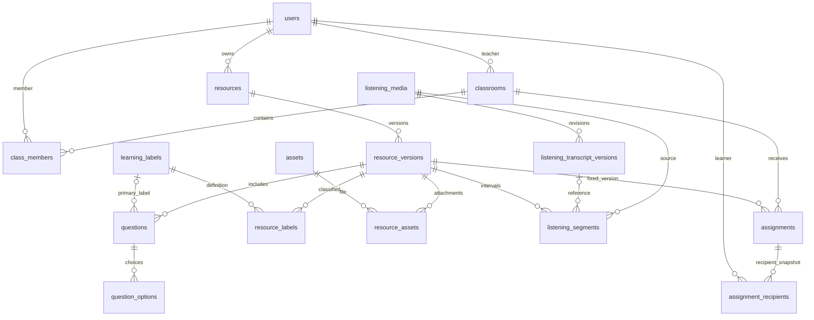
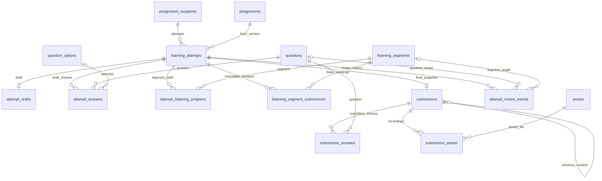
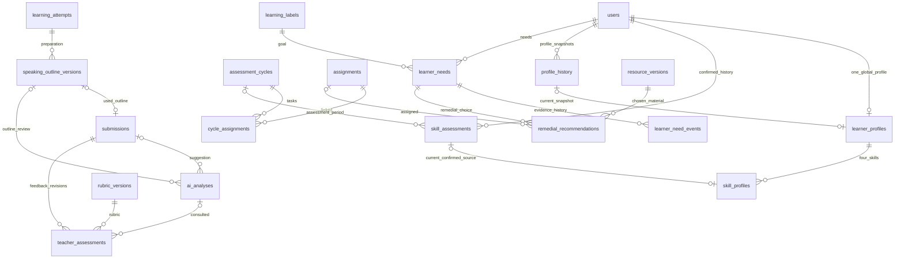
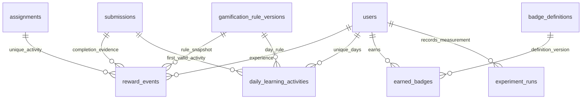

# Sơ đồ quan hệ database

Thiết kế được chia thành bốn sơ đồ để đọc theo phần việc. Đây là ERD rút gọn; khóa ghép và các FK chi tiết nằm trong [từ điển dữ liệu](DATA_DICTIONARY.md) và [SQL](schema.mysql.sql).

## Ngân hàng tài liệu và giao bài

[Nguồn Mermaid](../../statics/database-resources.mmd).

## Lần làm, nháp, bản nộp và review

[Nguồn Mermaid](../../statics/database-attempts.mmd).

## Chấm bài, profile và bổ trợ

[Nguồn Mermaid](../../statics/database-assessment.mmd).

## Gamification và thực nghiệm

[Nguồn Mermaid](../../statics/database-gamification.mmd).

